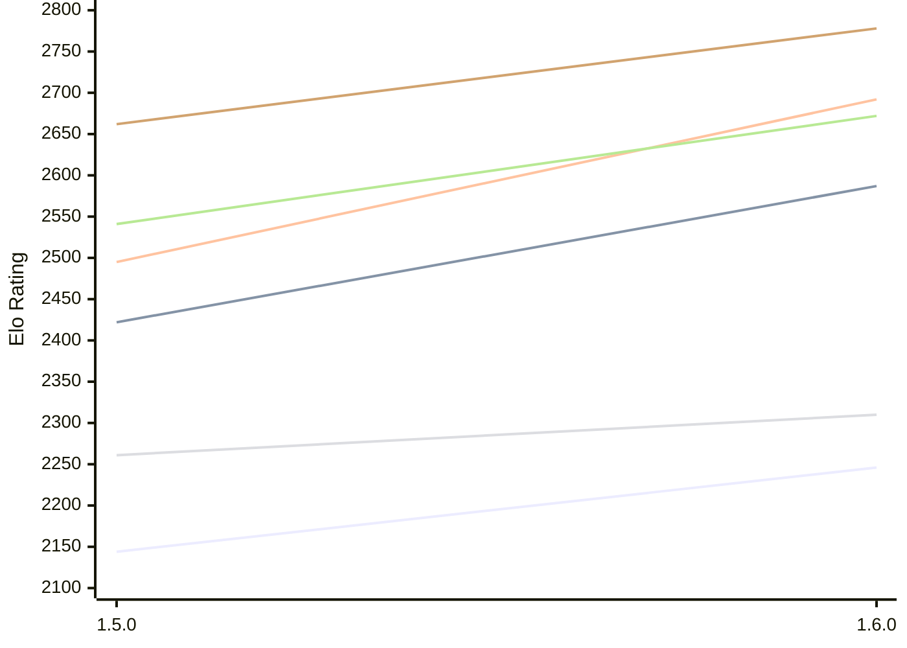
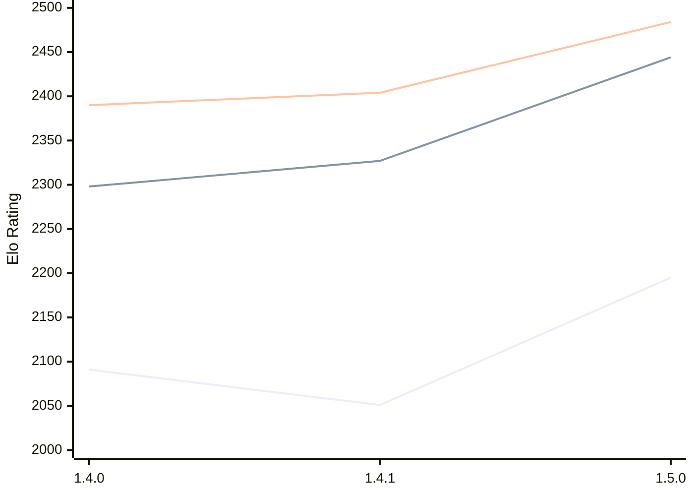

# Engine: Tofiks

Author: Arturs Priede

Home: https://github.com/likeawizard/tofiks

## Elo Ratings E1 (Ultra 7 265T (1.50 GHz) - E-Core)

| Version | Published | STC 8.0+0.08s  | LTC 60.0+0.60s | VLTC 2m24s+1.12s | Comment |
| --- | --- | --- | --- | --- | --- |
| 1.6.0 | 2026-10-18 | 2246(+102) | 2587(+165) | 2692(+197) |  |
| 1.5.0 | 2026-04-23 | 2144 | 2422 | 2495 |  |
 | | | cElo (∆ prev) | cElo (∆ prev) | cElo (∆ prev) | 

## Elo Ratings P1 (Ultra 7 265T (1.50 GHz) - P-Core)

| Version | Published | STC 8.0+0.08s  | LTC 60.0+0.60s | VLTC 2m24s+1.12s | Comment |
| --- | --- | --- | --- | --- | --- |
| 1.6.0 | 2026-10-18 | 2310(+49) | 2672(+131) | 2778(+116) |  |
| 1.5.0 | 2026-04-23 | 2261 | 2541 | 2662 |  |
 | | | cElo (∆ prev) | cElo (∆ prev) | cElo (∆ prev) | 

## Elo Ratings T1 (i5-7500T 2.70GHz)

| Version | Published | STC 8.0+0.08s  | LTC 60.0+0.60s | VLTC 2m24s+1.12s | Comment |
| --- | --- | --- | --- | --- | --- |
| 1.5.0 | 2026-04-23 | 2195(+144) | 2444(+117) | 2484(+80) |  |
| 1.4.1 | 2026-04-11 | 2051(-40) | 2327(+29) | 2404(+14) |  |
| 1.4.0 | 2026-04-09 | 2091 | 2298 | 2390 |  |
 | | | cElo (∆ prev) | cElo (∆ prev) | cElo (∆ prev) | 

<a href="https://github.com/computer-chess-index/cci/issues/new?template=submit-version.yml&title=[VERSION]+Tofiks+<version>&body=###%20Engine%20name%0ATofiks%0A%0A###%20Version%0A1.5.0" target="_blank">Submit new version</a>

 Test Conditions:

GUI/CLI: <a href=https://github.com/cutechess/cutechess target="_blank">Cute-Chess</a> 
Elo Calculation: <a href=https://www.remi-coulom.fr/Bayesian-Elo/ target="_blank">Bayesian-Elo</a> 
CPU for P1: Intel(R) Core(TM) Ultra 7 265T (1.50 GHz) - P-Core 
CPU for E1: Intel(R) Core(TM) Ultra 7 265T (1.50 GHz) - E-Core 
CPU for T1: Intel(R) Core(TM) i5-7500T 2.70GHz 
Opening book: 8_moves_v3 
\* STC: 8.0+0.08s, LTC: 60.0+0.60s, VLTC: 2m24s+1.12s

 Lists:
Ratings: <a href=https://github.com/computer-chess-index/cci/blob/main/lists/CCIRatings.csv target="_blank">Complete list</a>

Generated: 2026-10-22 04:44:25

## Ratings Verlauf E1 / P1

## Ratings Verlauf T1

## Detailed Evaluation Results

| Version | Time Control | Variant | Elo  | Range +/- | Matches | Score | Average Opponent Elo | Draws |
| --- | --- |--- | --- | --- | --- | --- | --- | --- |
| 1.6.0 | VLTC (2m24s+1.12s) | P1 | 2778 | 46 | 156 | 55% | 2732 | 28% |
|  |  | E1 | 2692 | 38 | 240 | 48% | 2709 | 27% |
|  | LTC (60.0+0.60s) | P1 | 2672 | 51 | 132 | 50% | 2673 | 23% |
|  |  | E1 | 2587 | 38 | 228 | 50% | 2584 | 32% |
|  | STC (8.0+0.08s) | E1 | 2246 | 36 | 276 | 55% | 2195 | 22% |
|  |  | P1 | 2310 | 55 | 120 | 51% | 2298 | 18% |
| --- | --- |--- | --- | --- | --- | --- | --- | --- |
| 1.5.0 | VLTC (2m24s+1.12s) | T1 | 2484 | 25 | 510 | 49% | 2489 | 35% |
|  |  | P1 | 2662 | 41 | 204 | 46% | 2692 | 28% |
|  |  | E1 | 2495 | 38 | 220 | 49% | 2504 | 40% |
|  | LTC (60.0+0.60s) | T1 | 2444 | 25 | 516 | 51% | 2431 | 34% |
|  |  | P1 | 2541 | 45 | 164 | 46% | 2584 | 31% |
|  |  | E1 | 2422 | 38 | 242 | 53% | 2375 | 30% |
|  | STC (8.0+0.08s) | T1 | 2195 | 25 | 572 | 48% | 2210 | 22% |
|  |  | P1 | 2261 | 40 | 216 | 50% | 2276 | 29% |
|  |  | E1 | 2144 | 37 | 264 | 46% | 2194 | 25% |
| --- | --- |--- | --- | --- | --- | --- | --- | --- |
| 1.4.1 | VLTC (2m24s+1.12s) | T1 | 2404 | 33 | 292 | 50% | 2400 | 33% |
|  | LTC (60.0+0.60s) | T1 | 2327 | 34 | 296 | 50% | 2325 | 29% |
|  | STC (8.0+0.08s) | T1 | 2051 | 34 | 302 | 51% | 2039 | 26% |
| --- | --- |--- | --- | --- | --- | --- | --- | --- |
| 1.4.0 | VLTC (2m24s+1.12s) | T1 | 2390 | 40 | 216 | 47% | 2418 | 29% |
|  | LTC (60.0+0.60s) | T1 | 2298 | 39 | 226 | 53% | 2275 | 29% |
|  | STC (8.0+0.08s) | T1 | 2091 | 43 | 184 | 50% | 2086 | 23% |