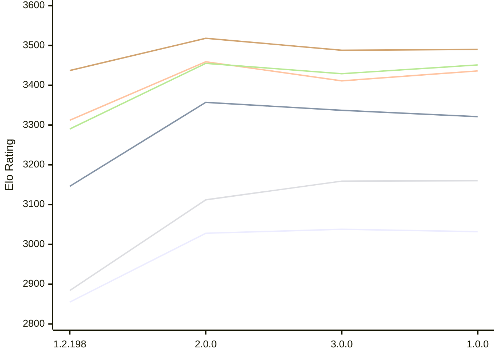

# Engine: Trebuchet

Author: Jonny Reckless

Home: https://github.com/jonny-reckless/zenith

## Elo Ratings E1 (Ultra 7 265T (1.50 GHz) - E-Core)

| Version | Published | STC 8.0+0.08s  | LTC 60.0+0.60s | VLTC 2m24s+1.12s | Comment |
| --- | --- | --- | --- | --- | --- |
| 1.0.0 | 2026-11-07 | 3032(-6) | 3321(-16) | 3436(+25) |  |
| 3.0.0 | 2026-10-30 | 3038(+10) | 3337(-20) | 3411(-48) |  |
| 2.0.0 | 2026-10-15 | 3028(+173) | 3357(+211) | 3459(+147) |  |
| 1.2.198 | 2026-08-01 | 2855 | 3146 | 3312 |  |
 | | | cElo (∆ prev) | cElo (∆ prev) | cElo (∆ prev) | 

## Elo Ratings P1 (Ultra 7 265T (1.50 GHz) - P-Core)

| Version | Published | STC 8.0+0.08s  | LTC 60.0+0.60s | VLTC 2m24s+1.12s | Comment |
| --- | --- | --- | --- | --- | --- |
| 1.0.0 | 2026-11-07 | 3160(+1) | 3451(+22) | 3490(+2) |  |
| 3.0.0 | 2026-10-30 | 3159(+47) | 3429(-26) | 3488(-30) |  |
| 2.0.0 | 2026-10-15 | 3112(+228) | 3455(+165) | 3518(+81) |  |
| 1.2.198 | 2026-08-01 | 2884 | 3290 | 3437 |  |
 | | | cElo (∆ prev) | cElo (∆ prev) | cElo (∆ prev) | 

## Elo Ratings T1 (i5-7500T 2.70GHz)

| Version | Published | STC 8.0+0.08s  | LTC 60.0+0.60s | VLTC 2m24s+1.12s | Comment |
| --- | --- | --- | --- | --- | --- |
| 1.2.198 | 2026-08-01 | 3067 | 3339 | 3387 |  |
 | | | cElo (∆ prev) | cElo (∆ prev) | cElo (∆ prev) | 

<a href="https://github.com/computer-chess-index/cci/issues/new?template=submit-version.yml&title=[VERSION]+Trebuchet+<version>&body=###%20Engine%20name%0ATrebuchet%0A%0A###%20Version%0A1.2.198" target="_blank">Submit new version</a>

 Test Conditions:

GUI/CLI: <a href=https://github.com/cutechess/cutechess target="_blank">Cute-Chess</a> 
Elo Calculation: <a href=https://www.remi-coulom.fr/Bayesian-Elo/ target="_blank">Bayesian-Elo</a> 
CPU for P1: Intel(R) Core(TM) Ultra 7 265T (1.50 GHz) - P-Core 
CPU for E1: Intel(R) Core(TM) Ultra 7 265T (1.50 GHz) - E-Core 
CPU for T1: Intel(R) Core(TM) i5-7500T 2.70GHz 
Opening book: 8_moves_v3 
\* STC: 8.0+0.08s, LTC: 60.0+0.60s, VLTC: 2m24s+1.12s

 Lists:
Ratings: <a href=https://github.com/computer-chess-index/cci/blob/main/lists/CCIRatings.csv target="_blank">Complete list</a>

Generated: 2026-11-08 05:43:16

## Ratings Verlauf E1 / P1

## Detailed Evaluation Results

| Version | Time Control | Variant | Elo  | Range +/- | Matches | Score | Average Opponent Elo | Draws |
| --- | --- |--- | --- | --- | --- | --- | --- | --- |
| 1.0.0 | VLTC (2m24s+1.12s) | P1 | 3490 | 53 | 88 | 49% | 3494 | 74% |
|  |  | E1 | 3436 | 30 | 318 | 57% | 3155 | 63% |
|  | LTC (60.0+0.60s) | P1 | 3451 | 52 | 92 | 52% | 3436 | 70% |
|  |  | E1 | 3321 | 34 | 222 | 48% | 3333 | 64% |
|  | STC (8.0+0.08s) | P1 | 3160 | 47 | 128 | 47% | 3183 | 50% |
|  |  | E1 | 3032 | 29 | 360 | 46% | 3062 | 46% |
| --- | --- |--- | --- | --- | --- | --- | --- | --- |
| 3.0.0 | VLTC (2m24s+1.12s) | P1 | 3488 | 38 | 168 | 51% | 3478 | 77% |
|  |  | E1 | 3411 | 31 | 264 | 51% | 3403 | 69% |
|  | LTC (60.0+0.60s) | P1 | 3429 | 37 | 192 | 52% | 3409 | 62% |
|  |  | E1 | 3337 | 28 | 324 | 54% | 3309 | 63% |
|  | STC (8.0+0.08s) | P1 | 3159 | 42 | 148 | 48% | 3174 | 60% |
|  |  | E1 | 3038 | 37 | 218 | 50% | 3032 | 43% |
| --- | --- |--- | --- | --- | --- | --- | --- | --- |
| 2.0.0 | VLTC (2m24s+1.12s) | P1 | 3518 | 34 | 224 | 51% | 3507 | 70% |
|  |  | E1 | 3459 | 29 | 300 | 49% | 3464 | 66% |
|  | LTC (60.0+0.60s) | P1 | 3455 | 39 | 174 | 53% | 3430 | 66% |
|  |  | E1 | 3357 | 32 | 266 | 52% | 3340 | 62% |
|  | STC (8.0+0.08s) | P1 | 3112 | 40 | 192 | 53% | 3081 | 44% |
|  |  | E1 | 3028 | 38 | 208 | 53% | 2997 | 44% |
| --- | --- |--- | --- | --- | --- | --- | --- | --- |
| 1.2.198 | VLTC (2m24s+1.12s) | T1 | 3387 | 31 | 272 | 51% | 3363 | 69% |
|  |  | P1 | 3437 | 33 | 252 | 44% | 3478 | 61% |
|  |  | E1 | 3312 | 29 | 326 | 41% | 3383 | 62% |
|  | LTC (60.0+0.60s) | T1 | 3339 | 34 | 236 | 54% | 3266 | 64% |
|  |  | P1 | 3290 | 32 | 288 | 39% | 3375 | 55% |
|  |  | E1 | 3146 | 28 | 370 | 39% | 3237 | 51% |
|  | STC (8.0+0.08s) | T1 | 3067 | 26 | 424 | 47% | 3067 | 54% |
|  |  | P1 | 2884 | 45 | 180 | 59% | 2790 | 26% |
|  |  | E1 | 2855 | 34 | 308 | 64% | 2726 | 29% |