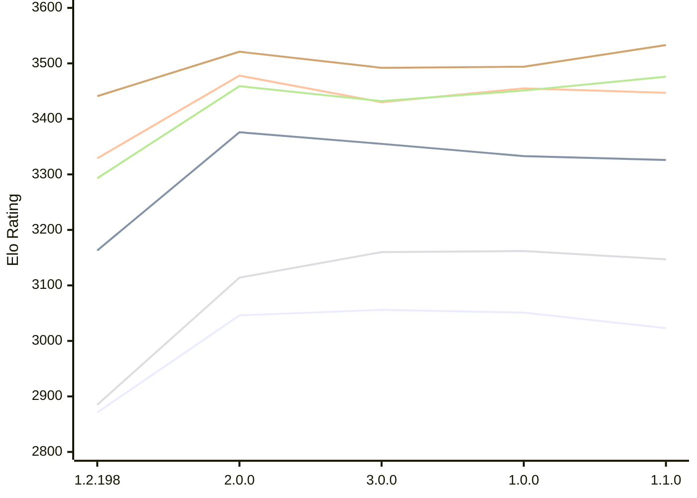

# Engine: Trebuchet

Author: Jonny Reckless

Home: https://github.com/jonny-reckless/zenith

## Elo Ratings E1 (Ultra 7 265T (1.50 GHz) - E-Core)

| Version | Published | STC 8.0+0.08s  | LTC 60.0+0.60s | VLTC 2m24s+1.12s | Comment |
| --- | --- | --- | --- | --- | --- |
| 1.1.0 | 2026-11-08 | 3023(-28) | 3326(-7) | 3447(-8) |  |
| 1.0.0 | 2026-11-07 | 3051(-5) | 3333(-22) | 3455(+25) |  |
| 3.0.0 | 2026-10-30 | 3056(+10) | 3355(-21) | 3430(-48) |  |
| 2.0.0 | 2026-10-15 | 3046(+175) | 3376(+213) | 3478(+149) |  |
| 1.2.198 | 2026-08-01 | 2871 | 3163 | 3329 |  |
 | | | cElo (∆ prev) | cElo (∆ prev) | cElo (∆ prev) | 

## Elo Ratings P1 (Ultra 7 265T (1.50 GHz) - P-Core)

| Version | Published | STC 8.0+0.08s  | LTC 60.0+0.60s | VLTC 2m24s+1.12s | Comment |
| --- | --- | --- | --- | --- | --- |
| 1.1.0 | 2026-11-08 | 3147(-15) | 3476(+25) | 3533(+39) |  |
| 1.0.0 | 2026-11-07 | 3162(+2) | 3451(+19) | 3494(+2) |  |
| 3.0.0 | 2026-10-30 | 3160(+46) | 3432(-27) | 3492(-29) |  |
| 2.0.0 | 2026-10-15 | 3114(+229) | 3459(+166) | 3521(+80) |  |
| 1.2.198 | 2026-08-01 | 2885 | 3293 | 3441 |  |
 | | | cElo (∆ prev) | cElo (∆ prev) | cElo (∆ prev) | 

## Elo Ratings T1 (i5-7500T 2.70GHz)

| Version | Published | STC 8.0+0.08s  | LTC 60.0+0.60s | VLTC 2m24s+1.12s | Comment |
| --- | --- | --- | --- | --- | --- |
| 1.2.198 | 2026-08-01 | 3067 | 3339 | 3387 |  |
 | | | cElo (∆ prev) | cElo (∆ prev) | cElo (∆ prev) | 

<a href="https://github.com/computer-chess-index/cci/issues/new?template=submit-version.yml&title=[VERSION]+Trebuchet+<version>&body=###%20Engine%20name%0ATrebuchet%0A%0A###%20Version%0A1.2.198" target="_blank">Submit new version</a>

 Test Conditions:

GUI/CLI: <a href=https://github.com/cutechess/cutechess target="_blank">Cute-Chess</a> 
Elo Calculation: <a href=https://www.remi-coulom.fr/Bayesian-Elo/ target="_blank">Bayesian-Elo</a> 
CPU for P1: Intel(R) Core(TM) Ultra 7 265T (1.50 GHz) - P-Core 
CPU for E1: Intel(R) Core(TM) Ultra 7 265T (1.50 GHz) - E-Core 
CPU for T1: Intel(R) Core(TM) i5-7500T 2.70GHz 
Opening book: 8_moves_v3 
\* STC: 8.0+0.08s, LTC: 60.0+0.60s, VLTC: 2m24s+1.12s

 Lists:
Ratings: <a href=https://github.com/computer-chess-index/cci/blob/main/lists/CCIRatings.csv target="_blank">Complete list</a>

Generated: 2026-11-11 05:43:39

## Ratings Verlauf E1 / P1

## Detailed Evaluation Results

| Version | Time Control | Variant | Elo  | Range +/- | Matches | Score | Average Opponent Elo | Draws |
| --- | --- |--- | --- | --- | --- | --- | --- | --- |
| 1.1.0 | VLTC (2m24s+1.12s) | E1 | 3447 | 34 | 224 | 49% | 3456 | 69% |
|  |  | P1 | 3533 | 39 | 166 | 48% | 3546 | 72% |
|  | LTC (60.0+0.60s) | E1 | 3326 | 33 | 232 | 50% | 3325 | 66% |
|  |  | P1 | 3476 | 30 | 292 | 46% | 3506 | 66% |
|  | STC (8.0+0.08s) | E1 | 3023 | 35 | 246 | 51% | 3016 | 45% |
|  |  | P1 | 3147 | 45 | 136 | 47% | 3166 | 57% |
| --- | --- |--- | --- | --- | --- | --- | --- | --- |
| 1.0.0 | VLTC (2m24s+1.12s) | P1 | 3494 | 49 | 100 | 50% | 3498 | 75% |
|  |  | E1 | 3455 | 29 | 322 | 57% | 3175 | 63% |
|  | LTC (60.0+0.60s) | P1 | 3451 | 50 | 100 | 52% | 3441 | 71% |
|  |  | E1 | 3333 | 32 | 256 | 48% | 3348 | 64% |
|  | STC (8.0+0.08s) | P1 | 3162 | 47 | 128 | 47% | 3185 | 50% |
|  |  | E1 | 3051 | 29 | 360 | 46% | 3081 | 46% |
| --- | --- |--- | --- | --- | --- | --- | --- | --- |
| 3.0.0 | VLTC (2m24s+1.12s) | E1 | 3430 | 31 | 264 | 51% | 3422 | 69% |
|  |  | P1 | 3492 | 38 | 168 | 51% | 3482 | 77% |
|  | LTC (60.0+0.60s) | E1 | 3355 | 28 | 324 | 54% | 3328 | 63% |
|  |  | P1 | 3432 | 37 | 192 | 52% | 3413 | 62% |
|  | STC (8.0+0.08s) | P1 | 3160 | 42 | 148 | 48% | 3175 | 60% |
|  |  | E1 | 3056 | 37 | 218 | 50% | 3052 | 43% |
| --- | --- |--- | --- | --- | --- | --- | --- | --- |
| 2.0.0 | VLTC (2m24s+1.12s) | P1 | 3521 | 34 | 224 | 51% | 3511 | 70% |
|  |  | E1 | 3478 | 29 | 300 | 49% | 3483 | 66% |
|  | LTC (60.0+0.60s) | P1 | 3459 | 39 | 174 | 53% | 3436 | 66% |
|  |  | E1 | 3376 | 32 | 266 | 52% | 3359 | 62% |
|  | STC (8.0+0.08s) | P1 | 3114 | 40 | 192 | 53% | 3082 | 44% |
|  |  | E1 | 3046 | 38 | 208 | 53% | 3016 | 44% |
| --- | --- |--- | --- | --- | --- | --- | --- | --- |
| 1.2.198 | VLTC (2m24s+1.12s) | P1 | 3441 | 33 | 252 | 44% | 3482 | 61% |
|  |  | E1 | 3329 | 29 | 326 | 41% | 3401 | 62% |
|  |  | T1 | 3387 | 31 | 272 | 51% | 3363 | 69% |
|  | LTC (60.0+0.60s) | E1 | 3163 | 28 | 370 | 39% | 3256 | 51% |
|  |  | T1 | 3339 | 34 | 236 | 54% | 3266 | 64% |
|  |  | P1 | 3293 | 32 | 288 | 39% | 3378 | 55% |
|  | STC (8.0+0.08s) | E1 | 2871 | 34 | 308 | 64% | 2742 | 29% |
|  |  | T1 | 3067 | 26 | 424 | 47% | 3067 | 54% |
|  |  | P1 | 2885 | 45 | 180 | 59% | 2792 | 26% |