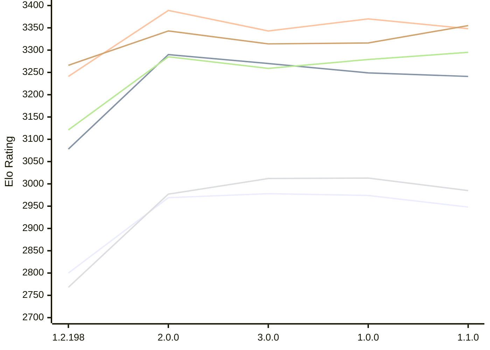

# Engine: Trebuchet

Author: Jonny Reckless

Home: https://github.com/jonny-reckless/zenith

## Elo Ratings E1 (Ultra 7 265T (1.50 GHz) - E-Core)

| Version | Published | STC 8.0+0.08s  | LTC 60.0+0.60s | VLTC 2m24s+1.12s | Comment |
| --- | --- | --- | --- | --- | --- |
| 1.1.0 | 2026-11-08 | 2948(-26) | 3241(-8) | 3348(-22) |  |
| 1.0.0 | 2026-11-07 | 2974(-4) | 3249(-21) | 3370(+27) |  |
| 3.0.0 | 2026-10-30 | 2978(+9) | 3270(-20) | 3343(-46) |  |
| 2.0.0 | 2026-10-15 | 2969(+169) | 3290(+212) | 3389(+148) |  |
| 1.2.198 | 2026-08-01 | 2800 | 3078 | 3241 |  |
 | | | cElo (∆ prev) | cElo (∆ prev) | cElo (∆ prev) | 

## Elo Ratings P1 (Ultra 7 265T (1.50 GHz) - P-Core)

| Version | Published | STC 8.0+0.08s  | LTC 60.0+0.60s | VLTC 2m24s+1.12s | Comment |
| --- | --- | --- | --- | --- | --- |
| 1.1.0 | 2026-11-08 | 2985(-28) | 3295(+16) | 3355(+39) |  |
| 1.0.0 | 2026-11-07 | 3013(+1) | 3279(+20) | 3316(+2) |  |
| 3.0.0 | 2026-10-30 | 3012(+35) | 3259(-26) | 3314(-29) |  |
| 2.0.0 | 2026-10-15 | 2977(+209) | 3285(+164) | 3343(+77) |  |
| 1.2.198 | 2026-08-01 | 2768 | 3121 | 3266 |  |
 | | | cElo (∆ prev) | cElo (∆ prev) | cElo (∆ prev) | 

## Elo Ratings T1 (i5-7500T 2.70GHz)

| Version | Published | STC 8.0+0.08s  | LTC 60.0+0.60s | VLTC 2m24s+1.12s | Comment |
| --- | --- | --- | --- | --- | --- |
| 1.2.198 | 2026-08-01 | 3067 | 3339 | 3387 |  |
 | | | cElo (∆ prev) | cElo (∆ prev) | cElo (∆ prev) | 

<a href="https://github.com/computer-chess-index/cci/issues/new?template=submit-version.yml&title=[VERSION]+Trebuchet+<version>&body=###%20Engine%20name%0ATrebuchet%0A%0A###%20Version%0A1.2.198" target="_blank">Submit new version</a>

 Test Conditions:

GUI/CLI: <a href=https://github.com/cutechess/cutechess target="_blank">Cute-Chess</a> 
Elo Calculation: <a href=https://www.remi-coulom.fr/Bayesian-Elo/ target="_blank">Bayesian-Elo</a> 
CPU for P1: Intel(R) Core(TM) Ultra 7 265T (1.50 GHz) - P-Core 
CPU for E1: Intel(R) Core(TM) Ultra 7 265T (1.50 GHz) - E-Core 
CPU for T1: Intel(R) Core(TM) i5-7500T 2.70GHz 
Opening book: 8_moves_v3 
\* STC: 8.0+0.08s, LTC: 60.0+0.60s, VLTC: 2m24s+1.12s

 Lists:
Ratings: <a href=https://github.com/computer-chess-index/cci/blob/main/lists/CCIRatings.csv target="_blank">Complete list</a>

Generated: 2026-11-27 05:44:27

## Ratings Verlauf E1 / P1

## Detailed Evaluation Results

| Version | Time Control | Variant | Elo  | Range +/- | Matches | Score | Average Opponent Elo | Draws |
| --- | --- |--- | --- | --- | --- | --- | --- | --- |
| 1.1.0 | VLTC (2m24s+1.12s) | P1 | 3355 | 36 | 198 | 48% | 3367 | 71% |
|  |  | E1 | 3348 | 29 | 296 | 48% | 3363 | 69% |
|  | LTC (60.0+0.60s) | P1 | 3295 | 27 | 348 | 46% | 3324 | 66% |
|  |  | E1 | 3241 | 30 | 292 | 50% | 3240 | 67% |
|  | STC (8.0+0.08s) | P1 | 2985 | 32 | 268 | 47% | 3008 | 58% |
|  |  | E1 | 2948 | 30 | 336 | 50% | 2952 | 46% |
| --- | --- |--- | --- | --- | --- | --- | --- | --- |
| 1.0.0 | VLTC (2m24s+1.12s) | P1 | 3316 | 47 | 112 | 50% | 3318 | 74% |
|  |  | E1 | 3370 | 28 | 350 | 57% | 3114 | 63% |
|  | LTC (60.0+0.60s) | P1 | 3279 | 45 | 124 | 51% | 3271 | 70% |
|  |  | E1 | 3249 | 29 | 312 | 48% | 3262 | 65% |
|  | STC (8.0+0.08s) | E1 | 2974 | 27 | 408 | 47% | 2997 | 45% |
|  |  | P1 | 3013 | 41 | 172 | 47% | 3032 | 51% |
| --- | --- |--- | --- | --- | --- | --- | --- | --- |
| 3.0.0 | VLTC (2m24s+1.12s) | P1 | 3314 | 38 | 168 | 51% | 3303 | 77% |
|  |  | E1 | 3343 | 31 | 264 | 51% | 3335 | 69% |
|  | LTC (60.0+0.60s) | P1 | 3259 | 37 | 192 | 52% | 3240 | 62% |
|  |  | E1 | 3270 | 29 | 324 | 54% | 3241 | 63% |
|  | STC (8.0+0.08s) | P1 | 3012 | 42 | 148 | 48% | 3027 | 60% |
|  |  | E1 | 2978 | 37 | 218 | 50% | 2974 | 43% |
| --- | --- |--- | --- | --- | --- | --- | --- | --- |
| 2.0.0 | VLTC (2m24s+1.12s) | P1 | 3343 | 34 | 224 | 51% | 3333 | 70% |
|  |  | E1 | 3389 | 29 | 300 | 49% | 3394 | 66% |
|  | LTC (60.0+0.60s) | P1 | 3285 | 39 | 174 | 53% | 3260 | 66% |
|  |  | E1 | 3290 | 32 | 266 | 52% | 3272 | 62% |
|  | STC (8.0+0.08s) | E1 | 2969 | 38 | 208 | 53% | 2939 | 44% |
|  |  | P1 | 2977 | 39 | 192 | 53% | 2946 | 44% |
| --- | --- |--- | --- | --- | --- | --- | --- | --- |
| 1.2.198 | VLTC (2m24s+1.12s) | T1 | 3387 | 31 | 272 | 51% | 3363 | 69% |
|  |  | P1 | 3266 | 33 | 252 | 44% | 3306 | 61% |
|  |  | E1 | 3241 | 29 | 326 | 41% | 3313 | 62% |
|  | LTC (60.0+0.60s) | T1 | 3339 | 34 | 236 | 54% | 3266 | 64% |
|  |  | P1 | 3121 | 32 | 288 | 39% | 3206 | 55% |
|  |  | E1 | 3078 | 28 | 370 | 39% | 3170 | 51% |
|  | STC (8.0+0.08s) | T1 | 3067 | 26 | 424 | 47% | 3067 | 54% |
|  |  | P1 | 2768 | 45 | 180 | 59% | 2674 | 26% |
|  |  | E1 | 2800 | 34 | 308 | 64% | 2670 | 29% |