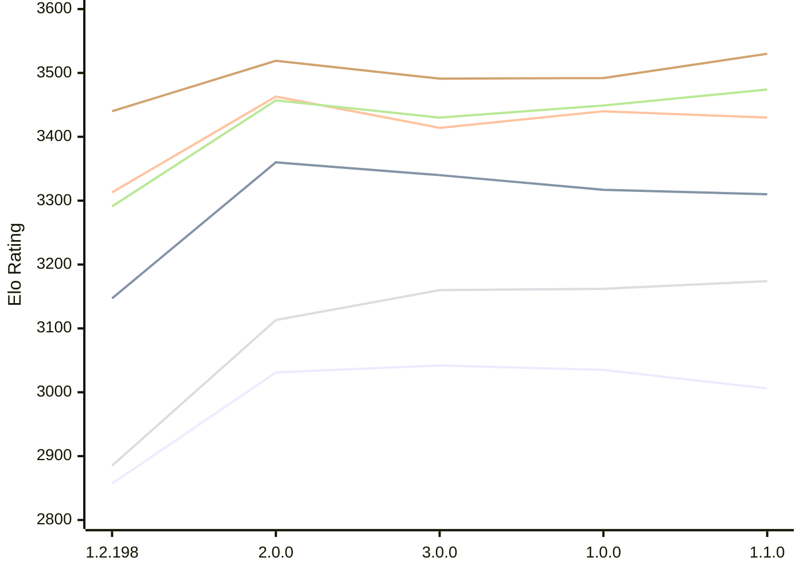

# Engine: Trebuchet

Author: Jonny Reckless

Home: https://github.com/jonny-reckless/zenith

## Elo Ratings E1 (Ultra 7 265T (1.50 GHz) - E-Core)

| Version | Published | STC 8.0+0.08s  | LTC 60.0+0.60s | VLTC 2m24s+1.12s | Comment |
| --- | --- | --- | --- | --- | --- |
| 1.1.0 | 2026-11-08 | 3006(-29) | 3310(-7) | 3430(-10) |  |
| 1.0.0 | 2026-11-07 | 3035(-7) | 3317(-23) | 3440(+26) |  |
| 3.0.0 | 2026-10-30 | 3042(+11) | 3340(-20) | 3414(-49) |  |
| 2.0.0 | 2026-10-15 | 3031(+174) | 3360(+213) | 3463(+150) |  |
| 1.2.198 | 2026-08-01 | 2857 | 3147 | 3313 |  |
 | | | cElo (∆ prev) | cElo (∆ prev) | cElo (∆ prev) | 

## Elo Ratings P1 (Ultra 7 265T (1.50 GHz) - P-Core)

| Version | Published | STC 8.0+0.08s  | LTC 60.0+0.60s | VLTC 2m24s+1.12s | Comment |
| --- | --- | --- | --- | --- | --- |
| 1.1.0 | 2026-11-08 | 3174(+12) | 3474(+25) | 3530(+38) |  |
| 1.0.0 | 2026-11-07 | 3162(+2) | 3449(+19) | 3492(+1) |  |
| 3.0.0 | 2026-10-30 | 3160(+47) | 3430(-27) | 3491(-28) |  |
| 2.0.0 | 2026-10-15 | 3113(+228) | 3457(+166) | 3519(+79) |  |
| 1.2.198 | 2026-08-01 | 2885 | 3291 | 3440 |  |
 | | | cElo (∆ prev) | cElo (∆ prev) | cElo (∆ prev) | 

## Elo Ratings T1 (i5-7500T 2.70GHz)

| Version | Published | STC 8.0+0.08s  | LTC 60.0+0.60s | VLTC 2m24s+1.12s | Comment |
| --- | --- | --- | --- | --- | --- |
| 1.2.198 | 2026-08-01 | 3067 | 3339 | 3387 |  |
 | | | cElo (∆ prev) | cElo (∆ prev) | cElo (∆ prev) | 

<a href="https://github.com/computer-chess-index/cci/issues/new?template=submit-version.yml&title=[VERSION]+Trebuchet+<version>&body=###%20Engine%20name%0ATrebuchet%0A%0A###%20Version%0A1.2.198" target="_blank">Submit new version</a>

 Test Conditions:

GUI/CLI: <a href=https://github.com/cutechess/cutechess target="_blank">Cute-Chess</a> 
Elo Calculation: <a href=https://www.remi-coulom.fr/Bayesian-Elo/ target="_blank">Bayesian-Elo</a> 
CPU for P1: Intel(R) Core(TM) Ultra 7 265T (1.50 GHz) - P-Core 
CPU for E1: Intel(R) Core(TM) Ultra 7 265T (1.50 GHz) - E-Core 
CPU for T1: Intel(R) Core(TM) i5-7500T 2.70GHz 
Opening book: 8_moves_v3 
\* STC: 8.0+0.08s, LTC: 60.0+0.60s, VLTC: 2m24s+1.12s

 Lists:
Ratings: <a href=https://github.com/computer-chess-index/cci/blob/main/lists/CCIRatings.csv target="_blank">Complete list</a>

Generated: 2026-11-10 05:43:37

## Ratings Verlauf E1 / P1

## Detailed Evaluation Results

| Version | Time Control | Variant | Elo  | Range +/- | Matches | Score | Average Opponent Elo | Draws |
| --- | --- |--- | --- | --- | --- | --- | --- | --- |
| 1.1.0 | VLTC (2m24s+1.12s) | P1 | 3530 | 40 | 158 | 48% | 3545 | 70% |
|  |  | E1 | 3430 | 34 | 224 | 49% | 3441 | 69% |
|  | LTC (60.0+0.60s) | E1 | 3310 | 34 | 220 | 50% | 3308 | 65% |
|  |  | P1 | 3474 | 31 | 276 | 45% | 3506 | 66% |
|  | STC (8.0+0.08s) | E1 | 3006 | 35 | 246 | 51% | 3000 | 45% |
|  |  | P1 | 3174 | 53 | 92 | 50% | 3174 | 61% |
| --- | --- |--- | --- | --- | --- | --- | --- | --- |
| 1.0.0 | VLTC (2m24s+1.12s) | P1 | 3492 | 49 | 100 | 50% | 3497 | 75% |
|  |  | E1 | 3440 | 29 | 322 | 57% | 3160 | 63% |
|  | LTC (60.0+0.60s) | P1 | 3449 | 50 | 100 | 52% | 3440 | 71% |
|  |  | E1 | 3317 | 32 | 256 | 48% | 3333 | 64% |
|  | STC (8.0+0.08s) | P1 | 3162 | 47 | 128 | 47% | 3185 | 50% |
|  |  | E1 | 3035 | 29 | 360 | 46% | 3065 | 46% |
| --- | --- |--- | --- | --- | --- | --- | --- | --- |
| 3.0.0 | VLTC (2m24s+1.12s) | E1 | 3414 | 31 | 264 | 51% | 3406 | 69% |
|  |  | P1 | 3491 | 38 | 168 | 51% | 3480 | 77% |
|  | LTC (60.0+0.60s) | E1 | 3340 | 28 | 324 | 54% | 3312 | 63% |
|  |  | P1 | 3430 | 37 | 192 | 52% | 3410 | 62% |
|  | STC (8.0+0.08s) | E1 | 3042 | 37 | 218 | 50% | 3036 | 43% |
|  |  | P1 | 3160 | 42 | 148 | 48% | 3175 | 60% |
| --- | --- |--- | --- | --- | --- | --- | --- | --- |
| 2.0.0 | VLTC (2m24s+1.12s) | P1 | 3519 | 34 | 224 | 51% | 3510 | 70% |
|  |  | E1 | 3463 | 29 | 300 | 49% | 3467 | 66% |
|  | LTC (60.0+0.60s) | P1 | 3457 | 39 | 174 | 53% | 3434 | 66% |
|  |  | E1 | 3360 | 32 | 266 | 52% | 3344 | 62% |
|  | STC (8.0+0.08s) | P1 | 3113 | 40 | 192 | 53% | 3082 | 44% |
|  |  | E1 | 3031 | 38 | 208 | 53% | 3000 | 44% |
| --- | --- |--- | --- | --- | --- | --- | --- | --- |
| 1.2.198 | VLTC (2m24s+1.12s) | P1 | 3440 | 33 | 252 | 44% | 3480 | 61% |
|  |  | E1 | 3313 | 29 | 326 | 41% | 3386 | 62% |
|  |  | T1 | 3387 | 31 | 272 | 51% | 3363 | 69% |
|  | LTC (60.0+0.60s) | P1 | 3291 | 32 | 288 | 39% | 3376 | 55% |
|  |  | E1 | 3147 | 28 | 370 | 39% | 3240 | 51% |
|  |  | T1 | 3339 | 34 | 236 | 54% | 3266 | 64% |
|  | STC (8.0+0.08s) | E1 | 2857 | 34 | 308 | 64% | 2727 | 29% |
|  |  | T1 | 3067 | 26 | 424 | 47% | 3067 | 54% |
|  |  | P1 | 2885 | 45 | 180 | 59% | 2792 | 26% |