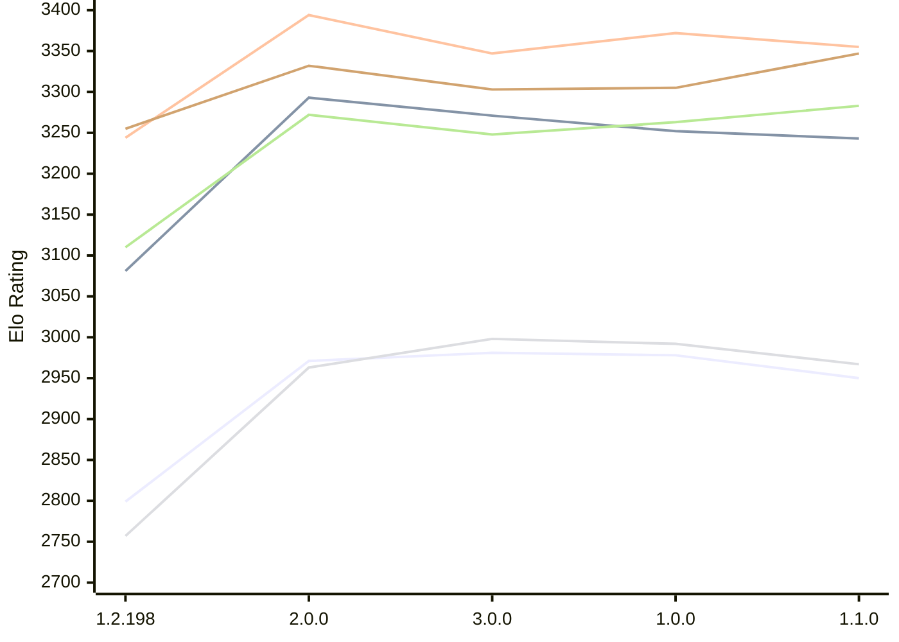

# Engine: Trebuchet

Author: Jonny Reckless

Home: https://github.com/jonny-reckless/zenith

## Elo Ratings E1 (Ultra 7 265T (1.50 GHz) - E-Core)

| Version | Published | STC 8.0+0.08s  | LTC 60.0+0.60s | VLTC 2m24s+1.12s | Comment |
| --- | --- | --- | --- | --- | --- |
| 1.1.0 | 2026-11-08 | 2950(-28) | 3243(-9) | 3355(-17) |  |
| 1.0.0 | 2026-11-07 | 2978(-3) | 3252(-19) | 3372(+25) |  |
| 3.0.0 | 2026-10-30 | 2981(+10) | 3271(-22) | 3347(-47) |  |
| 2.0.0 | 2026-10-15 | 2971(+172) | 3293(+212) | 3394(+150) |  |
| 1.2.198 | 2026-08-01 | 2799 | 3081 | 3244 |  |
 | | | cElo (∆ prev) | cElo (∆ prev) | cElo (∆ prev) | 

## Elo Ratings P1 (Ultra 7 265T (1.50 GHz) - P-Core)

| Version | Published | STC 8.0+0.08s  | LTC 60.0+0.60s | VLTC 2m24s+1.12s | Comment |
| --- | --- | --- | --- | --- | --- |
| 1.1.0 | 2026-11-08 | 2967(-25) | 3283(+20) | 3347(+42) |  |
| 1.0.0 | 2026-11-07 | 2992(-6) | 3263(+15) | 3305(+2) |  |
| 3.0.0 | 2026-10-30 | 2998(+35) | 3248(-24) | 3303(-29) |  |
| 2.0.0 | 2026-10-15 | 2963(+206) | 3272(+162) | 3332(+77) |  |
| 1.2.198 | 2026-08-01 | 2757 | 3110 | 3255 |  |
 | | | cElo (∆ prev) | cElo (∆ prev) | cElo (∆ prev) | 

## Elo Ratings T1 (i5-7500T 2.70GHz)

| Version | Published | STC 8.0+0.08s  | LTC 60.0+0.60s | VLTC 2m24s+1.12s | Comment |
| --- | --- | --- | --- | --- | --- |
| 1.2.198 | 2026-08-01 | 3067 | 3339 | 3387 |  |
 | | | cElo (∆ prev) | cElo (∆ prev) | cElo (∆ prev) | 

<a href="https://github.com/computer-chess-index/cci/issues/new?template=submit-version.yml&title=[VERSION]+Trebuchet+<version>&body=###%20Engine%20name%0ATrebuchet%0A%0A###%20Version%0A1.2.198" target="_blank">Submit new version</a>

 Test Conditions:

GUI/CLI: <a href=https://github.com/cutechess/cutechess target="_blank">Cute-Chess</a> 
Elo Calculation: <a href=https://www.remi-coulom.fr/Bayesian-Elo/ target="_blank">Bayesian-Elo</a> 
CPU for P1: Intel(R) Core(TM) Ultra 7 265T (1.50 GHz) - P-Core 
CPU for E1: Intel(R) Core(TM) Ultra 7 265T (1.50 GHz) - E-Core 
CPU for T1: Intel(R) Core(TM) i5-7500T 2.70GHz 
Opening book: 8_moves_v3 
\* STC: 8.0+0.08s, LTC: 60.0+0.60s, VLTC: 2m24s+1.12s

 Lists:
Ratings: <a href=https://github.com/computer-chess-index/cci/blob/main/lists/CCIRatings.csv target="_blank">Complete list</a>

Generated: 2026-11-23 05:44:00

## Ratings Verlauf E1 / P1

## Detailed Evaluation Results

| Version | Time Control | Variant | Elo  | Range +/- | Matches | Score | Average Opponent Elo | Draws |
| --- | --- |--- | --- | --- | --- | --- | --- | --- |
| 1.1.0 | VLTC (2m24s+1.12s) | P1 | 3347 | 37 | 182 | 49% | 3356 | 71% |
|  |  | E1 | 3355 | 30 | 284 | 48% | 3368 | 69% |
|  | LTC (60.0+0.60s) | P1 | 3283 | 28 | 332 | 46% | 3314 | 66% |
|  |  | E1 | 3243 | 31 | 260 | 50% | 3240 | 66% |
|  | STC (8.0+0.08s) | P1 | 2967 | 34 | 236 | 46% | 2997 | 58% |
|  |  | E1 | 2950 | 32 | 300 | 50% | 2954 | 44% |
| --- | --- |--- | --- | --- | --- | --- | --- | --- |
| 1.0.0 | VLTC (2m24s+1.12s) | E1 | 3372 | 28 | 346 | 57% | 3116 | 63% |
|  |  | P1 | 3305 | 47 | 112 | 50% | 3308 | 74% |
|  | LTC (60.0+0.60s) | P1 | 3263 | 46 | 120 | 51% | 3258 | 70% |
|  |  | E1 | 3252 | 30 | 288 | 48% | 3264 | 64% |
|  | STC (8.0+0.08s) | P1 | 2992 | 43 | 156 | 46% | 3023 | 51% |
|  |  | E1 | 2978 | 27 | 396 | 47% | 3000 | 45% |
| --- | --- |--- | --- | --- | --- | --- | --- | --- |
| 3.0.0 | VLTC (2m24s+1.12s) | P1 | 3303 | 38 | 168 | 51% | 3293 | 77% |
|  |  | E1 | 3347 | 31 | 264 | 51% | 3339 | 69% |
|  | LTC (60.0+0.60s) | P1 | 3248 | 37 | 192 | 52% | 3228 | 62% |
|  |  | E1 | 3271 | 29 | 324 | 54% | 3243 | 63% |
|  | STC (8.0+0.08s) | P1 | 2998 | 42 | 148 | 48% | 3012 | 60% |
|  |  | E1 | 2981 | 37 | 218 | 50% | 2975 | 43% |
| --- | --- |--- | --- | --- | --- | --- | --- | --- |
| 2.0.0 | VLTC (2m24s+1.12s) | E1 | 3394 | 29 | 300 | 49% | 3398 | 66% |
|  |  | P1 | 3332 | 34 | 224 | 51% | 3321 | 70% |
|  | LTC (60.0+0.60s) | P1 | 3272 | 39 | 174 | 53% | 3249 | 66% |
|  |  | E1 | 3293 | 32 | 266 | 52% | 3275 | 62% |
|  | STC (8.0+0.08s) | P1 | 2963 | 39 | 192 | 53% | 2932 | 44% |
|  |  | E1 | 2971 | 38 | 208 | 53% | 2940 | 44% |
| --- | --- |--- | --- | --- | --- | --- | --- | --- |
| 1.2.198 | VLTC (2m24s+1.12s) | T1 | 3387 | 31 | 272 | 51% | 3363 | 69% |
|  |  | P1 | 3255 | 33 | 252 | 44% | 3294 | 61% |
|  |  | E1 | 3244 | 29 | 326 | 41% | 3316 | 62% |
|  | LTC (60.0+0.60s) | T1 | 3339 | 34 | 236 | 54% | 3266 | 64% |
|  |  | P1 | 3110 | 32 | 288 | 39% | 3195 | 55% |
|  |  | E1 | 3081 | 28 | 370 | 39% | 3173 | 51% |
|  | STC (8.0+0.08s) | T1 | 3067 | 26 | 424 | 47% | 3067 | 54% |
|  |  | P1 | 2757 | 45 | 180 | 59% | 2664 | 26% |
|  |  | E1 | 2799 | 34 | 308 | 64% | 2669 | 29% |