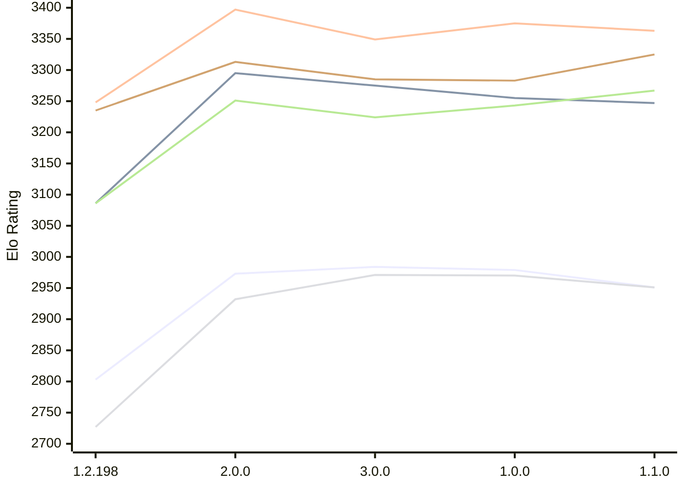

# Engine: Trebuchet

Author: Jonny Reckless

Home: https://github.com/jonny-reckless/zenith

## Elo Ratings E1 (Ultra 7 265T (1.50 GHz) - E-Core)

| Version | Published | STC 8.0+0.08s  | LTC 60.0+0.60s | VLTC 2m24s+1.12s | Comment |
| --- | --- | --- | --- | --- | --- |
| 1.1.0 | 2026-11-08 | 2951(-28) | 3247(-8) | 3363(-12) |  |
| 1.0.0 | 2026-11-07 | 2979(-5) | 3255(-20) | 3375(+26) |  |
| 3.0.0 | 2026-10-30 | 2984(+11) | 3275(-20) | 3349(-48) |  |
| 2.0.0 | 2026-10-15 | 2973(+170) | 3295(+209) | 3397(+149) |  |
| 1.2.198 | 2026-08-01 | 2803 | 3086 | 3248 |  |
 | | | cElo (∆ prev) | cElo (∆ prev) | cElo (∆ prev) | 

## Elo Ratings P1 (Ultra 7 265T (1.50 GHz) - P-Core)

| Version | Published | STC 8.0+0.08s  | LTC 60.0+0.60s | VLTC 2m24s+1.12s | Comment |
| --- | --- | --- | --- | --- | --- |
| 1.1.0 | 2026-11-08 | 2951(-19) | 3267(+24) | 3325(+42) |  |
| 1.0.0 | 2026-11-07 | 2970(-1) | 3243(+19) | 3283(-2) |  |
| 3.0.0 | 2026-10-30 | 2971(+39) | 3224(-27) | 3285(-28) |  |
| 2.0.0 | 2026-10-15 | 2932(+205) | 3251(+165) | 3313(+78) |  |
| 1.2.198 | 2026-08-01 | 2727 | 3086 | 3235 |  |
 | | | cElo (∆ prev) | cElo (∆ prev) | cElo (∆ prev) | 

## Elo Ratings T1 (i5-7500T 2.70GHz)

| Version | Published | STC 8.0+0.08s  | LTC 60.0+0.60s | VLTC 2m24s+1.12s | Comment |
| --- | --- | --- | --- | --- | --- |
| 1.2.198 | 2026-08-01 | 3067 | 3339 | 3387 |  |
 | | | cElo (∆ prev) | cElo (∆ prev) | cElo (∆ prev) | 

<a href="https://github.com/computer-chess-index/cci/issues/new?template=submit-version.yml&title=[VERSION]+Trebuchet+<version>&body=###%20Engine%20name%0ATrebuchet%0A%0A###%20Version%0A1.2.198" target="_blank">Submit new version</a>

 Test Conditions:

GUI/CLI: <a href=https://github.com/cutechess/cutechess target="_blank">Cute-Chess</a> 
Elo Calculation: <a href=https://www.remi-coulom.fr/Bayesian-Elo/ target="_blank">Bayesian-Elo</a> 
CPU for P1: Intel(R) Core(TM) Ultra 7 265T (1.50 GHz) - P-Core 
CPU for E1: Intel(R) Core(TM) Ultra 7 265T (1.50 GHz) - E-Core 
CPU for T1: Intel(R) Core(TM) i5-7500T 2.70GHz 
Opening book: 8_moves_v3 
\* STC: 8.0+0.08s, LTC: 60.0+0.60s, VLTC: 2m24s+1.12s

 Lists:
Ratings: <a href=https://github.com/computer-chess-index/cci/blob/main/lists/CCIRatings.csv target="_blank">Complete list</a>

Generated: 2026-11-16 05:43:52

## Ratings Verlauf E1 / P1

## Detailed Evaluation Results

| Version | Time Control | Variant | Elo  | Range +/- | Matches | Score | Average Opponent Elo | Draws |
| --- | --- |--- | --- | --- | --- | --- | --- | --- |
| 1.1.0 | VLTC (2m24s+1.12s) | P1 | 3325 | 38 | 170 | 48% | 3339 | 71% |
|  |  | E1 | 3363 | 32 | 248 | 48% | 3374 | 69% |
|  | LTC (60.0+0.60s) | P1 | 3267 | 29 | 300 | 46% | 3298 | 66% |
|  |  | E1 | 3247 | 33 | 236 | 50% | 3245 | 66% |
|  | STC (8.0+0.08s) | P1 | 2951 | 40 | 168 | 46% | 2981 | 58% |
|  |  | E1 | 2951 | 33 | 270 | 50% | 2954 | 45% |
| --- | --- |--- | --- | --- | --- | --- | --- | --- |
| 1.0.0 | VLTC (2m24s+1.12s) | E1 | 3375 | 28 | 342 | 57% | 3116 | 63% |
|  |  | P1 | 3283 | 48 | 104 | 49% | 3290 | 75% |
|  | LTC (60.0+0.60s) | E1 | 3255 | 30 | 284 | 48% | 3268 | 64% |
|  |  | P1 | 3243 | 50 | 100 | 52% | 3233 | 71% |
|  | STC (8.0+0.08s) | P1 | 2970 | 44 | 144 | 46% | 2997 | 51% |
|  |  | E1 | 2979 | 28 | 380 | 47% | 3005 | 45% |
| --- | --- |--- | --- | --- | --- | --- | --- | --- |
| 3.0.0 | VLTC (2m24s+1.12s) | P1 | 3285 | 38 | 168 | 51% | 3274 | 77% |
|  |  | E1 | 3349 | 31 | 264 | 51% | 3341 | 69% |
|  | LTC (60.0+0.60s) | P1 | 3224 | 37 | 192 | 52% | 3205 | 62% |
|  |  | E1 | 3275 | 28 | 324 | 54% | 3247 | 63% |
|  | STC (8.0+0.08s) | P1 | 2971 | 42 | 148 | 48% | 2985 | 60% |
|  |  | E1 | 2984 | 37 | 218 | 50% | 2979 | 43% |
| --- | --- |--- | --- | --- | --- | --- | --- | --- |
| 2.0.0 | VLTC (2m24s+1.12s) | E1 | 3397 | 29 | 300 | 49% | 3402 | 66% |
|  |  | P1 | 3313 | 34 | 224 | 51% | 3303 | 70% |
|  | LTC (60.0+0.60s) | E1 | 3295 | 32 | 266 | 52% | 3278 | 62% |
|  |  | P1 | 3251 | 39 | 174 | 53% | 3228 | 66% |
|  | STC (8.0+0.08s) | P1 | 2932 | 39 | 192 | 53% | 2901 | 44% |
|  |  | E1 | 2973 | 38 | 208 | 53% | 2943 | 44% |
| --- | --- |--- | --- | --- | --- | --- | --- | --- |
| 1.2.198 | VLTC (2m24s+1.12s) | T1 | 3387 | 31 | 272 | 51% | 3363 | 69% |
|  |  | P1 | 3235 | 33 | 252 | 44% | 3274 | 61% |
|  |  | E1 | 3248 | 29 | 326 | 41% | 3320 | 62% |
|  | LTC (60.0+0.60s) | T1 | 3339 | 34 | 236 | 54% | 3266 | 64% |
|  |  | P1 | 3086 | 32 | 288 | 39% | 3171 | 55% |
|  |  | E1 | 3086 | 28 | 370 | 39% | 3178 | 51% |
|  | STC (8.0+0.08s) | T1 | 3067 | 26 | 424 | 47% | 3067 | 54% |
|  |  | P1 | 2727 | 45 | 180 | 59% | 2635 | 26% |
|  |  | E1 | 2803 | 34 | 308 | 64% | 2673 | 29% |