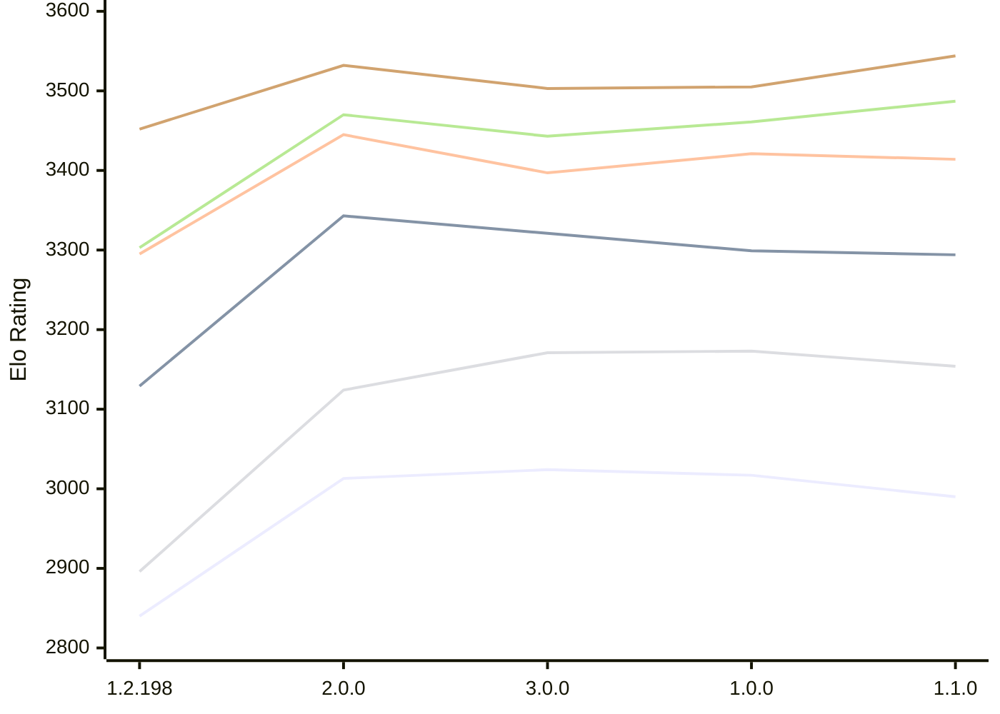

# Engine: Trebuchet

Author: Jonny Reckless

Home: https://github.com/jonny-reckless/zenith

## Elo Ratings E1 (Ultra 7 265T (1.50 GHz) - E-Core)

| Version | Published | STC 8.0+0.08s  | LTC 60.0+0.60s | VLTC 2m24s+1.12s | Comment |
| --- | --- | --- | --- | --- | --- |
| 1.1.0 | 2026-11-08 | 2990(-27) | 3294(-5) | 3414(-7) |  |
| 1.0.0 | 2026-11-07 | 3017(-7) | 3299(-22) | 3421(+24) |  |
| 3.0.0 | 2026-10-30 | 3024(+11) | 3321(-22) | 3397(-48) |  |
| 2.0.0 | 2026-10-15 | 3013(+173) | 3343(+214) | 3445(+150) |  |
| 1.2.198 | 2026-08-01 | 2840 | 3129 | 3295 |  |
 | | | cElo (∆ prev) | cElo (∆ prev) | cElo (∆ prev) | 

## Elo Ratings P1 (Ultra 7 265T (1.50 GHz) - P-Core)

| Version | Published | STC 8.0+0.08s  | LTC 60.0+0.60s | VLTC 2m24s+1.12s | Comment |
| --- | --- | --- | --- | --- | --- |
| 1.1.0 | 2026-11-08 | 3154(-19) | 3487(+26) | 3544(+39) |  |
| 1.0.0 | 2026-11-07 | 3173(+2) | 3461(+18) | 3505(+2) |  |
| 3.0.0 | 2026-10-30 | 3171(+47) | 3443(-27) | 3503(-29) |  |
| 2.0.0 | 2026-10-15 | 3124(+228) | 3470(+167) | 3532(+80) |  |
| 1.2.198 | 2026-08-01 | 2896 | 3303 | 3452 |  |
 | | | cElo (∆ prev) | cElo (∆ prev) | cElo (∆ prev) | 

## Elo Ratings T1 (i5-7500T 2.70GHz)

| Version | Published | STC 8.0+0.08s  | LTC 60.0+0.60s | VLTC 2m24s+1.12s | Comment |
| --- | --- | --- | --- | --- | --- |
| 1.2.198 | 2026-08-01 | 3067 | 3339 | 3387 |  |
 | | | cElo (∆ prev) | cElo (∆ prev) | cElo (∆ prev) | 

<a href="https://github.com/computer-chess-index/cci/issues/new?template=submit-version.yml&title=[VERSION]+Trebuchet+<version>&body=###%20Engine%20name%0ATrebuchet%0A%0A###%20Version%0A1.2.198" target="_blank">Submit new version</a>

 Test Conditions:

GUI/CLI: <a href=https://github.com/cutechess/cutechess target="_blank">Cute-Chess</a> 
Elo Calculation: <a href=https://www.remi-coulom.fr/Bayesian-Elo/ target="_blank">Bayesian-Elo</a> 
CPU for P1: Intel(R) Core(TM) Ultra 7 265T (1.50 GHz) - P-Core 
CPU for E1: Intel(R) Core(TM) Ultra 7 265T (1.50 GHz) - E-Core 
CPU for T1: Intel(R) Core(TM) i5-7500T 2.70GHz 
Opening book: 8_moves_v3 
\* STC: 8.0+0.08s, LTC: 60.0+0.60s, VLTC: 2m24s+1.12s

 Lists:
Ratings: <a href=https://github.com/computer-chess-index/cci/blob/main/lists/CCIRatings.csv target="_blank">Complete list</a>

Generated: 2026-11-12 05:43:32

## Ratings Verlauf E1 / P1

## Detailed Evaluation Results

| Version | Time Control | Variant | Elo  | Range +/- | Matches | Score | Average Opponent Elo | Draws |
| --- | --- |--- | --- | --- | --- | --- | --- | --- |
| 1.1.0 | VLTC (2m24s+1.12s) | E1 | 3414 | 33 | 228 | 49% | 3422 | 68% |
|  |  | P1 | 3544 | 39 | 166 | 48% | 3559 | 72% |
|  | LTC (60.0+0.60s) | E1 | 3294 | 33 | 232 | 50% | 3291 | 66% |
|  |  | P1 | 3487 | 30 | 296 | 46% | 3515 | 66% |
|  | STC (8.0+0.08s) | P1 | 3154 | 43 | 144 | 47% | 3175 | 58% |
|  |  | E1 | 2990 | 34 | 250 | 51% | 2982 | 46% |
| --- | --- |--- | --- | --- | --- | --- | --- | --- |
| 1.0.0 | VLTC (2m24s+1.12s) | P1 | 3505 | 49 | 100 | 50% | 3509 | 75% |
|  |  | E1 | 3421 | 29 | 322 | 57% | 3146 | 63% |
|  | LTC (60.0+0.60s) | P1 | 3461 | 50 | 100 | 52% | 3452 | 71% |
|  |  | E1 | 3299 | 32 | 256 | 48% | 3316 | 64% |
|  | STC (8.0+0.08s) | P1 | 3173 | 47 | 128 | 47% | 3195 | 50% |
|  |  | E1 | 3017 | 29 | 360 | 46% | 3047 | 46% |
| --- | --- |--- | --- | --- | --- | --- | --- | --- |
| 3.0.0 | VLTC (2m24s+1.12s) | E1 | 3397 | 31 | 264 | 51% | 3390 | 69% |
|  |  | P1 | 3503 | 38 | 168 | 51% | 3492 | 77% |
|  | LTC (60.0+0.60s) | P1 | 3443 | 37 | 192 | 52% | 3424 | 62% |
|  |  | E1 | 3321 | 28 | 324 | 54% | 3294 | 63% |
|  | STC (8.0+0.08s) | P1 | 3171 | 42 | 148 | 48% | 3186 | 60% |
|  |  | E1 | 3024 | 37 | 218 | 50% | 3019 | 43% |
| --- | --- |--- | --- | --- | --- | --- | --- | --- |
| 2.0.0 | VLTC (2m24s+1.12s) | P1 | 3532 | 34 | 224 | 51% | 3522 | 70% |
|  |  | E1 | 3445 | 29 | 300 | 49% | 3449 | 66% |
|  | LTC (60.0+0.60s) | P1 | 3470 | 39 | 174 | 53% | 3447 | 66% |
|  |  | E1 | 3343 | 32 | 266 | 52% | 3325 | 62% |
|  | STC (8.0+0.08s) | P1 | 3124 | 40 | 192 | 53% | 3093 | 44% |
|  |  | E1 | 3013 | 38 | 208 | 53% | 2982 | 44% |
| --- | --- |--- | --- | --- | --- | --- | --- | --- |
| 1.2.198 | VLTC (2m24s+1.12s) | E1 | 3295 | 29 | 326 | 41% | 3368 | 62% |
|  |  | T1 | 3387 | 31 | 272 | 51% | 3363 | 69% |
|  |  | P1 | 3452 | 33 | 252 | 44% | 3492 | 61% |
|  | LTC (60.0+0.60s) | E1 | 3129 | 28 | 370 | 39% | 3222 | 51% |
|  |  | T1 | 3339 | 34 | 236 | 54% | 3266 | 64% |
|  |  | P1 | 3303 | 32 | 288 | 39% | 3389 | 55% |
|  | STC (8.0+0.08s) | E1 | 2840 | 34 | 308 | 64% | 2711 | 29% |
|  |  | T1 | 3067 | 26 | 424 | 47% | 3067 | 54% |
|  |  | P1 | 2896 | 45 | 180 | 59% | 2803 | 26% |