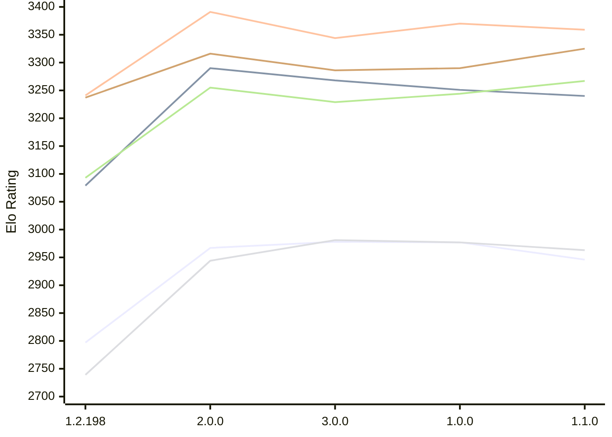

# Engine: Trebuchet

Author: Jonny Reckless

Home: https://github.com/jonny-reckless/zenith

## Elo Ratings E1 (Ultra 7 265T (1.50 GHz) - E-Core)

| Version | Published | STC 8.0+0.08s  | LTC 60.0+0.60s | VLTC 2m24s+1.12s | Comment |
| --- | --- | --- | --- | --- | --- |
| 1.1.0 | 2026-11-08 | 2946(-31) | 3240(-11) | 3359(-11) |  |
| 1.0.0 | 2026-11-07 | 2977(-1) | 3251(-17) | 3370(+26) |  |
| 3.0.0 | 2026-10-30 | 2978(+11) | 3268(-22) | 3344(-47) |  |
| 2.0.0 | 2026-10-15 | 2967(+170) | 3290(+211) | 3391(+150) |  |
| 1.2.198 | 2026-08-01 | 2797 | 3079 | 3241 |  |
 | | | cElo (∆ prev) | cElo (∆ prev) | cElo (∆ prev) | 

## Elo Ratings P1 (Ultra 7 265T (1.50 GHz) - P-Core)

| Version | Published | STC 8.0+0.08s  | LTC 60.0+0.60s | VLTC 2m24s+1.12s | Comment |
| --- | --- | --- | --- | --- | --- |
| 1.1.0 | 2026-11-08 | 2963(-14) | 3267(+23) | 3325(+35) |  |
| 1.0.0 | 2026-11-07 | 2977(-4) | 3244(+15) | 3290(+4) |  |
| 3.0.0 | 2026-10-30 | 2981(+37) | 3229(-26) | 3286(-30) |  |
| 2.0.0 | 2026-10-15 | 2944(+205) | 3255(+162) | 3316(+79) |  |
| 1.2.198 | 2026-08-01 | 2739 | 3093 | 3237 |  |
 | | | cElo (∆ prev) | cElo (∆ prev) | cElo (∆ prev) | 

## Elo Ratings T1 (i5-7500T 2.70GHz)

| Version | Published | STC 8.0+0.08s  | LTC 60.0+0.60s | VLTC 2m24s+1.12s | Comment |
| --- | --- | --- | --- | --- | --- |
| 1.2.198 | 2026-08-01 | 3067 | 3339 | 3387 |  |
 | | | cElo (∆ prev) | cElo (∆ prev) | cElo (∆ prev) | 

<a href="https://github.com/computer-chess-index/cci/issues/new?template=submit-version.yml&title=[VERSION]+Trebuchet+<version>&body=###%20Engine%20name%0ATrebuchet%0A%0A###%20Version%0A1.2.198" target="_blank">Submit new version</a>

 Test Conditions:

GUI/CLI: <a href=https://github.com/cutechess/cutechess target="_blank">Cute-Chess</a> 
Elo Calculation: <a href=https://www.remi-coulom.fr/Bayesian-Elo/ target="_blank">Bayesian-Elo</a> 
CPU for P1: Intel(R) Core(TM) Ultra 7 265T (1.50 GHz) - P-Core 
CPU for E1: Intel(R) Core(TM) Ultra 7 265T (1.50 GHz) - E-Core 
CPU for T1: Intel(R) Core(TM) i5-7500T 2.70GHz 
Opening book: 8_moves_v3 
\* STC: 8.0+0.08s, LTC: 60.0+0.60s, VLTC: 2m24s+1.12s

 Lists:
Ratings: <a href=https://github.com/computer-chess-index/cci/blob/main/lists/CCIRatings.csv target="_blank">Complete list</a>

Generated: 2026-11-19 05:44:23

## Ratings Verlauf E1 / P1

## Detailed Evaluation Results

| Version | Time Control | Variant | Elo  | Range +/- | Matches | Score | Average Opponent Elo | Draws |
| --- | --- |--- | --- | --- | --- | --- | --- | --- |
| 1.1.0 | VLTC (2m24s+1.12s) | P1 | 3325 | 38 | 174 | 48% | 3341 | 71% |
|  |  | E1 | 3359 | 32 | 252 | 49% | 3368 | 69% |
|  | LTC (60.0+0.60s) | P1 | 3267 | 29 | 316 | 46% | 3299 | 66% |
|  |  | E1 | 3240 | 32 | 256 | 50% | 3240 | 66% |
|  | STC (8.0+0.08s) | E1 | 2946 | 32 | 282 | 50% | 2951 | 46% |
|  |  | P1 | 2963 | 39 | 180 | 47% | 2988 | 58% |
| --- | --- |--- | --- | --- | --- | --- | --- | --- |
| 1.0.0 | VLTC (2m24s+1.12s) | P1 | 3290 | 47 | 112 | 50% | 3293 | 74% |
|  |  | E1 | 3370 | 28 | 346 | 57% | 3113 | 63% |
|  | LTC (60.0+0.60s) | P1 | 3244 | 48 | 108 | 51% | 3239 | 72% |
|  |  | E1 | 3251 | 30 | 288 | 48% | 3262 | 64% |
|  | STC (8.0+0.08s) | P1 | 2977 | 44 | 148 | 46% | 3005 | 51% |
|  |  | E1 | 2977 | 27 | 396 | 47% | 2998 | 45% |
| --- | --- |--- | --- | --- | --- | --- | --- | --- |
| 3.0.0 | VLTC (2m24s+1.12s) | P1 | 3286 | 38 | 168 | 51% | 3276 | 77% |
|  |  | E1 | 3344 | 31 | 264 | 51% | 3336 | 69% |
|  | LTC (60.0+0.60s) | E1 | 3268 | 29 | 324 | 54% | 3241 | 63% |
|  |  | P1 | 3229 | 37 | 192 | 52% | 3210 | 62% |
|  | STC (8.0+0.08s) | E1 | 2978 | 37 | 218 | 50% | 2973 | 43% |
|  |  | P1 | 2981 | 42 | 148 | 48% | 2994 | 60% |
| --- | --- |--- | --- | --- | --- | --- | --- | --- |
| 2.0.0 | VLTC (2m24s+1.12s) | P1 | 3316 | 34 | 224 | 51% | 3306 | 70% |
|  |  | E1 | 3391 | 29 | 300 | 49% | 3395 | 66% |
|  | LTC (60.0+0.60s) | P1 | 3255 | 39 | 174 | 53% | 3232 | 66% |
|  |  | E1 | 3290 | 32 | 266 | 52% | 3272 | 62% |
|  | STC (8.0+0.08s) | P1 | 2944 | 39 | 192 | 53% | 2913 | 44% |
|  |  | E1 | 2967 | 38 | 208 | 53% | 2938 | 44% |
| --- | --- |--- | --- | --- | --- | --- | --- | --- |
| 1.2.198 | VLTC (2m24s+1.12s) | P1 | 3237 | 33 | 252 | 44% | 3278 | 61% |
|  |  | E1 | 3241 | 29 | 326 | 41% | 3314 | 62% |
|  |  | T1 | 3387 | 31 | 272 | 51% | 3363 | 69% |
|  | LTC (60.0+0.60s) | P1 | 3093 | 32 | 288 | 39% | 3178 | 55% |
|  |  | E1 | 3079 | 28 | 370 | 39% | 3171 | 51% |
|  |  | T1 | 3339 | 34 | 236 | 54% | 3266 | 64% |
|  | STC (8.0+0.08s) | P1 | 2739 | 45 | 180 | 59% | 2647 | 26% |
|  |  | E1 | 2797 | 34 | 308 | 64% | 2668 | 29% |
|  |  | T1 | 3067 | 26 | 424 | 47% | 3067 | 54% |