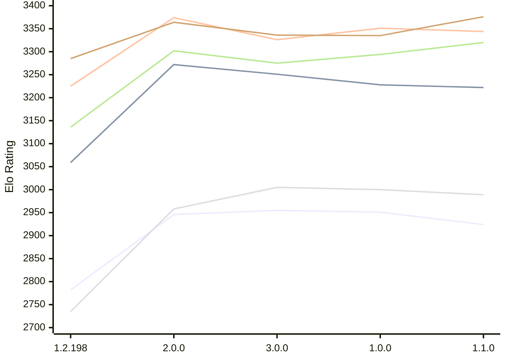

# Engine: Trebuchet

Author: Jonny Reckless

Home: https://github.com/jonny-reckless/zenith

## Elo Ratings E1 (Ultra 7 265T (1.50 GHz) - E-Core)

| Version | Published | STC 8.0+0.08s  | LTC 60.0+0.60s | VLTC 2m24s+1.12s | Comment |
| --- | --- | --- | --- | --- | --- |
| 1.1.0 | 2026-11-08 | 2924(-27) | 3222(-6) | 3344(-7) |  |
| 1.0.0 | 2026-11-07 | 2951(-4) | 3228(-23) | 3351(+25) |  |
| 3.0.0 | 2026-10-30 | 2955(+9) | 3251(-21) | 3326(-48) |  |
| 2.0.0 | 2026-10-15 | 2946(+164) | 3272(+213) | 3374(+149) |  |
| 1.2.198 | 2026-08-01 | 2782 | 3059 | 3225 |  |
 | | | cElo (∆ prev) | cElo (∆ prev) | cElo (∆ prev) | 

## Elo Ratings P1 (Ultra 7 265T (1.50 GHz) - P-Core)

| Version | Published | STC 8.0+0.08s  | LTC 60.0+0.60s | VLTC 2m24s+1.12s | Comment |
| --- | --- | --- | --- | --- | --- |
| 1.1.0 | 2026-11-08 | 2989(-11) | 3320(+26) | 3376(+41) |  |
| 1.0.0 | 2026-11-07 | 3000(-5) | 3294(+19) | 3335(-1) |  |
| 3.0.0 | 2026-10-30 | 3005(+47) | 3275(-27) | 3336(-28) |  |
| 2.0.0 | 2026-10-15 | 2958(+223) | 3302(+166) | 3364(+79) |  |
| 1.2.198 | 2026-08-01 | 2735 | 3136 | 3285 |  |
 | | | cElo (∆ prev) | cElo (∆ prev) | cElo (∆ prev) | 

## Elo Ratings T1 (i5-7500T 2.70GHz)

| Version | Published | STC 8.0+0.08s  | LTC 60.0+0.60s | VLTC 2m24s+1.12s | Comment |
| --- | --- | --- | --- | --- | --- |
| 1.2.198 | 2026-08-01 | 3067 | 3339 | 3387 |  |
 | | | cElo (∆ prev) | cElo (∆ prev) | cElo (∆ prev) | 

<a href="https://github.com/computer-chess-index/cci/issues/new?template=submit-version.yml&title=[VERSION]+Trebuchet+<version>&body=###%20Engine%20name%0ATrebuchet%0A%0A###%20Version%0A1.2.198" target="_blank">Submit new version</a>

 Test Conditions:

GUI/CLI: <a href=https://github.com/cutechess/cutechess target="_blank">Cute-Chess</a> 
Elo Calculation: <a href=https://www.remi-coulom.fr/Bayesian-Elo/ target="_blank">Bayesian-Elo</a> 
CPU for P1: Intel(R) Core(TM) Ultra 7 265T (1.50 GHz) - P-Core 
CPU for E1: Intel(R) Core(TM) Ultra 7 265T (1.50 GHz) - E-Core 
CPU for T1: Intel(R) Core(TM) i5-7500T 2.70GHz 
Opening book: 8_moves_v3 
\* STC: 8.0+0.08s, LTC: 60.0+0.60s, VLTC: 2m24s+1.12s

 Lists:
Ratings: <a href=https://github.com/computer-chess-index/cci/blob/main/lists/CCIRatings.csv target="_blank">Complete list</a>

Generated: 2026-11-13 05:43:58

## Ratings Verlauf E1 / P1

## Detailed Evaluation Results

| Version | Time Control | Variant | Elo  | Range +/- | Matches | Score | Average Opponent Elo | Draws |
| --- | --- |--- | --- | --- | --- | --- | --- | --- |
| 1.1.0 | VLTC (2m24s+1.12s) | P1 | 3376 | 39 | 166 | 48% | 3390 | 72% |
|  |  | E1 | 3344 | 33 | 228 | 49% | 3351 | 68% |
|  | LTC (60.0+0.60s) | P1 | 3320 | 30 | 296 | 46% | 3348 | 66% |
|  |  | E1 | 3222 | 33 | 232 | 50% | 3220 | 66% |
|  | STC (8.0+0.08s) | P1 | 2989 | 43 | 148 | 47% | 3012 | 59% |
|  |  | E1 | 2924 | 34 | 254 | 50% | 2923 | 45% |
| --- | --- |--- | --- | --- | --- | --- | --- | --- |
| 1.0.0 | VLTC (2m24s+1.12s) | P1 | 3335 | 48 | 104 | 49% | 3341 | 75% |
|  |  | E1 | 3351 | 29 | 322 | 57% | 3079 | 63% |
|  | LTC (60.0+0.60s) | P1 | 3294 | 50 | 100 | 52% | 3285 | 71% |
|  |  | E1 | 3228 | 32 | 256 | 48% | 3244 | 64% |
|  | STC (8.0+0.08s) | P1 | 3000 | 46 | 132 | 46% | 3028 | 50% |
|  |  | E1 | 2951 | 28 | 368 | 46% | 2979 | 45% |
| --- | --- |--- | --- | --- | --- | --- | --- | --- |
| 3.0.0 | VLTC (2m24s+1.12s) | P1 | 3336 | 38 | 168 | 51% | 3325 | 77% |
|  |  | E1 | 3326 | 31 | 264 | 51% | 3318 | 69% |
|  | LTC (60.0+0.60s) | P1 | 3275 | 37 | 192 | 52% | 3256 | 62% |
|  |  | E1 | 3251 | 28 | 324 | 54% | 3222 | 63% |
|  | STC (8.0+0.08s) | P1 | 3005 | 42 | 148 | 48% | 3020 | 60% |
|  |  | E1 | 2955 | 37 | 218 | 50% | 2951 | 43% |
| --- | --- |--- | --- | --- | --- | --- | --- | --- |
| 2.0.0 | VLTC (2m24s+1.12s) | P1 | 3364 | 34 | 224 | 51% | 3355 | 70% |
|  |  | E1 | 3374 | 29 | 300 | 49% | 3379 | 66% |
|  | LTC (60.0+0.60s) | P1 | 3302 | 39 | 174 | 53% | 3279 | 66% |
|  |  | E1 | 3272 | 32 | 266 | 52% | 3255 | 62% |
|  | STC (8.0+0.08s) | P1 | 2958 | 40 | 192 | 53% | 2927 | 44% |
|  |  | E1 | 2946 | 38 | 208 | 53% | 2916 | 44% |
| --- | --- |--- | --- | --- | --- | --- | --- | --- |
| 1.2.198 | VLTC (2m24s+1.12s) | E1 | 3225 | 29 | 326 | 41% | 3297 | 62% |
|  |  | T1 | 3387 | 31 | 272 | 51% | 3363 | 69% |
|  |  | P1 | 3285 | 33 | 252 | 44% | 3325 | 61% |
|  | LTC (60.0+0.60s) | T1 | 3339 | 34 | 236 | 54% | 3266 | 64% |
|  |  | P1 | 3136 | 32 | 288 | 39% | 3221 | 55% |
|  |  | E1 | 3059 | 28 | 370 | 39% | 3151 | 51% |
|  | STC (8.0+0.08s) | T1 | 3067 | 26 | 424 | 47% | 3067 | 54% |
|  |  | P1 | 2735 | 45 | 180 | 59% | 2643 | 26% |
|  |  | E1 | 2782 | 34 | 308 | 64% | 2653 | 29% |