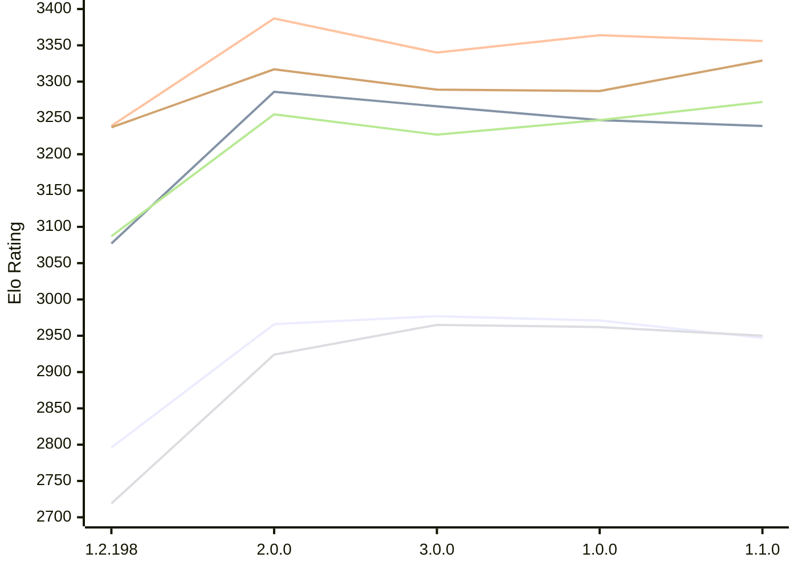

# Engine: Trebuchet

Author: Jonny Reckless

Home: https://github.com/jonny-reckless/zenith

## Elo Ratings E1 (Ultra 7 265T (1.50 GHz) - E-Core)

| Version | Published | STC 8.0+0.08s  | LTC 60.0+0.60s | VLTC 2m24s+1.12s | Comment |
| --- | --- | --- | --- | --- | --- |
| 1.1.0 | 2026-11-08 | 2947(-24) | 3239(-8) | 3356(-8) |  |
| 1.0.0 | 2026-11-07 | 2971(-6) | 3247(-19) | 3364(+24) |  |
| 3.0.0 | 2026-10-30 | 2977(+11) | 3266(-20) | 3340(-47) |  |
| 2.0.0 | 2026-10-15 | 2966(+170) | 3286(+209) | 3387(+148) |  |
| 1.2.198 | 2026-08-01 | 2796 | 3077 | 3239 |  |
 | | | cElo (∆ prev) | cElo (∆ prev) | cElo (∆ prev) | 

## Elo Ratings P1 (Ultra 7 265T (1.50 GHz) - P-Core)

| Version | Published | STC 8.0+0.08s  | LTC 60.0+0.60s | VLTC 2m24s+1.12s | Comment |
| --- | --- | --- | --- | --- | --- |
| 1.1.0 | 2026-11-08 | 2950(-12) | 3272(+25) | 3329(+42) |  |
| 1.0.0 | 2026-11-07 | 2962(-3) | 3247(+20) | 3287(-2) |  |
| 3.0.0 | 2026-10-30 | 2965(+41) | 3227(-28) | 3289(-28) |  |
| 2.0.0 | 2026-10-15 | 2924(+205) | 3255(+168) | 3317(+80) |  |
| 1.2.198 | 2026-08-01 | 2719 | 3087 | 3237 |  |
 | | | cElo (∆ prev) | cElo (∆ prev) | cElo (∆ prev) | 

## Elo Ratings T1 (i5-7500T 2.70GHz)

| Version | Published | STC 8.0+0.08s  | LTC 60.0+0.60s | VLTC 2m24s+1.12s | Comment |
| --- | --- | --- | --- | --- | --- |
| 1.2.198 | 2026-08-01 | 3067 | 3339 | 3387 |  |
 | | | cElo (∆ prev) | cElo (∆ prev) | cElo (∆ prev) | 

<a href="https://github.com/computer-chess-index/cci/issues/new?template=submit-version.yml&title=[VERSION]+Trebuchet+<version>&body=###%20Engine%20name%0ATrebuchet%0A%0A###%20Version%0A1.2.198" target="_blank">Submit new version</a>

 Test Conditions:

GUI/CLI: <a href=https://github.com/cutechess/cutechess target="_blank">Cute-Chess</a> 
Elo Calculation: <a href=https://www.remi-coulom.fr/Bayesian-Elo/ target="_blank">Bayesian-Elo</a> 
CPU for P1: Intel(R) Core(TM) Ultra 7 265T (1.50 GHz) - P-Core 
CPU for E1: Intel(R) Core(TM) Ultra 7 265T (1.50 GHz) - E-Core 
CPU for T1: Intel(R) Core(TM) i5-7500T 2.70GHz 
Opening book: 8_moves_v3 
\* STC: 8.0+0.08s, LTC: 60.0+0.60s, VLTC: 2m24s+1.12s

 Lists:
Ratings: <a href=https://github.com/computer-chess-index/cci/blob/main/lists/CCIRatings.csv target="_blank">Complete list</a>

Generated: 2026-11-15 05:43:51

## Ratings Verlauf E1 / P1

## Detailed Evaluation Results

| Version | Time Control | Variant | Elo  | Range +/- | Matches | Score | Average Opponent Elo | Draws |
| --- | --- |--- | --- | --- | --- | --- | --- | --- |
| 1.1.0 | VLTC (2m24s+1.12s) | P1 | 3329 | 39 | 166 | 48% | 3343 | 72% |
|  |  | E1 | 3356 | 33 | 232 | 49% | 3364 | 69% |
|  | LTC (60.0+0.60s) | P1 | 3272 | 30 | 296 | 46% | 3301 | 66% |
|  |  | E1 | 3239 | 33 | 236 | 50% | 3236 | 66% |
|  | STC (8.0+0.08s) | P1 | 2950 | 42 | 156 | 46% | 2977 | 58% |
|  |  | E1 | 2947 | 33 | 266 | 50% | 2946 | 45% |
| --- | --- |--- | --- | --- | --- | --- | --- | --- |
| 1.0.0 | VLTC (2m24s+1.12s) | P1 | 3287 | 48 | 104 | 49% | 3294 | 75% |
|  |  | E1 | 3364 | 29 | 330 | 57% | 3098 | 63% |
|  | LTC (60.0+0.60s) | P1 | 3247 | 50 | 100 | 52% | 3236 | 71% |
|  |  | E1 | 3247 | 31 | 272 | 48% | 3259 | 64% |
|  | STC (8.0+0.08s) | P1 | 2962 | 44 | 144 | 46% | 2990 | 51% |
|  |  | E1 | 2971 | 28 | 380 | 47% | 2998 | 45% |
| --- | --- |--- | --- | --- | --- | --- | --- | --- |
| 3.0.0 | VLTC (2m24s+1.12s) | P1 | 3289 | 38 | 168 | 51% | 3278 | 77% |
|  |  | E1 | 3340 | 31 | 264 | 51% | 3332 | 69% |
|  | LTC (60.0+0.60s) | P1 | 3227 | 37 | 192 | 52% | 3208 | 62% |
|  |  | E1 | 3266 | 28 | 324 | 54% | 3237 | 63% |
|  | STC (8.0+0.08s) | P1 | 2965 | 42 | 148 | 48% | 2979 | 60% |
|  |  | E1 | 2977 | 37 | 218 | 50% | 2971 | 43% |
| --- | --- |--- | --- | --- | --- | --- | --- | --- |
| 2.0.0 | VLTC (2m24s+1.12s) | P1 | 3317 | 34 | 224 | 51% | 3308 | 70% |
|  |  | E1 | 3387 | 29 | 300 | 49% | 3391 | 66% |
|  | LTC (60.0+0.60s) | P1 | 3255 | 39 | 174 | 53% | 3231 | 66% |
|  |  | E1 | 3286 | 32 | 266 | 52% | 3268 | 62% |
|  | STC (8.0+0.08s) | P1 | 2924 | 39 | 192 | 53% | 2893 | 44% |
|  |  | E1 | 2966 | 38 | 208 | 53% | 2935 | 44% |
| --- | --- |--- | --- | --- | --- | --- | --- | --- |
| 1.2.198 | VLTC (2m24s+1.12s) | T1 | 3387 | 31 | 272 | 51% | 3363 | 69% |
|  |  | P1 | 3237 | 33 | 252 | 44% | 3278 | 61% |
|  |  | E1 | 3239 | 29 | 326 | 41% | 3310 | 62% |
|  | LTC (60.0+0.60s) | T1 | 3339 | 34 | 236 | 54% | 3266 | 64% |
|  |  | P1 | 3087 | 32 | 288 | 39% | 3173 | 55% |
|  |  | E1 | 3077 | 28 | 370 | 39% | 3168 | 51% |
|  | STC (8.0+0.08s) | T1 | 3067 | 26 | 424 | 47% | 3067 | 54% |
|  |  | P1 | 2719 | 45 | 180 | 59% | 2626 | 26% |
|  |  | E1 | 2796 | 34 | 308 | 64% | 2666 | 29% |