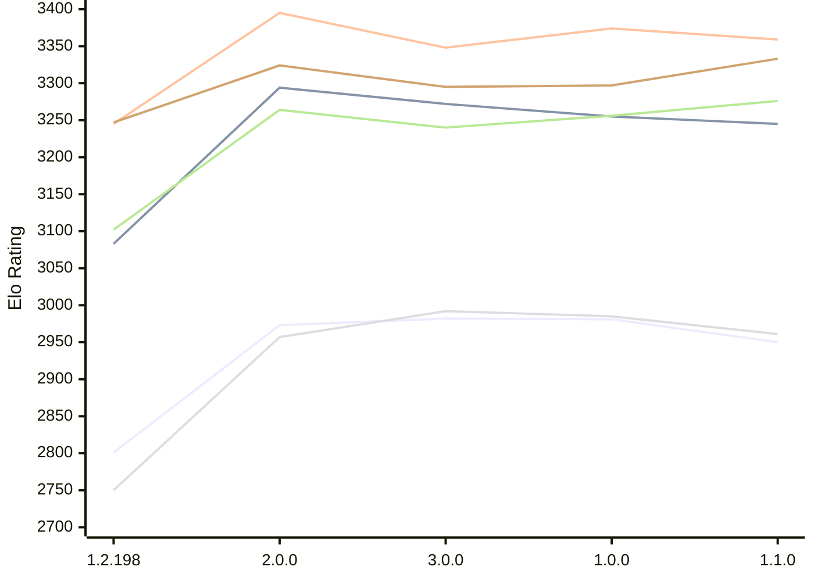

# Engine: Trebuchet

Author: Jonny Reckless

Home: https://github.com/jonny-reckless/zenith

## Elo Ratings E1 (Ultra 7 265T (1.50 GHz) - E-Core)

| Version | Published | STC 8.0+0.08s  | LTC 60.0+0.60s | VLTC 2m24s+1.12s | Comment |
| --- | --- | --- | --- | --- | --- |
| 1.1.0 | 2026-11-08 | 2950(-31) | 3245(-10) | 3359(-15) |  |
| 1.0.0 | 2026-11-07 | 2981(-1) | 3255(-17) | 3374(+26) |  |
| 3.0.0 | 2026-10-30 | 2982(+9) | 3272(-22) | 3348(-47) |  |
| 2.0.0 | 2026-10-15 | 2973(+172) | 3294(+211) | 3395(+150) |  |
| 1.2.198 | 2026-08-01 | 2801 | 3083 | 3245 |  |
 | | | cElo (∆ prev) | cElo (∆ prev) | cElo (∆ prev) | 

## Elo Ratings P1 (Ultra 7 265T (1.50 GHz) - P-Core)

| Version | Published | STC 8.0+0.08s  | LTC 60.0+0.60s | VLTC 2m24s+1.12s | Comment |
| --- | --- | --- | --- | --- | --- |
| 1.1.0 | 2026-11-08 | 2961(-24) | 3276(+20) | 3333(+36) |  |
| 1.0.0 | 2026-11-07 | 2985(-7) | 3256(+16) | 3297(+2) |  |
| 3.0.0 | 2026-10-30 | 2992(+35) | 3240(-24) | 3295(-29) |  |
| 2.0.0 | 2026-10-15 | 2957(+207) | 3264(+162) | 3324(+77) |  |
| 1.2.198 | 2026-08-01 | 2750 | 3102 | 3247 |  |
 | | | cElo (∆ prev) | cElo (∆ prev) | cElo (∆ prev) | 

## Elo Ratings T1 (i5-7500T 2.70GHz)

| Version | Published | STC 8.0+0.08s  | LTC 60.0+0.60s | VLTC 2m24s+1.12s | Comment |
| --- | --- | --- | --- | --- | --- |
| 1.2.198 | 2026-08-01 | 3067 | 3339 | 3387 |  |
 | | | cElo (∆ prev) | cElo (∆ prev) | cElo (∆ prev) | 

<a href="https://github.com/computer-chess-index/cci/issues/new?template=submit-version.yml&title=[VERSION]+Trebuchet+<version>&body=###%20Engine%20name%0ATrebuchet%0A%0A###%20Version%0A1.2.198" target="_blank">Submit new version</a>

 Test Conditions:

GUI/CLI: <a href=https://github.com/cutechess/cutechess target="_blank">Cute-Chess</a> 
Elo Calculation: <a href=https://www.remi-coulom.fr/Bayesian-Elo/ target="_blank">Bayesian-Elo</a> 
CPU for P1: Intel(R) Core(TM) Ultra 7 265T (1.50 GHz) - P-Core 
CPU for E1: Intel(R) Core(TM) Ultra 7 265T (1.50 GHz) - E-Core 
CPU for T1: Intel(R) Core(TM) i5-7500T 2.70GHz 
Opening book: 8_moves_v3 
\* STC: 8.0+0.08s, LTC: 60.0+0.60s, VLTC: 2m24s+1.12s

 Lists:
Ratings: <a href=https://github.com/computer-chess-index/cci/blob/main/lists/CCIRatings.csv target="_blank">Complete list</a>

Generated: 2026-11-22 05:43:54

## Ratings Verlauf E1 / P1

## Detailed Evaluation Results

| Version | Time Control | Variant | Elo  | Range +/- | Matches | Score | Average Opponent Elo | Draws |
| --- | --- |--- | --- | --- | --- | --- | --- | --- |
| 1.1.0 | VLTC (2m24s+1.12s) | P1 | 3333 | 38 | 174 | 48% | 3349 | 71% |
|  |  | E1 | 3359 | 31 | 264 | 48% | 3372 | 69% |
|  | LTC (60.0+0.60s) | P1 | 3276 | 29 | 316 | 46% | 3309 | 66% |
|  |  | E1 | 3245 | 31 | 260 | 50% | 3243 | 66% |
|  | STC (8.0+0.08s) | E1 | 2950 | 32 | 296 | 49% | 2955 | 44% |
|  |  | P1 | 2961 | 35 | 228 | 46% | 2990 | 57% |
| --- | --- |--- | --- | --- | --- | --- | --- | --- |
| 1.0.0 | VLTC (2m24s+1.12s) | P1 | 3297 | 47 | 112 | 50% | 3299 | 74% |
|  |  | E1 | 3374 | 28 | 346 | 57% | 3117 | 63% |
|  | LTC (60.0+0.60s) | P1 | 3256 | 46 | 120 | 51% | 3249 | 70% |
|  |  | E1 | 3255 | 30 | 288 | 48% | 3266 | 64% |
|  | STC (8.0+0.08s) | P1 | 2985 | 43 | 156 | 46% | 3016 | 51% |
|  |  | E1 | 2981 | 27 | 396 | 47% | 3002 | 45% |
| --- | --- |--- | --- | --- | --- | --- | --- | --- |
| 3.0.0 | VLTC (2m24s+1.12s) | P1 | 3295 | 38 | 168 | 51% | 3285 | 77% |
|  |  | E1 | 3348 | 31 | 264 | 51% | 3340 | 69% |
|  | LTC (60.0+0.60s) | E1 | 3272 | 29 | 324 | 54% | 3245 | 63% |
|  |  | P1 | 3240 | 37 | 192 | 52% | 3221 | 62% |
|  | STC (8.0+0.08s) | E1 | 2982 | 37 | 218 | 50% | 2978 | 43% |
|  |  | P1 | 2992 | 42 | 148 | 48% | 3006 | 60% |
| --- | --- |--- | --- | --- | --- | --- | --- | --- |
| 2.0.0 | VLTC (2m24s+1.12s) | P1 | 3324 | 34 | 224 | 51% | 3314 | 70% |
|  |  | E1 | 3395 | 29 | 300 | 49% | 3401 | 66% |
|  | LTC (60.0+0.60s) | P1 | 3264 | 39 | 174 | 53% | 3241 | 66% |
|  |  | E1 | 3294 | 32 | 266 | 52% | 3276 | 62% |
|  | STC (8.0+0.08s) | P1 | 2957 | 39 | 192 | 53% | 2925 | 44% |
|  |  | E1 | 2973 | 38 | 208 | 53% | 2942 | 44% |
| --- | --- |--- | --- | --- | --- | --- | --- | --- |
| 1.2.198 | VLTC (2m24s+1.12s) | P1 | 3247 | 33 | 252 | 44% | 3286 | 61% |
|  |  | E1 | 3245 | 29 | 326 | 41% | 3318 | 62% |
|  |  | T1 | 3387 | 31 | 272 | 51% | 3363 | 69% |
|  | LTC (60.0+0.60s) | P1 | 3102 | 32 | 288 | 39% | 3187 | 55% |
|  |  | E1 | 3083 | 28 | 370 | 39% | 3175 | 51% |
|  |  | T1 | 3339 | 34 | 236 | 54% | 3266 | 64% |
|  | STC (8.0+0.08s) | P1 | 2750 | 45 | 180 | 59% | 2657 | 26% |
|  |  | E1 | 2801 | 34 | 308 | 64% | 2672 | 29% |
|  |  | T1 | 3067 | 26 | 424 | 47% | 3067 | 54% |