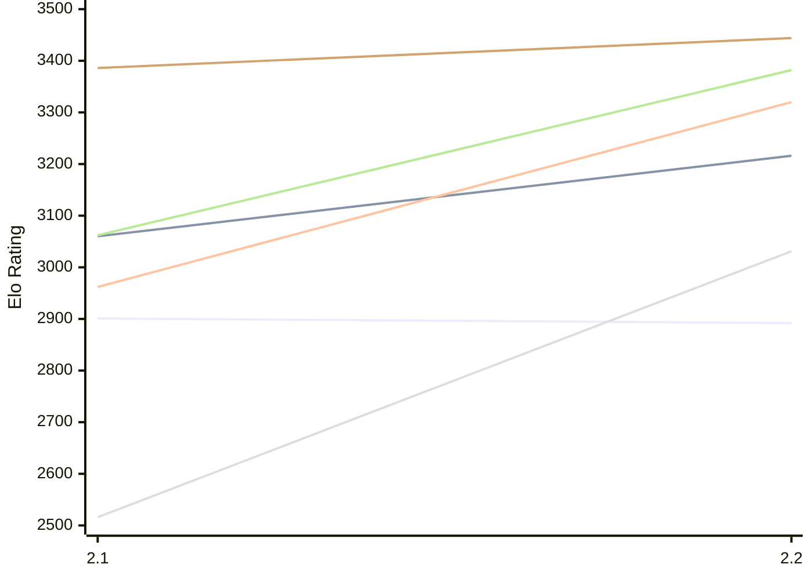
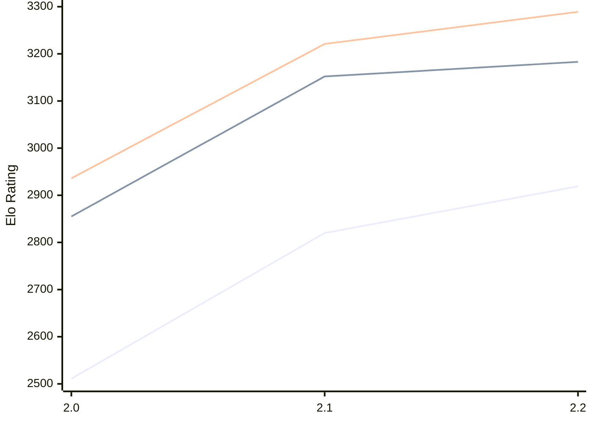

# Engine: Tunguska

Author: Fernando Tenorio

Home: https://github.com/fernandotenorio/Tunguska

## Elo Ratings E1 (Ultra 7 265T (1.50 GHz) - E-Core)

| Version | Published | STC 8.0+0.08s  | LTC 60.0+0.60s | VLTC 2m24s+1.12s | Comment |
| --- | --- | --- | --- | --- | --- |
| 2.2 | 2026-09-07 | 2892(-9) | 3216(+156) | 3320(+358) |  |
| 2.1 | 2026-04-08 | 2901 | 3060 | 2962 |  |
 | | | cElo (∆ prev) | cElo (∆ prev) | cElo (∆ prev) | 

## Elo Ratings P1 (Ultra 7 265T (1.50 GHz) - P-Core)

| Version | Published | STC 8.0+0.08s  | LTC 60.0+0.60s | VLTC 2m24s+1.12s | Comment |
| --- | --- | --- | --- | --- | --- |
| 2.2 | 2026-09-07 | 3031(+515) | 3382(+320) | 3444(+58) |  |
| 2.1 | 2026-04-08 | 2516 | 3062 | 3386 |  |
 | | | cElo (∆ prev) | cElo (∆ prev) | cElo (∆ prev) | 

## Elo Ratings T1 (i5-7500T 2.70GHz)

| Version | Published | STC 8.0+0.08s  | LTC 60.0+0.60s | VLTC 2m24s+1.12s | Comment |
| --- | --- | --- | --- | --- | --- |
| 2.2 | 2026-09-07 | 2919(+99) | 3183(+31) | 3289(+68) |  |
| 2.1 | 2026-04-08 | 2820(+309) | 3152(+297) | 3221(+285) |  |
| 2.0 | 2026-03-18 | 2511 | 2855 | 2936 |  |
 | | | cElo (∆ prev) | cElo (∆ prev) | cElo (∆ prev) | 

<a href="https://github.com/computer-chess-index/cci/issues/new?template=submit-version.yml&title=[VERSION]+Tunguska+<version>&body=###%20Engine%20name%0ATunguska%0A%0A###%20Version%0A2.2" target="_blank">Submit new version</a>

 Test Conditions:

GUI/CLI: <a href=https://github.com/cutechess/cutechess target="_blank">Cute-Chess</a> 
Elo Calculation: <a href=https://www.remi-coulom.fr/Bayesian-Elo/ target="_blank">Bayesian-Elo</a> 
CPU for P1: Intel(R) Core(TM) Ultra 7 265T (1.50 GHz) - P-Core 
CPU for E1: Intel(R) Core(TM) Ultra 7 265T (1.50 GHz) - E-Core 
CPU for T1: Intel(R) Core(TM) i5-7500T 2.70GHz 
Opening book: 8_moves_v3 
\* STC: 8.0+0.08s, LTC: 60.0+0.60s, VLTC: 2m24s+1.12s

 Lists:
Ratings: <a href=https://github.com/computer-chess-index/cci/blob/main/lists/CCIRatings.csv target="_blank">Complete list</a>

Generated: 2026-11-12 05:43:37

## Ratings Verlauf E1 / P1

## Ratings Verlauf T1

## Detailed Evaluation Results

| Version | Time Control | Variant | Elo  | Range +/- | Matches | Score | Average Opponent Elo | Draws |
| --- | --- |--- | --- | --- | --- | --- | --- | --- |
| 2.2 | VLTC (2m24s+1.12s) | T1 | 3289 | 30 | 284 | 50% | 3286 | 68% |
|  |  | P1 | 3444 | 29 | 308 | 47% | 3463 | 61% |
|  |  | E1 | 3320 | 25 | 436 | 48% | 3335 | 58% |
|  | LTC (60.0+0.60s) | T1 | 3183 | 33 | 244 | 49% | 3186 | 61% |
|  |  | P1 | 3382 | 29 | 324 | 49% | 3390 | 57% |
|  |  | E1 | 3216 | 24 | 478 | 46% | 3243 | 58% |
|  | STC (8.0+0.08s) | T1 | 2919 | 34 | 252 | 50% | 2919 | 51% |
|  |  | P1 | 3031 | 32 | 288 | 47% | 3063 | 44% |
|  |  | E1 | 2892 | 27 | 412 | 46% | 2903 | 47% |
| --- | --- |--- | --- | --- | --- | --- | --- | --- |
| 2.1 | VLTC (2m24s+1.12s) | E1 | 2962 | 204 | 16 | 53% | 2839 | 6% |
|  |  | T1 | 3221 | 24 | 488 | 50% | 3217 | 59% |
|  |  | P1 | 3386 | 248 | 4 | 88% | 3159 | 25% |
|  | LTC (60.0+0.60s) | E1 | 3060 | 180 | 12 | 63% | 2840 | 25% |
|  |  | T1 | 3152 | 24 | 458 | 52% | 3135 | 59% |
|  |  | P1 | 3062 | 175 | 12 | 79% | 2805 | 8% |
|  | STC (8.0+0.08s) | E1 | 2901 | 149 | 24 | 50% | 2865 | 8% |
|  |  | T1 | 2820 | 23 | 540 | 48% | 2838 | 46% |
|  |  | P1 | 2516 | 317 | 4 | 100% | 2115 | 0% |
| --- | --- |--- | --- | --- | --- | --- | --- | --- |
| 2.0 | VLTC (2m24s+1.12s) | T1 | 2936 | 30 | 356 | 51% | 2920 | 37% |
|  | LTC (60.0+0.60s) | T1 | 2855 | 31 | 328 | 50% | 2849 | 36% |
|  | STC (8.0+0.08s) | T1 | 2511 | 31 | 368 | 50% | 2504 | 25% |