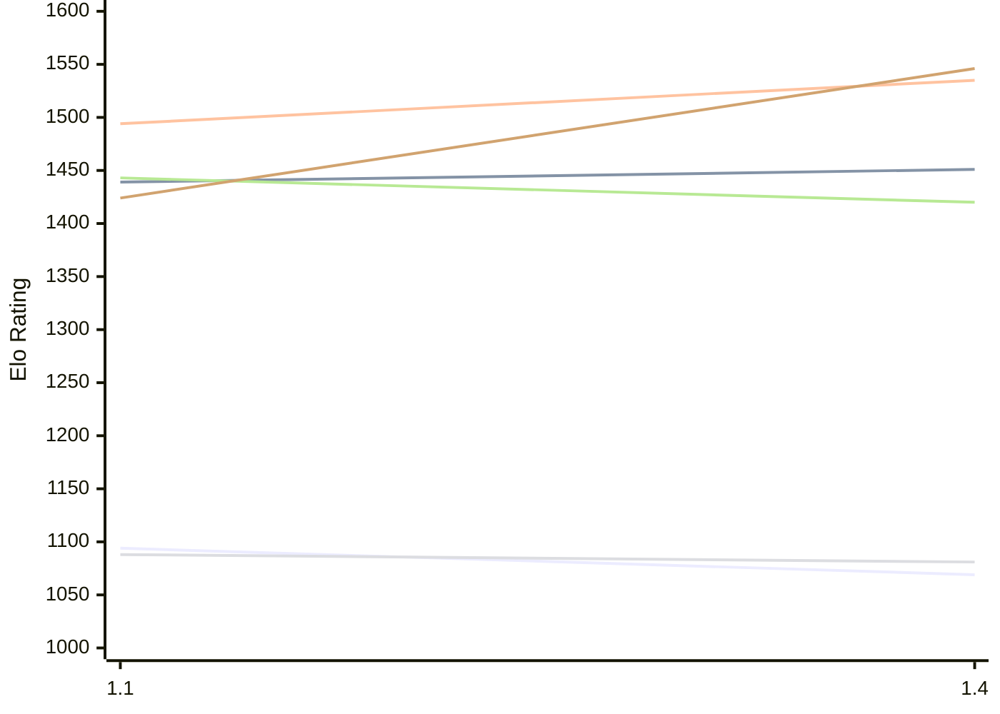
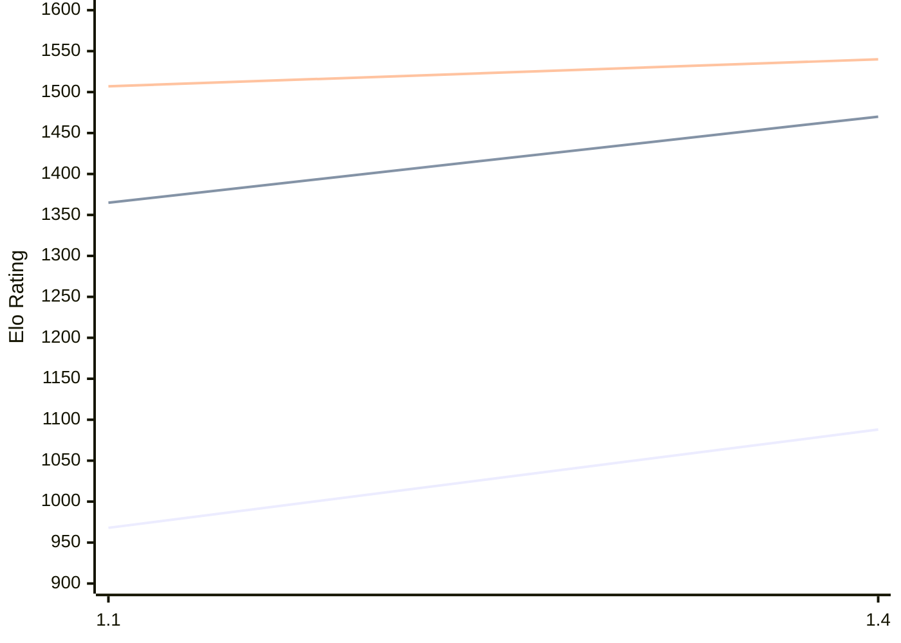

# Engine: USunfish

Author: Angel Monreal

Home: https://github.com/fizban99/micropython-usunfish

## Elo Ratings E1 (Ultra 7 265T (1.50 GHz) - E-Core)

| Version | Published | STC 8.0+0.08s  | LTC 60.0+0.60s | VLTC 2m24s+1.12s | Comment |
| --- | --- | --- | --- | --- | --- |
| 1.4 | 2026-09-12 | 1069(-25) | 1451(+12) | 1535(+41) |  |
| 1.1 | 2026-05-15 | 1094 | 1439 | 1494 |  |
 | | | cElo (∆ prev) | cElo (∆ prev) | cElo (∆ prev) | 

## Elo Ratings P1 (Ultra 7 265T (1.50 GHz) - P-Core)

| Version | Published | STC 8.0+0.08s  | LTC 60.0+0.60s | VLTC 2m24s+1.12s | Comment |
| --- | --- | --- | --- | --- | --- |
| 1.4 | 2026-09-12 | 1081(-7) | 1420(-23) | 1546(+122) |  |
| 1.1 | 2026-05-15 | 1088 | 1443 | 1424 |  |
 | | | cElo (∆ prev) | cElo (∆ prev) | cElo (∆ prev) | 

## Elo Ratings T1 (i5-7500T 2.70GHz)

| Version | Published | STC 8.0+0.08s  | LTC 60.0+0.60s | VLTC 2m24s+1.12s | Comment |
| --- | --- | --- | --- | --- | --- |
| 1.4 | 2026-09-12 | 1088(+120) | 1470(+105) | 1540(+33) |  |
| 1.1 | 2026-05-15 | 968 | 1365 | 1507 |  |
 | | | cElo (∆ prev) | cElo (∆ prev) | cElo (∆ prev) | 

<a href="https://github.com/computer-chess-index/cci/issues/new?template=submit-version.yml&title=[VERSION]+USunfish+<version>&body=###%20Engine%20name%0AUSunfish%0A%0A###%20Version%0A1.4" target="_blank">Submit new version</a>

 Test Conditions:

GUI/CLI: <a href=https://github.com/cutechess/cutechess target="_blank">Cute-Chess</a> 
Elo Calculation: <a href=https://www.remi-coulom.fr/Bayesian-Elo/ target="_blank">Bayesian-Elo</a> 
CPU for P1: Intel(R) Core(TM) Ultra 7 265T (1.50 GHz) - P-Core 
CPU for E1: Intel(R) Core(TM) Ultra 7 265T (1.50 GHz) - E-Core 
CPU for T1: Intel(R) Core(TM) i5-7500T 2.70GHz 
Opening book: 8_moves_v3 
\* STC: 8.0+0.08s, LTC: 60.0+0.60s, VLTC: 2m24s+1.12s

 Lists:
Ratings: <a href=https://github.com/computer-chess-index/cci/blob/main/lists/CCIRatings.csv target="_blank">Complete list</a>

Generated: 2026-11-17 05:44:20

## Ratings Verlauf E1 / P1

## Ratings Verlauf T1

## Detailed Evaluation Results

| Version | Time Control | Variant | Elo  | Range +/- | Matches | Score | Average Opponent Elo | Draws |
| --- | --- |--- | --- | --- | --- | --- | --- | --- |
| 1.4 | VLTC (2m24s+1.12s) | T1 | 1540 | 39 | 238 | 54% | 1507 | 21% |
|  |  | P1 | 1546 | 34 | 320 | 52% | 1532 | 16% |
|  |  | E1 | 1535 | 33 | 336 | 50% | 1542 | 21% |
|  | LTC (60.0+0.60s) | T1 | 1470 | 40 | 220 | 52% | 1449 | 20% |
|  |  | P1 | 1420 | 41 | 214 | 50% | 1431 | 24% |
|  |  | E1 | 1451 | 32 | 354 | 50% | 1442 | 19% |
|  | STC (8.0+0.08s) | T1 | 1088 | 36 | 282 | 49% | 1100 | 19% |
|  |  | P1 | 1081 | 38 | 240 | 49% | 1091 | 23% |
|  |  | E1 | 1069 | 30 | 380 | 49% | 1080 | 27% |
| --- | --- |--- | --- | --- | --- | --- | --- | --- |
| 1.1 | VLTC (2m24s+1.12s) | T1 | 1507 | 32 | 360 | 51% | 1492 | 19% |
|  |  | P1 | 1424 | 64 | 102 | 44% | 1566 | 23% |
|  |  | E1 | 1494 | 52 | 152 | 42% | 1638 | 20% |
|  | LTC (60.0+0.60s) | T1 | 1365 | 33 | 344 | 51% | 1354 | 18% |
|  |  | P1 | 1443 | 59 | 114 | 46% | 1521 | 22% |
|  |  | E1 | 1439 | 49 | 160 | 51% | 1477 | 21% |
|  | STC (8.0+0.08s) | T1 | 968 | 31 | 404 | 54% | 915 | 21% |
|  |  | P1 | 1088 | 64 | 108 | 36% | 1391 | 17% |
|  |  | E1 | 1094 | 50 | 170 | 39% | 1311 | 18% |