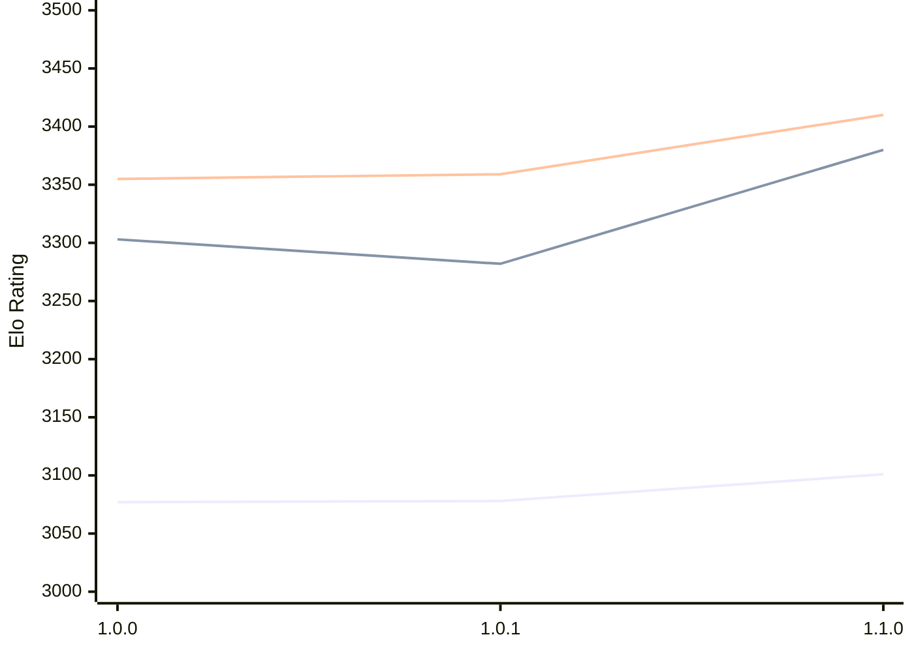

# Engine: Ursus

Author: Zander Chown

Home: https://github.com/zchown/Ursus

## Elo Ratings E1 (Ultra 7 265T (1.50 GHz) - E-Core)

| Version | Published | STC 8.0+0.08s  | LTC 60.0+0.60s | VLTC 2m24s+1.12s | Comment |
| --- | --- | --- | --- | --- | --- |
| 1.1.0 | 2026-08-18 | 3031 | 3382 | 3438 |  |
 | | | cElo (∆ prev) | cElo (∆ prev) | cElo (∆ prev) | 

## Elo Ratings P1 (Ultra 7 265T (1.50 GHz) - P-Core)

| Version | Published | STC 8.0+0.08s  | LTC 60.0+0.60s | VLTC 2m24s+1.12s | Comment |
| --- | --- | --- | --- | --- | --- |
| 1.1.0 | 2026-08-18 | 3255 | 3526 | 3571 |  |
 | | | cElo (∆ prev) | cElo (∆ prev) | cElo (∆ prev) | 

## Elo Ratings T1 (i5-7500T 2.70GHz)

| Version | Published | STC 8.0+0.08s  | LTC 60.0+0.60s | VLTC 2m24s+1.12s | Comment |
| --- | --- | --- | --- | --- | --- |
| 1.1.0 | 2026-08-18 | 3101(+23) | 3380(+98) | 3410(+51) |  |
| 1.0.1 | 2026-07-27 | 3078(+1) | 3282(-21) | 3359(+4) |  |
| 1.0.0 | 2026-06-30 | 3077 | 3303 | 3355 |  |
 | | | cElo (∆ prev) | cElo (∆ prev) | cElo (∆ prev) | 

<a href="https://github.com/computer-chess-index/cci/issues/new?template=submit-version.yml&title=[VERSION]+Ursus+<version>&body=###%20Engine%20name%0AUrsus%0A%0A###%20Version%0A1.1.0" target="_blank">Submit new version</a>

 Test Conditions:

GUI/CLI: <a href=https://github.com/cutechess/cutechess target="_blank">Cute-Chess</a> 
Elo Calculation: <a href=https://www.remi-coulom.fr/Bayesian-Elo/ target="_blank">Bayesian-Elo</a> 
CPU for P1: Intel(R) Core(TM) Ultra 7 265T (1.50 GHz) - P-Core 
CPU for E1: Intel(R) Core(TM) Ultra 7 265T (1.50 GHz) - E-Core 
CPU for T1: Intel(R) Core(TM) i5-7500T 2.70GHz 
Opening book: 8_moves_v3 
\* STC: 8.0+0.08s, LTC: 60.0+0.60s, VLTC: 2m24s+1.12s

 Lists:
Ratings: <a href=https://github.com/computer-chess-index/cci/blob/main/lists/CCIRatings.csv target="_blank">Complete list</a>

Generated: 2026-10-22 04:44:43

## Ratings Verlauf T1

## Detailed Evaluation Results

| Version | Time Control | Variant | Elo  | Range +/- | Matches | Score | Average Opponent Elo | Draws |
| --- | --- |--- | --- | --- | --- | --- | --- | --- |
| 1.1.0 | VLTC (2m24s+1.12s) | T1 | 3410 | 38 | 172 | 51% | 3402 | 73% |
|  |  | P1 | 3571 | 54 | 92 | 56% | 3488 | 66% |
|  |  | E1 | 3438 | 37 | 216 | 54% | 3345 | 56% |
|  | LTC (60.0+0.60s) | T1 | 3380 | 38 | 172 | 50% | 3378 | 69% |
|  |  | P1 | 3526 | 54 | 100 | 63% | 3393 | 61% |
|  |  | E1 | 3382 | 49 | 120 | 59% | 3285 | 56% |
|  | STC (8.0+0.08s) | T1 | 3101 | 35 | 220 | 48% | 3121 | 57% |
|  |  | P1 | 3255 | 49 | 130 | 46% | 3267 | 45% |
|  |  | E1 | 3031 | 48 | 140 | 56% | 2944 | 37% |
| --- | --- |--- | --- | --- | --- | --- | --- | --- |
| 1.0.1 | VLTC (2m24s+1.12s) | T1 | 3359 | 37 | 184 | 48% | 3370 | 68% |
|  | LTC (60.0+0.60s) | T1 | 3282 | 37 | 184 | 49% | 3285 | 66% |
|  | STC (8.0+0.08s) | T1 | 3078 | 46 | 132 | 52% | 3066 | 52% |
| --- | --- |--- | --- | --- | --- | --- | --- | --- |
| 1.0.0 | VLTC (2m24s+1.12s) | T1 | 3355 | 40 | 160 | 55% | 3309 | 71% |
|  | LTC (60.0+0.60s) | T1 | 3303 | 40 | 166 | 55% | 3252 | 62% |
|  | STC (8.0+0.08s) | T1 | 3077 | 49 | 120 | 55% | 3023 | 53% |