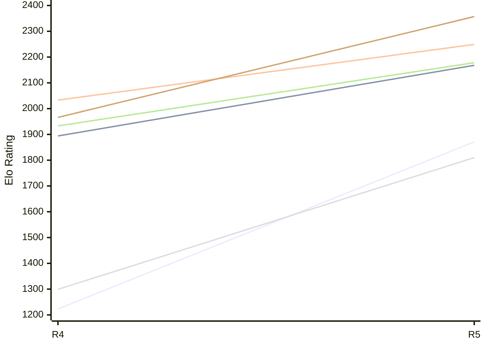
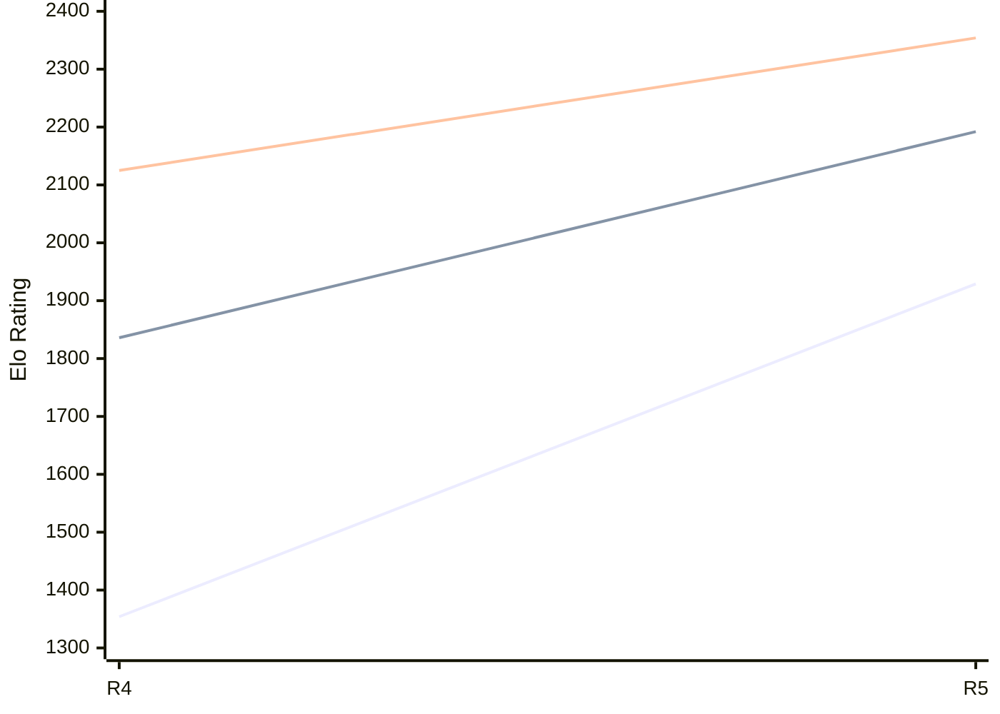

# Engine: Viking

Author: Dario Pendic

Home: https://github.com/nbqofficial/viking

## Elo Ratings E1 (Ultra 7 265T (1.50 GHz) - E-Core)

| Version | Published | STC 8.0+0.08s  | LTC 60.0+0.60s | VLTC 2m24s+1.12s | Comment |
| --- | --- | --- | --- | --- | --- |
| R5 | 2026-04-27 | 1871(+648) | 2168(+274) | 2249(+216) |  |
| R4 | 2026-04-22 | 1223 | 1894 | 2033 |  |
 | | | cElo (∆ prev) | cElo (∆ prev) | cElo (∆ prev) | 

## Elo Ratings P1 (Ultra 7 265T (1.50 GHz) - P-Core)

| Version | Published | STC 8.0+0.08s  | LTC 60.0+0.60s | VLTC 2m24s+1.12s | Comment |
| --- | --- | --- | --- | --- | --- |
| R5 | 2026-04-27 | 1810(+511) | 2178(+245) | 2357(+391) |  |
| R4 | 2026-04-22 | 1299 | 1933 | 1966 |  |
 | | | cElo (∆ prev) | cElo (∆ prev) | cElo (∆ prev) | 

## Elo Ratings T1 (i5-7500T 2.70GHz)

| Version | Published | STC 8.0+0.08s  | LTC 60.0+0.60s | VLTC 2m24s+1.12s | Comment |
| --- | --- | --- | --- | --- | --- |
| R5 | 2026-04-27 | 1929(+575) | 2192(+356) | 2354(+229) |  |
| R4 | 2026-04-22 | 1354 | 1836 | 2125 |  |
 | | | cElo (∆ prev) | cElo (∆ prev) | cElo (∆ prev) | 

<a href="https://github.com/computer-chess-index/cci/issues/new?template=submit-version.yml&title=[VERSION]+Viking+<version>&body=###%20Engine%20name%0AViking%0A%0A###%20Version%0AR5" target="_blank">Submit new version</a>

 Test Conditions:

GUI/CLI: <a href=https://github.com/cutechess/cutechess target="_blank">Cute-Chess</a> 
Elo Calculation: <a href=https://www.remi-coulom.fr/Bayesian-Elo/ target="_blank">Bayesian-Elo</a> 
CPU for P1: Intel(R) Core(TM) Ultra 7 265T (1.50 GHz) - P-Core 
CPU for E1: Intel(R) Core(TM) Ultra 7 265T (1.50 GHz) - E-Core 
CPU for T1: Intel(R) Core(TM) i5-7500T 2.70GHz 
Opening book: 8_moves_v3 
\* STC: 8.0+0.08s, LTC: 60.0+0.60s, VLTC: 2m24s+1.12s

 Lists:
Ratings: <a href=https://github.com/computer-chess-index/cci/blob/main/lists/CCIRatings.csv target="_blank">Complete list</a>

Generated: 2026-11-14 05:43:49

## Ratings Verlauf E1 / P1

## Ratings Verlauf T1

## Detailed Evaluation Results

| Version | Time Control | Variant | Elo  | Range +/- | Matches | Score | Average Opponent Elo | Draws |
| --- | --- |--- | --- | --- | --- | --- | --- | --- |
| R5 | VLTC (2m24s+1.12s) | T1 | 2354 | 26 | 482 | 49% | 2367 | 33% |
|  |  | P1 | 2357 | 37 | 250 | 43% | 2430 | 30% |
|  |  | E1 | 2249 | 34 | 306 | 51% | 2250 | 27% |
|  | LTC (60.0+0.60s) | T1 | 2192 | 28 | 450 | 51% | 2174 | 29% |
|  |  | P1 | 2178 | 41 | 204 | 47% | 2237 | 30% |
|  |  | E1 | 2168 | 34 | 298 | 46% | 2229 | 30% |
|  | STC (8.0+0.08s) | T1 | 1929 | 26 | 542 | 50% | 1935 | 20% |
|  |  | P1 | 1810 | 41 | 206 | 49% | 1823 | 23% |
|  |  | E1 | 1871 | 30 | 380 | 46% | 1928 | 30% |
| --- | --- |--- | --- | --- | --- | --- | --- | --- |
| R4 | VLTC (2m24s+1.12s) | P1 | 1966 | 97 | 44 | 36% | 2159 | 27% |
|  |  | E1 | 2033 | 93 | 50 | 30% | 2342 | 20% |
|  |  | T1 | 2125 | 31 | 372 | 41% | 2236 | 28% |
|  | LTC (60.0+0.60s) | E1 | 1894 | 87 | 56 | 30% | 2175 | 18% |
|  |  | T1 | 1836 | 36 | 298 | 46% | 1906 | 23% |
|  |  | P1 | 1933 | 97 | 40 | 35% | 2083 | 15% |
|  | STC (8.0+0.08s) | E1 | 1223 | 63 | 98 | 45% | 1293 | 12% |
|  |  | T1 | 1354 | 38 | 288 | 47% | 1418 | 19% |
|  |  | P1 | 1299 | 111 | 48 | 13% | 1926 | 21% |