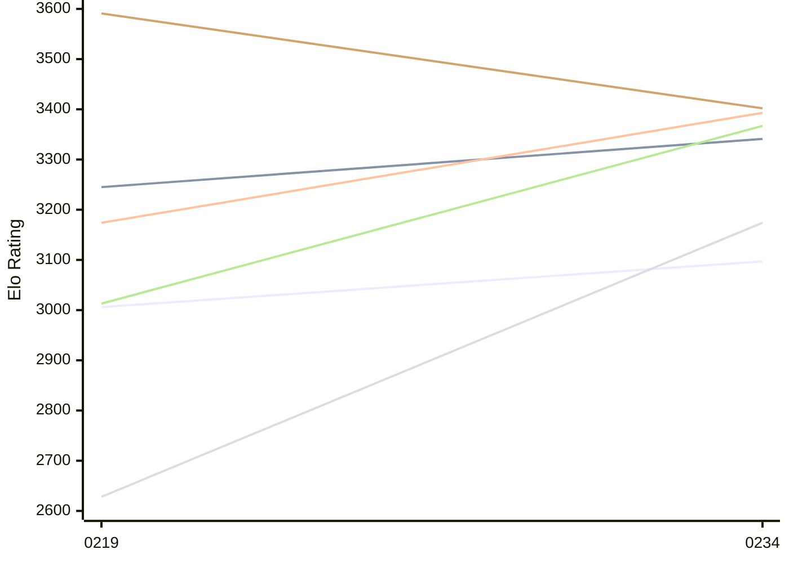
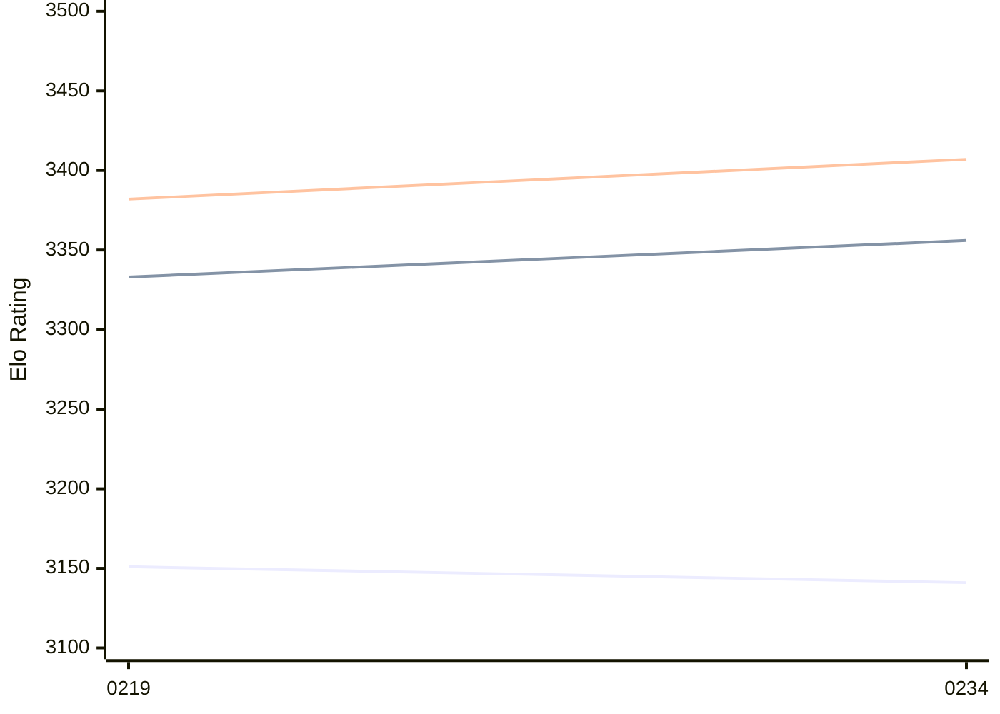

# Engine: Ynode

Author: oozturk777

Home: https://github.com/oozturk777/ynode

## Elo Ratings E1 (Ultra 7 265T (1.50 GHz) - E-Core)

| Version | Published | STC 8.0+0.08s  | LTC 60.0+0.60s | VLTC 2m24s+1.12s | Comment |
| --- | --- | --- | --- | --- | --- |
| 0234 | 2026-03-22 | 3097(+91) | 3341(+96) | 3393(+219) |  |
| 0219 | 2025-11-16 | 3006 | 3245 | 3174 |  |
 | | | cElo (∆ prev) | cElo (∆ prev) | cElo (∆ prev) | 

## Elo Ratings P1 (Ultra 7 265T (1.50 GHz) - P-Core)

| Version | Published | STC 8.0+0.08s  | LTC 60.0+0.60s | VLTC 2m24s+1.12s | Comment |
| --- | --- | --- | --- | --- | --- |
| 0234 | 2026-03-22 | 3174(+546) | 3367(+354) | 3402(-189) |  |
| 0219 | 2025-11-16 | 2628 | 3013 | 3591 |  |
 | | | cElo (∆ prev) | cElo (∆ prev) | cElo (∆ prev) | 

## Elo Ratings T1 (i5-7500T 2.70GHz)

| Version | Published | STC 8.0+0.08s  | LTC 60.0+0.60s | VLTC 2m24s+1.12s | Comment |
| --- | --- | --- | --- | --- | --- |
| 0234 | 2026-03-22 | 3141(-10) | 3356(+23) | 3407(+25) |  |
| 0219 | 2025-11-16 | 3151 | 3333 | 3382 |  |
 | | | cElo (∆ prev) | cElo (∆ prev) | cElo (∆ prev) | 

<a href="https://github.com/computer-chess-index/cci/issues/new?template=submit-version.yml&title=[VERSION]+Ynode+<version>&body=###%20Engine%20name%0AYnode%0A%0A###%20Version%0A0234" target="_blank">Submit new version</a>

 Test Conditions:

GUI/CLI: <a href=https://github.com/cutechess/cutechess target="_blank">Cute-Chess</a> 
Elo Calculation: <a href=https://www.remi-coulom.fr/Bayesian-Elo/ target="_blank">Bayesian-Elo</a> 
CPU for P1: Intel(R) Core(TM) Ultra 7 265T (1.50 GHz) - P-Core 
CPU for E1: Intel(R) Core(TM) Ultra 7 265T (1.50 GHz) - E-Core 
CPU for T1: Intel(R) Core(TM) i5-7500T 2.70GHz 
Opening book: 8_moves_v3 
\* STC: 8.0+0.08s, LTC: 60.0+0.60s, VLTC: 2m24s+1.12s

 Lists:
Ratings: <a href=https://github.com/computer-chess-index/cci/blob/main/lists/CCIRatings.csv target="_blank">Complete list</a>

Generated: 2026-11-13 05:44:34

## Ratings Verlauf E1 / P1

## Ratings Verlauf T1

## Detailed Evaluation Results

| Version | Time Control | Variant | Elo  | Range +/- | Matches | Score | Average Opponent Elo | Draws |
| --- | --- |--- | --- | --- | --- | --- | --- | --- |
| 0234 | VLTC (2m24s+1.12s) | T1 | 3407 | 25 | 382 | 50% | 3409 | 81% |
|  |  | P1 | 3402 | 33 | 226 | 54% | 3353 | 73% |
|  |  | E1 | 3393 | 25 | 436 | 58% | 3281 | 67% |
|  | LTC (60.0+0.60s) | T1 | 3356 | 24 | 416 | 51% | 3347 | 74% |
|  |  | P1 | 3367 | 30 | 294 | 54% | 3316 | 69% |
|  |  | E1 | 3341 | 28 | 342 | 55% | 3268 | 68% |
|  | STC (8.0+0.08s) | T1 | 3141 | 23 | 524 | 50% | 3140 | 57% |
|  |  | P1 | 3174 | 33 | 250 | 49% | 3182 | 61% |
|  |  | E1 | 3097 | 25 | 438 | 47% | 3121 | 55% |
| --- | --- |--- | --- | --- | --- | --- | --- | --- |
| 0219 | VLTC (2m24s+1.12s) | P1 | 3591 | 294 | 12 | 100% | 2959 | 0% |
|  |  | E1 | 3174 | 141 | 12 | 50% | 3177 | 50% |
|  |  | T1 | 3382 | 27 | 336 | 52% | 3357 | 79% |
|  | LTC (60.0+0.60s) | E1 | 3245 | 203 | 24 | 94% | 2337 | 4% |
|  |  | T1 | 3333 | 25 | 406 | 49% | 3326 | 72% |
|  |  | P1 | 3013 | 161 | 16 | 88% | 2584 | 25% |
|  | STC (8.0+0.08s) | E1 | 3006 | 114 | 26 | 58% | 2901 | 38% |
|  |  | T1 | 3151 | 24 | 490 | 53% | 3105 | 57% |
|  |  | P1 | 2628 | 213 | 12 | 42% | 2543 | 17% |