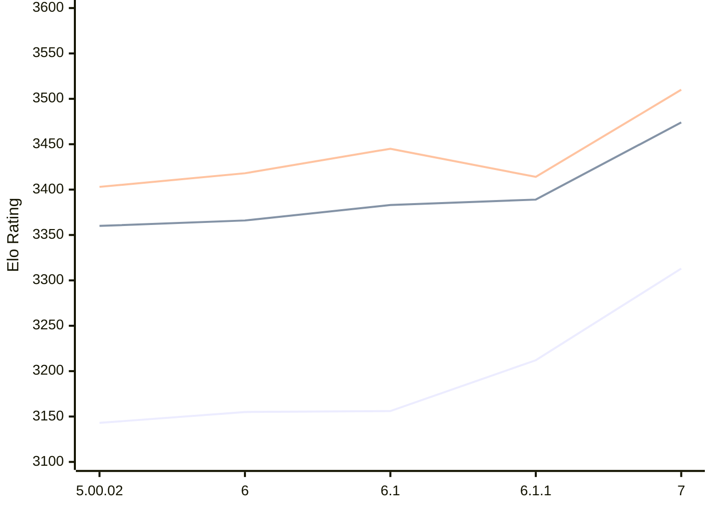

# Engine: Zangdar

Author: Carbecq

Home: https://github.com/Carbecq/Zangdar

## Elo Ratings E1 (Ultra 7 265T (1.50 GHz) - E-Core)

| Version | Published | STC 8.0+0.08s  | LTC 60.0+0.60s | VLTC 2m24s+1.12s | Comment |
| --- | --- | --- | --- | --- | --- |
| 7 | 2026-07-13 | 3222 | 3437 | 3505 |  |
 | | | cElo (∆ prev) | cElo (∆ prev) | cElo (∆ prev) | 

## Elo Ratings P1 (Ultra 7 265T (1.50 GHz) - P-Core)

| Version | Published | STC 8.0+0.08s  | LTC 60.0+0.60s | VLTC 2m24s+1.12s | Comment |
| --- | --- | --- | --- | --- | --- |
| 7 | 2026-07-13 | 3411 | 3619 | 3673 |  |
 | | | cElo (∆ prev) | cElo (∆ prev) | cElo (∆ prev) | 

## Elo Ratings T1 (i5-7500T 2.70GHz)

| Version | Published | STC 8.0+0.08s  | LTC 60.0+0.60s | VLTC 2m24s+1.12s | Comment |
| --- | --- | --- | --- | --- | --- |
| 7 | 2026-07-13 | 3313(+101) | 3474(+85) | 3510(+96) |  |
| 6.1.1 | 2026-02-25 | 3212(+56) | 3389(+6) | 3414(-31) |  |
| 6.1 | 2026-02-10 | 3156(+1) | 3383(+17) | 3445(+27) |  |
| 6 | 2026-02-07 | 3155(+12) | 3366(+6) | 3418(+15) |  |
| 5.00.02 | 2025-09-24 | 3143 | 3360 | 3403 |  |
 | | | cElo (∆ prev) | cElo (∆ prev) | cElo (∆ prev) | 

<a href="https://github.com/computer-chess-index/cci/issues/new?template=submit-version.yml&title=[VERSION]+Zangdar+<version>&body=###%20Engine%20name%0AZangdar%0A%0A###%20Version%0A7" target="_blank">Submit new version</a>

 Test Conditions:

GUI/CLI: <a href=https://github.com/cutechess/cutechess target="_blank">Cute-Chess</a> 
Elo Calculation: <a href=https://www.remi-coulom.fr/Bayesian-Elo/ target="_blank">Bayesian-Elo</a> 
CPU for P1: Intel(R) Core(TM) Ultra 7 265T (1.50 GHz) - P-Core 
CPU for E1: Intel(R) Core(TM) Ultra 7 265T (1.50 GHz) - E-Core 
CPU for T1: Intel(R) Core(TM) i5-7500T 2.70GHz 
Opening book: 8_moves_v3 
\* STC: 8.0+0.08s, LTC: 60.0+0.60s, VLTC: 2m24s+1.12s

 Lists:
Ratings: <a href=https://github.com/computer-chess-index/cci/blob/main/lists/CCIRatings.csv target="_blank">Complete list</a>

Generated: 2026-10-14 04:45:04

## Ratings Verlauf T1

## Detailed Evaluation Results

| Version | Time Control | Variant | Elo  | Range +/- | Matches | Score | Average Opponent Elo | Draws |
| --- | --- |--- | --- | --- | --- | --- | --- | --- |
| 7 | VLTC (2m24s+1.12s) | T1 | 3510 | 35 | 196 | 49% | 3513 | 81% |
|  |  | P1 | 3673 | 38 | 172 | 56% | 3599 | 73% |
|  |  | E1 | 3505 | 36 | 208 | 60% | 3352 | 71% |
|  | LTC (60.0+0.60s) | P1 | 3619 | 40 | 172 | 57% | 3494 | 65% |
|  |  | E1 | 3437 | 40 | 192 | 64% | 3204 | 57% |
|  |  | T1 | 3474 | 36 | 186 | 51% | 3468 | 78% |
|  | STC (8.0+0.08s) | P1 | 3411 | 33 | 248 | 49% | 3422 | 62% |
|  |  | E1 | 3222 | 30 | 296 | 46% | 3255 | 64% |
|  |  | T1 | 3313 | 27 | 352 | 50% | 3310 | 68% |
| --- | --- |--- | --- | --- | --- | --- | --- | --- |
| 6.1.1 | VLTC (2m24s+1.12s) | T1 | 3414 | 25 | 394 | 50% | 3411 | 75% |
|  | LTC (60.0+0.60s) | T1 | 3389 | 26 | 364 | 51% | 3384 | 70% |
|  | STC (8.0+0.08s) | T1 | 3212 | 25 | 444 | 51% | 3208 | 55% |
| --- | --- |--- | --- | --- | --- | --- | --- | --- |
| 6.1 | VLTC (2m24s+1.12s) | T1 | 3445 | 31 | 256 | 50% | 3443 | 77% |
|  | LTC (60.0+0.60s) | T1 | 3383 | 27 | 332 | 49% | 3387 | 75% |
|  | STC (8.0+0.08s) | T1 | 3156 | 32 | 276 | 51% | 3150 | 48% |
| --- | --- |--- | --- | --- | --- | --- | --- | --- |
| 6 | VLTC (2m24s+1.12s) | T1 | 3418 | 36 | 192 | 50% | 3418 | 76% |
|  | LTC (60.0+0.60s) | T1 | 3366 | 33 | 228 | 52% | 3356 | 71% |
|  | STC (8.0+0.08s) | T1 | 3155 | 34 | 244 | 49% | 3160 | 52% |
| --- | --- |--- | --- | --- | --- | --- | --- | --- |
| 5.00.02 | VLTC (2m24s+1.12s) | T1 | 3403 | 27 | 356 | 54% | 3366 | 74% |
|  | LTC (60.0+0.60s) | T1 | 3360 | 31 | 272 | 51% | 3340 | 71% |
|  | STC (8.0+0.08s) | T1 | 3143 | 32 | 280 | 55% | 3086 | 59% |