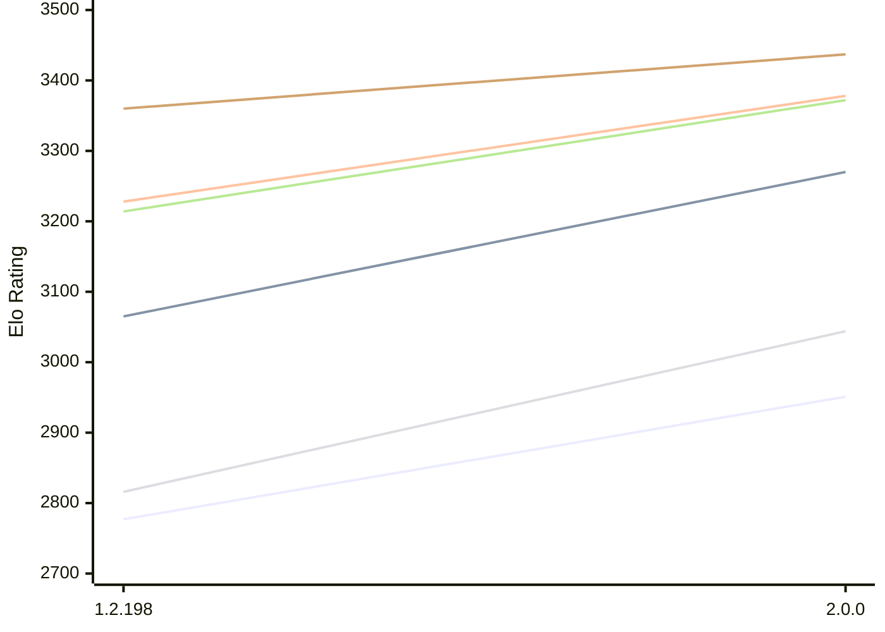

# Engine: Zenith

Author: Jonny Reckless

Home: https://github.com/jonny-reckless/zenith

## Elo Ratings E1 (Ultra 7 265T (1.50 GHz) - E-Core)

| Version | Published | STC 8.0+0.08s  | LTC 60.0+0.60s | VLTC 2m24s+1.12s | Comment |
| --- | --- | --- | --- | --- | --- |
| 2.0.0 | 2026-10-15 | 2951(+174) | 3270(+205) | 3378(+150) |  |
| 1.2.198 | 2026-08-01 | 2777 | 3065 | 3228 |  |
 | | | cElo (∆ prev) | cElo (∆ prev) | cElo (∆ prev) | 

## Elo Ratings P1 (Ultra 7 265T (1.50 GHz) - P-Core)

| Version | Published | STC 8.0+0.08s  | LTC 60.0+0.60s | VLTC 2m24s+1.12s | Comment |
| --- | --- | --- | --- | --- | --- |
| 2.0.0 | 2026-10-15 | 3044(+228) | 3372(+158) | 3437(+77) |  |
| 1.2.198 | 2026-08-01 | 2816 | 3214 | 3360 |  |
 | | | cElo (∆ prev) | cElo (∆ prev) | cElo (∆ prev) | 

## Elo Ratings T1 (i5-7500T 2.70GHz)

| Version | Published | STC 8.0+0.08s  | LTC 60.0+0.60s | VLTC 2m24s+1.12s | Comment |
| --- | --- | --- | --- | --- | --- |
| 1.2.198 | 2026-08-01 | 3067 | 3339 | 3387 |  |
 | | | cElo (∆ prev) | cElo (∆ prev) | cElo (∆ prev) | 

<a href="https://github.com/computer-chess-index/cci/issues/new?template=submit-version.yml&title=[VERSION]+Zenith+<version>&body=###%20Engine%20name%0AZenith%0A%0A###%20Version%0A1.2.198" target="_blank">Submit new version</a>

 Test Conditions:

GUI/CLI: <a href=https://github.com/cutechess/cutechess target="_blank">Cute-Chess</a> 
Elo Calculation: <a href=https://www.remi-coulom.fr/Bayesian-Elo/ target="_blank">Bayesian-Elo</a> 
CPU for P1: Intel(R) Core(TM) Ultra 7 265T (1.50 GHz) - P-Core 
CPU for E1: Intel(R) Core(TM) Ultra 7 265T (1.50 GHz) - E-Core 
CPU for T1: Intel(R) Core(TM) i5-7500T 2.70GHz 
Opening book: 8_moves_v3 
\* STC: 8.0+0.08s, LTC: 60.0+0.60s, VLTC: 2m24s+1.12s

 Lists:
Ratings: <a href=https://github.com/computer-chess-index/cci/blob/main/lists/CCIRatings.csv target="_blank">Complete list</a>

Generated: 2026-10-19 04:45:02

## Ratings Verlauf E1 / P1

## Detailed Evaluation Results

| Version | Time Control | Variant | Elo  | Range +/- | Matches | Score | Average Opponent Elo | Draws |
| --- | --- |--- | --- | --- | --- | --- | --- | --- |
| 2.0.0 | VLTC (2m24s+1.12s) | P1 | 3437 | 37 | 184 | 51% | 3428 | 68% |
|  |  | E1 | 3378 | 33 | 232 | 49% | 3380 | 66% |
|  | LTC (60.0+0.60s) | P1 | 3372 | 44 | 130 | 54% | 3347 | 68% |
|  |  | E1 | 3270 | 38 | 186 | 53% | 3244 | 62% |
|  | STC (8.0+0.08s) | P1 | 3044 | 42 | 172 | 54% | 3006 | 42% |
|  |  | E1 | 2951 | 42 | 168 | 54% | 2907 | 45% |
| --- | --- |--- | --- | --- | --- | --- | --- | --- |
| 1.2.198 | VLTC (2m24s+1.12s) | T1 | 3387 | 31 | 272 | 51% | 3363 | 69% |
|  |  | P1 | 3360 | 33 | 252 | 44% | 3401 | 61% |
|  |  | E1 | 3228 | 29 | 326 | 41% | 3301 | 62% |
|  | LTC (60.0+0.60s) | T1 | 3339 | 34 | 236 | 54% | 3266 | 64% |
|  |  | P1 | 3214 | 32 | 288 | 39% | 3299 | 55% |
|  |  | E1 | 3065 | 28 | 370 | 39% | 3156 | 51% |
|  | STC (8.0+0.08s) | P1 | 2816 | 45 | 180 | 59% | 2724 | 26% |
|  |  | E1 | 2777 | 34 | 308 | 64% | 2649 | 29% |
|  |  | T1 | 3067 | 26 | 424 | 47% | 3067 | 54% |