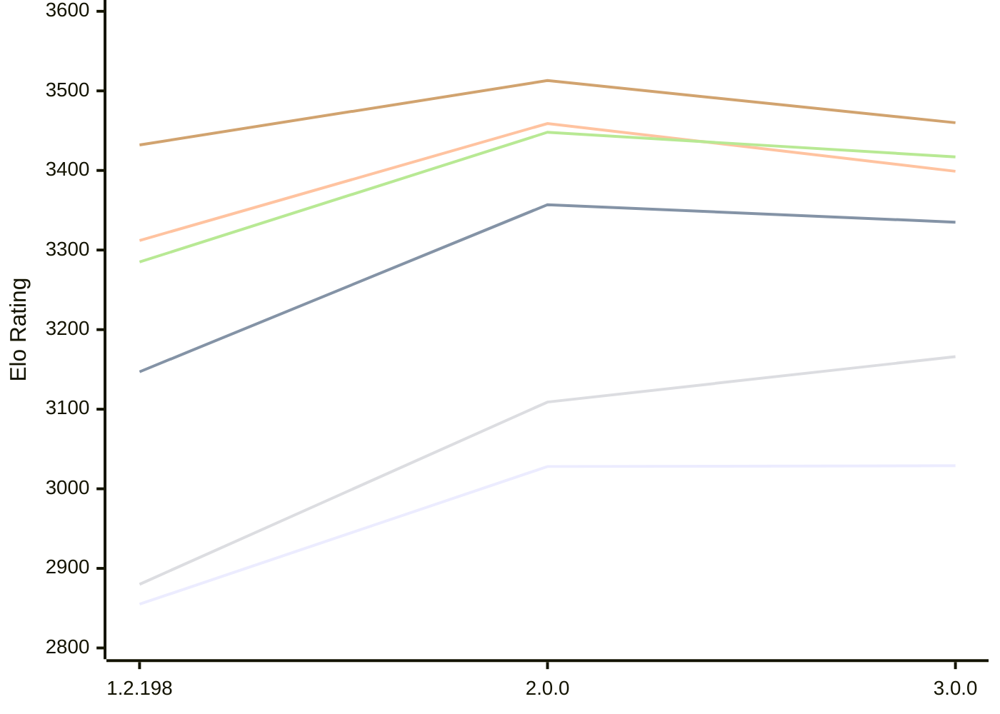

# Engine: Zenith

Author: Jonny Reckless

Home: https://github.com/jonny-reckless/zenith

## Elo Ratings E1 (Ultra 7 265T (1.50 GHz) - E-Core)

| Version | Published | STC 8.0+0.08s  | LTC 60.0+0.60s | VLTC 2m24s+1.12s | Comment |
| --- | --- | --- | --- | --- | --- |
| 3.0.0 | 2026-10-30 | 3029(+1) | 3335(-22) | 3399(-60) |  |
| 2.0.0 | 2026-10-15 | 3028(+173) | 3357(+210) | 3459(+147) |  |
| 1.2.198 | 2026-08-01 | 2855 | 3147 | 3312 |  |
 | | | cElo (∆ prev) | cElo (∆ prev) | cElo (∆ prev) | 

## Elo Ratings P1 (Ultra 7 265T (1.50 GHz) - P-Core)

| Version | Published | STC 8.0+0.08s  | LTC 60.0+0.60s | VLTC 2m24s+1.12s | Comment |
| --- | --- | --- | --- | --- | --- |
| 3.0.0 | 2026-10-30 | 3166(+57) | 3417(-31) | 3460(-53) |  |
| 2.0.0 | 2026-10-15 | 3109(+229) | 3448(+163) | 3513(+81) |  |
| 1.2.198 | 2026-08-01 | 2880 | 3285 | 3432 |  |
 | | | cElo (∆ prev) | cElo (∆ prev) | cElo (∆ prev) | 

## Elo Ratings T1 (i5-7500T 2.70GHz)

| Version | Published | STC 8.0+0.08s  | LTC 60.0+0.60s | VLTC 2m24s+1.12s | Comment |
| --- | --- | --- | --- | --- | --- |
| 1.2.198 | 2026-08-01 | 3067 | 3339 | 3387 |  |
 | | | cElo (∆ prev) | cElo (∆ prev) | cElo (∆ prev) | 

<a href="https://github.com/computer-chess-index/cci/issues/new?template=submit-version.yml&title=[VERSION]+Zenith+<version>&body=###%20Engine%20name%0AZenith%0A%0A###%20Version%0A1.2.198" target="_blank">Submit new version</a>

 Test Conditions:

GUI/CLI: <a href=https://github.com/cutechess/cutechess target="_blank">Cute-Chess</a> 
Elo Calculation: <a href=https://www.remi-coulom.fr/Bayesian-Elo/ target="_blank">Bayesian-Elo</a> 
CPU for P1: Intel(R) Core(TM) Ultra 7 265T (1.50 GHz) - P-Core 
CPU for E1: Intel(R) Core(TM) Ultra 7 265T (1.50 GHz) - E-Core 
CPU for T1: Intel(R) Core(TM) i5-7500T 2.70GHz 
Opening book: 8_moves_v3 
\* STC: 8.0+0.08s, LTC: 60.0+0.60s, VLTC: 2m24s+1.12s

 Lists:
Ratings: <a href=https://github.com/computer-chess-index/cci/blob/main/lists/CCIRatings.csv target="_blank">Complete list</a>

Generated: 2026-11-03 05:44:36

## Ratings Verlauf E1 / P1

## Detailed Evaluation Results

| Version | Time Control | Variant | Elo  | Range +/- | Matches | Score | Average Opponent Elo | Draws |
| --- | --- |--- | --- | --- | --- | --- | --- | --- |
| 3.0.0 | VLTC (2m24s+1.12s) | P1 | 3460 | 52 | 88 | 49% | 3468 | 82% |
|  |  | E1 | 3399 | 36 | 196 | 50% | 3398 | 68% |
|  | LTC (60.0+0.60s) | P1 | 3417 | 38 | 180 | 53% | 3397 | 62% |
|  |  | E1 | 3335 | 30 | 300 | 54% | 3305 | 61% |
|  | STC (8.0+0.08s) | P1 | 3166 | 53 | 96 | 48% | 3175 | 59% |
|  |  | E1 | 3029 | 40 | 186 | 49% | 3033 | 43% |
| --- | --- |--- | --- | --- | --- | --- | --- | --- |
| 2.0.0 | VLTC (2m24s+1.12s) | P1 | 3513 | 34 | 224 | 51% | 3502 | 70% |
|  |  | E1 | 3459 | 29 | 300 | 49% | 3464 | 66% |
|  | LTC (60.0+0.60s) | P1 | 3448 | 39 | 174 | 53% | 3425 | 66% |
|  |  | E1 | 3357 | 32 | 266 | 52% | 3340 | 62% |
|  | STC (8.0+0.08s) | P1 | 3109 | 40 | 192 | 53% | 3078 | 44% |
|  |  | E1 | 3028 | 38 | 208 | 53% | 2997 | 44% |
| --- | --- |--- | --- | --- | --- | --- | --- | --- |
| 1.2.198 | VLTC (2m24s+1.12s) | T1 | 3387 | 31 | 272 | 51% | 3363 | 69% |
|  |  | P1 | 3432 | 33 | 252 | 44% | 3471 | 61% |
|  |  | E1 | 3312 | 29 | 326 | 41% | 3383 | 62% |
|  | LTC (60.0+0.60s) | T1 | 3339 | 34 | 236 | 54% | 3266 | 64% |
|  |  | P1 | 3285 | 32 | 288 | 39% | 3370 | 55% |
|  |  | E1 | 3147 | 28 | 370 | 39% | 3239 | 51% |
|  | STC (8.0+0.08s) | T1 | 3067 | 26 | 424 | 47% | 3067 | 54% |
|  |  | P1 | 2880 | 45 | 180 | 59% | 2786 | 26% |
|  |  | E1 | 2855 | 34 | 308 | 64% | 2726 | 29% |