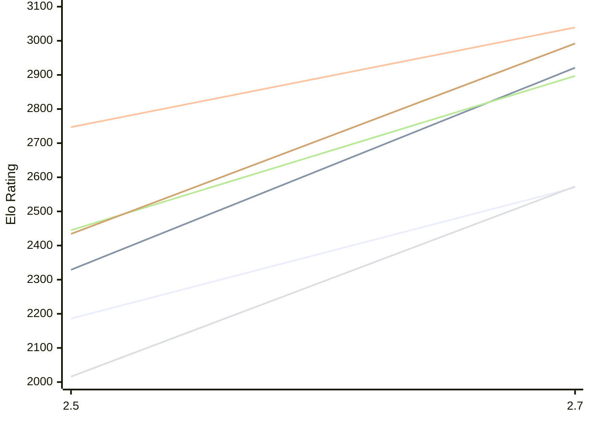
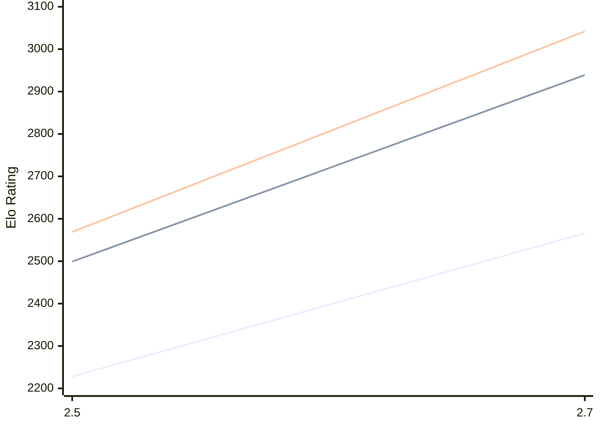

# Engine: Zevra

Author: Oleg Smirnov

Home: https://github.com/sovaz1997/Zevra2

## Elo Ratings E1 (Ultra 7 265T (1.50 GHz) - E-Core)

| Version | Published | STC 8.0+0.08s  | LTC 60.0+0.60s | VLTC 2m24s+1.12s | Comment |
| --- | --- | --- | --- | --- | --- |
| 2.7 | 2026-08-30 | 2570(+384) | 2921(+592) | 3039(+292) |  |
| 2.5 | 2021-09-20 | 2186 | 2329 | 2747 |  |
 | | | cElo (∆ prev) | cElo (∆ prev) | cElo (∆ prev) | 

## Elo Ratings P1 (Ultra 7 265T (1.50 GHz) - P-Core)

| Version | Published | STC 8.0+0.08s  | LTC 60.0+0.60s | VLTC 2m24s+1.12s | Comment |
| --- | --- | --- | --- | --- | --- |
| 2.7 | 2026-08-30 | 2573(+557) | 2897(+452) | 2992(+558) |  |
| 2.5 | 2021-09-20 | 2016 | 2445 | 2434 |  |
 | | | cElo (∆ prev) | cElo (∆ prev) | cElo (∆ prev) | 

## Elo Ratings T1 (i5-7500T 2.70GHz)

| Version | Published | STC 8.0+0.08s  | LTC 60.0+0.60s | VLTC 2m24s+1.12s | Comment |
| --- | --- | --- | --- | --- | --- |
| 2.7 | 2026-08-30 | 2566(+338) | 2939(+440) | 3042(+473) |  |
| 2.5 | 2021-09-20 | 2228 | 2499 | 2569 |  |
 | | | cElo (∆ prev) | cElo (∆ prev) | cElo (∆ prev) | 

<a href="https://github.com/computer-chess-index/cci/issues/new?template=submit-version.yml&title=[VERSION]+Zevra+<version>&body=###%20Engine%20name%0AZevra%0A%0A###%20Version%0A2.7" target="_blank">Submit new version</a>

 Test Conditions:

GUI/CLI: <a href=https://github.com/cutechess/cutechess target="_blank">Cute-Chess</a> 
Elo Calculation: <a href=https://www.remi-coulom.fr/Bayesian-Elo/ target="_blank">Bayesian-Elo</a> 
CPU for P1: Intel(R) Core(TM) Ultra 7 265T (1.50 GHz) - P-Core 
CPU for E1: Intel(R) Core(TM) Ultra 7 265T (1.50 GHz) - E-Core 
CPU for T1: Intel(R) Core(TM) i5-7500T 2.70GHz 
Opening book: 8_moves_v3 
\* STC: 8.0+0.08s, LTC: 60.0+0.60s, VLTC: 2m24s+1.12s

 Lists:
Ratings: <a href=https://github.com/computer-chess-index/cci/blob/main/lists/CCIRatings.csv target="_blank">Complete list</a>

Generated: 2026-11-14 05:44:22

## Ratings Verlauf E1 / P1

## Ratings Verlauf T1

## Detailed Evaluation Results

| Version | Time Control | Variant | Elo  | Range +/- | Matches | Score | Average Opponent Elo | Draws |
| --- | --- |--- | --- | --- | --- | --- | --- | --- |
| 2.7 | VLTC (2m24s+1.12s) | T1 | 3042 | 30 | 304 | 50% | 3040 | 54% |
|  |  | E1 | 3039 | 26 | 416 | 48% | 3060 | 51% |
|  |  | P1 | 2992 | 34 | 252 | 50% | 3000 | 47% |
|  | LTC (60.0+0.60s) | P1 | 2897 | 34 | 264 | 49% | 2903 | 43% |
|  |  | T1 | 2939 | 32 | 296 | 53% | 2915 | 41% |
|  |  | E1 | 2921 | 28 | 366 | 47% | 2947 | 49% |
|  | STC (8.0+0.08s) | P1 | 2573 | 31 | 326 | 49% | 2585 | 36% |
|  |  | T1 | 2566 | 35 | 268 | 51% | 2560 | 30% |
|  |  | E1 | 2570 | 29 | 380 | 49% | 2577 | 31% |
| --- | --- |--- | --- | --- | --- | --- | --- | --- |
| 2.5 | VLTC (2m24s+1.12s) | T1 | 2569 | 33 | 316 | 52% | 2526 | 29% |
|  |  | E1 | 2747 | 91 | 42 | 51% | 2736 | 31% |
|  |  | P1 | 2434 | 138 | 32 | 52% | 2345 | 9% |
|  | LTC (60.0+0.60s) | P1 | 2445 | 105 | 28 | 48% | 2462 | 32% |
|  |  | T1 | 2499 | 14 | 1812 | 51% | 2488 | 27% |
|  |  | E1 | 2329 | 79 | 60 | 60% | 2246 | 20% |
|  | STC (8.0+0.08s) | P1 | 2016 | 106 | 40 | 35% | 2218 | 10% |
|  |  | T1 | 2228 | 14 | 1898 | 51% | 2214 | 23% |
|  |  | E1 | 2186 | 92 | 48 | 42% | 2345 | 21% |