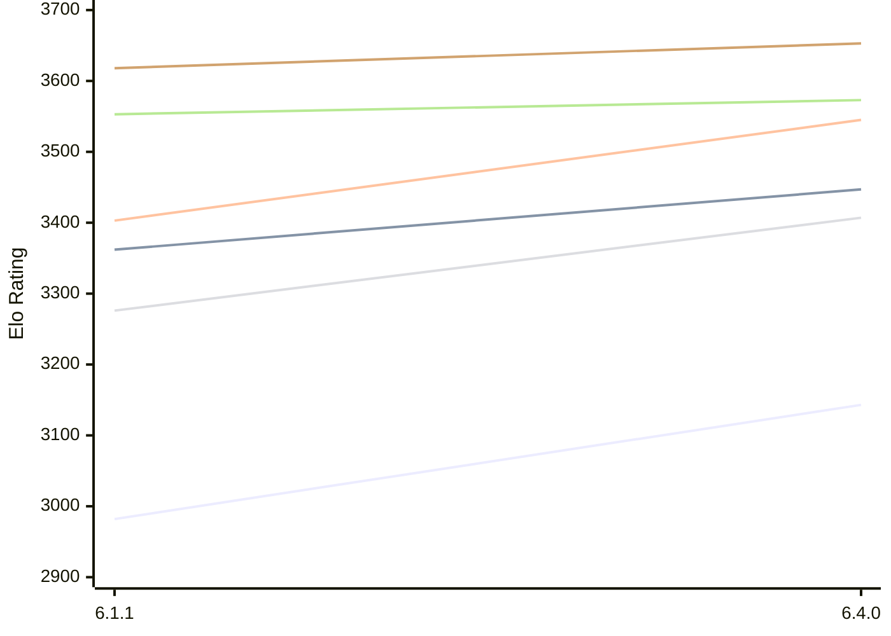
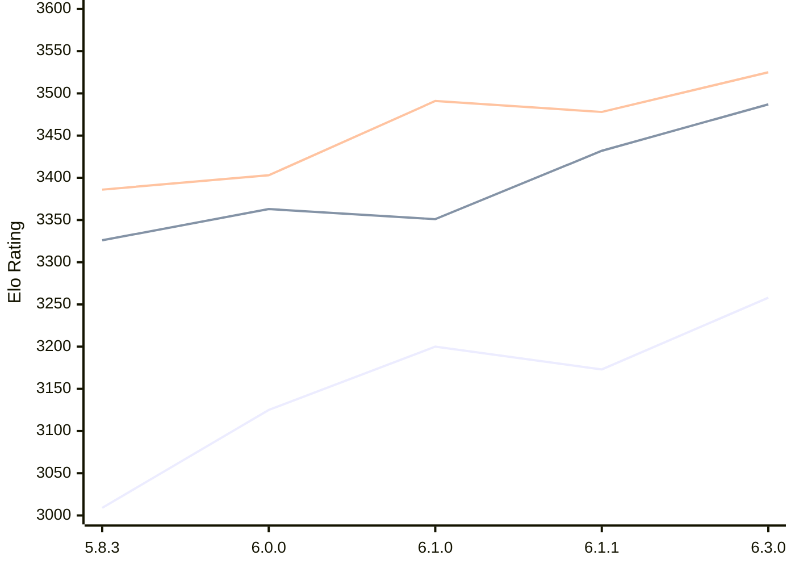

# Engine: Zigqueen

Author: Matthias Stier

Home: https://github.com/stierms/zigqueen

## Elo Ratings E1 (Ultra 7 265T (1.50 GHz) - E-Core)

| Version | Published | STC 8.0+0.08s  | LTC 60.0+0.60s | VLTC 2m24s+1.12s | Comment |
| --- | --- | --- | --- | --- | --- |
| 6.4.0 | 2026-10-10 | 3143(+161) | 3447(+85) | 3545(+142) |  |
| 6.1.1 | 2026-09-03 | 2982 | 3362 | 3403 |  |
 | | | cElo (∆ prev) | cElo (∆ prev) | cElo (∆ prev) | 

## Elo Ratings P1 (Ultra 7 265T (1.50 GHz) - P-Core)

| Version | Published | STC 8.0+0.08s  | LTC 60.0+0.60s | VLTC 2m24s+1.12s | Comment |
| --- | --- | --- | --- | --- | --- |
| 6.4.0 | 2026-10-10 | 3407(+131) | 3573(+20) | 3653(+35) |  |
| 6.1.1 | 2026-09-03 | 3276 | 3553 | 3618 |  |
 | | | cElo (∆ prev) | cElo (∆ prev) | cElo (∆ prev) | 

## Elo Ratings T1 (i5-7500T 2.70GHz)

| Version | Published | STC 8.0+0.08s  | LTC 60.0+0.60s | VLTC 2m24s+1.12s | Comment |
| --- | --- | --- | --- | --- | --- |
| 6.3.0 | 2026-09-25 | 3258(+85) | 3487(+55) | 3525(+47) |  |
| 6.1.1 | 2026-09-03 | 3173(-27) | 3432(+81) | 3478(-13) |  |
| 6.1.0 | 2026-08-31 | 3200(+75) | 3351(-12) | 3491(+88) |  |
| 6.0.0 | 2026-08-19 | 3125(+116) | 3363(+37) | 3403(+17) |  |
| 5.8.3 | 2026-07-25 | 3009 | 3326 | 3386 |  |
 | | | cElo (∆ prev) | cElo (∆ prev) | cElo (∆ prev) | 

<a href="https://github.com/computer-chess-index/cci/issues/new?template=submit-version.yml&title=[VERSION]+Zigqueen+<version>&body=###%20Engine%20name%0AZigqueen%0A%0A###%20Version%0A6.3.0" target="_blank">Submit new version</a>

 Test Conditions:

GUI/CLI: <a href=https://github.com/cutechess/cutechess target="_blank">Cute-Chess</a> 
Elo Calculation: <a href=https://www.remi-coulom.fr/Bayesian-Elo/ target="_blank">Bayesian-Elo</a> 
CPU for P1: Intel(R) Core(TM) Ultra 7 265T (1.50 GHz) - P-Core 
CPU for E1: Intel(R) Core(TM) Ultra 7 265T (1.50 GHz) - E-Core 
CPU for T1: Intel(R) Core(TM) i5-7500T 2.70GHz 
Opening book: 8_moves_v3 
\* STC: 8.0+0.08s, LTC: 60.0+0.60s, VLTC: 2m24s+1.12s

 Lists:
Ratings: <a href=https://github.com/computer-chess-index/cci/blob/main/lists/CCIRatings.csv target="_blank">Complete list</a>

Generated: 2026-10-16 04:45:44

## Ratings Verlauf E1 / P1

## Ratings Verlauf T1

## Detailed Evaluation Results

| Version | Time Control | Variant | Elo  | Range +/- | Matches | Score | Average Opponent Elo | Draws |
| --- | --- |--- | --- | --- | --- | --- | --- | --- |
| 6.4.0 | VLTC (2m24s+1.12s) | P1 | 3653 | 117 | 16 | 53% | 3632 | 81% |
|  |  | E1 | 3545 | 54 | 80 | 53% | 3528 | 83% |
|  | LTC (60.0+0.60s) | P1 | 3573 | 116 | 16 | 50% | 3573 | 88% |
|  |  | E1 | 3447 | 58 | 68 | 50% | 3445 | 82% |
|  | STC (8.0+0.08s) | P1 | 3407 | 128 | 16 | 66% | 3298 | 56% |
|  |  | E1 | 3143 | 53 | 92 | 57% | 3097 | 67% |
| --- | --- |--- | --- | --- | --- | --- | --- | --- |
| 6.3.0 | VLTC (2m24s+1.12s) | T1 | 3525 | 37 | 174 | 47% | 3544 | 79% |
|  | LTC (60.0+0.60s) | T1 | 3487 | 43 | 126 | 50% | 3488 | 82% |
|  | STC (8.0+0.08s) | T1 | 3258 | 41 | 147 | 53% | 3231 | 70% |
| --- | --- |--- | --- | --- | --- | --- | --- | --- |
| 6.1.1 | VLTC (2m24s+1.12s) | T1 | 3478 | 45 | 114 | 50% | 3475 | 85% |
|  |  | P1 | 3618 | 57 | 78 | 58% | 3511 | 73% |
|  |  | E1 | 3403 | 49 | 124 | 59% | 3216 | 57% |
|  | LTC (60.0+0.60s) | T1 | 3432 | 35 | 200 | 48% | 3447 | 78% |
|  |  | P1 | 3553 | 68 | 78 | 70% | 3121 | 47% |
|  |  | E1 | 3362 | 53 | 116 | 68% | 2979 | 55% |
|  | STC (8.0+0.08s) | T1 | 3173 | 34 | 240 | 52% | 3160 | 57% |
|  |  | P1 | 3276 | 73 | 54 | 56% | 3195 | 56% |
|  |  | E1 | 2982 | 57 | 88 | 54% | 2947 | 58% |
| --- | --- |--- | --- | --- | --- | --- | --- | --- |
| 6.1.0 | VLTC (2m24s+1.12s) | T1 | 3491 | 41 | 140 | 53% | 3472 | 81% |
|  | LTC (60.0+0.60s) | T1 | 3351 | 47 | 112 | 49% | 3357 | 73% |
|  | STC (8.0+0.08s) | T1 | 3200 | 44 | 136 | 49% | 3209 | 60% |
| --- | --- |--- | --- | --- | --- | --- | --- | --- |
| 6.0.0 | VLTC (2m24s+1.12s) | T1 | 3403 | 45 | 120 | 50% | 3399 | 73% |
|  | LTC (60.0+0.60s) | T1 | 3363 | 39 | 160 | 50% | 3362 | 74% |
|  | STC (8.0+0.08s) | T1 | 3125 | 45 | 132 | 50% | 3123 | 60% |
| --- | --- |--- | --- | --- | --- | --- | --- | --- |
| 5.8.3 | VLTC (2m24s+1.12s) | T1 | 3386 | 33 | 228 | 48% | 3399 | 76% |
|  | LTC (60.0+0.60s) | T1 | 3326 | 40 | 160 | 51% | 3318 | 67% |
|  | STC (8.0+0.08s) | T1 | 3009 | 38 | 188 | 54% | 2977 | 57% |