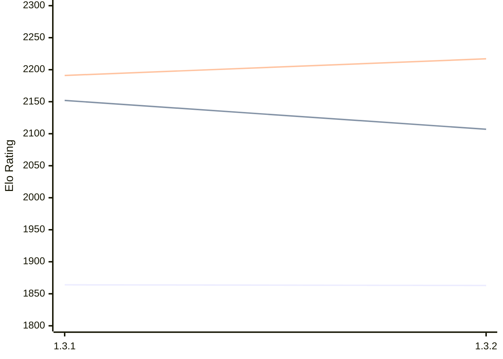

# Engine: Zugblitz

Author: 

Home: https://github.com/P1X3R/zugblitz

## Elo Ratings E1 (Ultra 7 265T (1.50 GHz) - E-Core)

| Version | Published | STC 8.0+0.08s  | LTC 60.0+0.60s | VLTC 2m24s+1.12s | Comment |
| --- | --- | --- | --- | --- | --- |
| 1.3.2 | 2026-06-13 | 1548 | 1752 | 1743 |  |
 | | | cElo (∆ prev) | cElo (∆ prev) | cElo (∆ prev) | 

## Elo Ratings P1 (Ultra 7 265T (1.50 GHz) - P-Core)

| Version | Published | STC 8.0+0.08s  | LTC 60.0+0.60s | VLTC 2m24s+1.12s | Comment |
| --- | --- | --- | --- | --- | --- |
| 1.3.2 | 2026-06-13 | 1625 | 1820 | 2007 |  |
 | | | cElo (∆ prev) | cElo (∆ prev) | cElo (∆ prev) | 

## Elo Ratings T1 (i5-7500T 2.70GHz)

| Version | Published | STC 8.0+0.08s  | LTC 60.0+0.60s | VLTC 2m24s+1.12s | Comment |
| --- | --- | --- | --- | --- | --- |
| 1.3.2 | 2026-06-13 | 1863(-1) | 2107(-45) | 2217(+26) |  |
| 1.3.1 | 2026-01-10 | 1864 | 2152 | 2191 |  |
 | | | cElo (∆ prev) | cElo (∆ prev) | cElo (∆ prev) | 

<a href="https://github.com/computer-chess-index/cci/issues/new?template=submit-version.yml&title=[VERSION]+Zugblitz+<version>&body=###%20Engine%20name%0AZugblitz%0A%0A###%20Version%0A1.3.2" target="_blank">Submit new version</a>

 Test Conditions:

GUI/CLI: <a href=https://github.com/cutechess/cutechess target="_blank">Cute-Chess</a> 
Elo Calculation: <a href=https://www.remi-coulom.fr/Bayesian-Elo/ target="_blank">Bayesian-Elo</a> 
CPU for P1: Intel(R) Core(TM) Ultra 7 265T (1.50 GHz) - P-Core 
CPU for E1: Intel(R) Core(TM) Ultra 7 265T (1.50 GHz) - E-Core 
CPU for T1: Intel(R) Core(TM) i5-7500T 2.70GHz 
Opening book: 8_moves_v3 
\* STC: 8.0+0.08s, LTC: 60.0+0.60s, VLTC: 2m24s+1.12s

 Lists:
Ratings: <a href=https://github.com/computer-chess-index/cci/blob/main/lists/CCIRatings.csv target="_blank">Complete list</a>

Generated: 2026-10-17 04:45:03

## Ratings Verlauf T1

## Detailed Evaluation Results

| Version | Time Control | Variant | Elo  | Range +/- | Matches | Score | Average Opponent Elo | Draws |
| --- | --- |--- | --- | --- | --- | --- | --- | --- |
| 1.3.2 | VLTC (2m24s+1.12s) | T1 | 2217 | 29 | 376 | 50% | 2222 | 35% |
|  |  | P1 | 2007 | 41 | 220 | 44% | 2097 | 18% |
|  |  | E1 | 1743 | 41 | 234 | 52% | 1737 | 17% |
|  | LTC (60.0+0.60s) | T1 | 2107 | 29 | 404 | 53% | 2080 | 32% |
|  |  | P1 | 1820 | 33 | 346 | 37% | 1974 | 21% |
|  |  | E1 | 1752 | 40 | 222 | 50% | 1774 | 23% |
|  | STC (8.0+0.08s) | T1 | 1863 | 29 | 410 | 53% | 1827 | 28% |
|  |  | P1 | 1625 | 40 | 248 | 44% | 1689 | 15% |
|  |  | E1 | 1548 | 33 | 340 | 43% | 1624 | 19% |
| --- | --- |--- | --- | --- | --- | --- | --- | --- |
| 1.3.1 | VLTC (2m24s+1.12s) | T1 | 2191 | 27 | 456 | 49% | 2201 | 35% |
|  | LTC (60.0+0.60s) | T1 | 2152 | 28 | 422 | 49% | 2157 | 28% |
|  | STC (8.0+0.08s) | T1 | 1864 | 24 | 614 | 51% | 1843 | 27% |