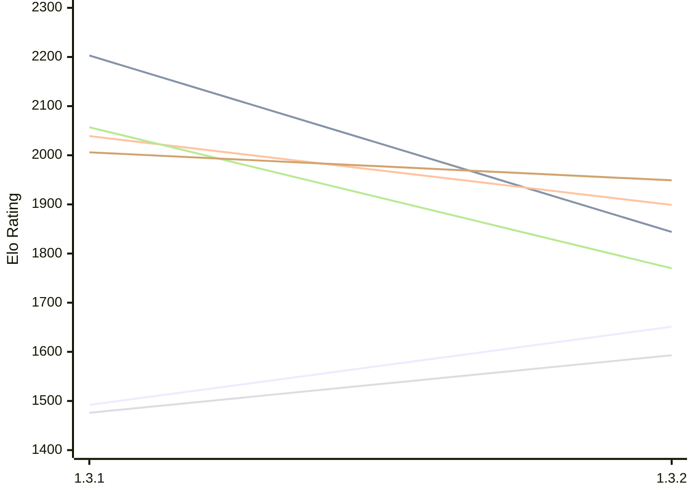
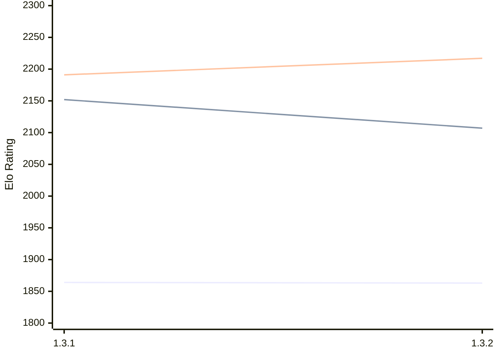

# Engine: Zugblitz

Author: 

Home: https://github.com/P1X3R/zugblitz

## Elo Ratings E1 (Ultra 7 265T (1.50 GHz) - E-Core)

| Version | Published | STC 8.0+0.08s  | LTC 60.0+0.60s | VLTC 2m24s+1.12s | Comment |
| --- | --- | --- | --- | --- | --- |
| 1.3.2 | 2026-06-13 | 1651(+159) | 1844(-359) | 1899(-140) |  |
| 1.3.1 | 2026-01-10 | 1492 | 2203 | 2039 |  |
 | | | cElo (∆ prev) | cElo (∆ prev) | cElo (∆ prev) | 

## Elo Ratings P1 (Ultra 7 265T (1.50 GHz) - P-Core)

| Version | Published | STC 8.0+0.08s  | LTC 60.0+0.60s | VLTC 2m24s+1.12s | Comment |
| --- | --- | --- | --- | --- | --- |
| 1.3.2 | 2026-06-13 | 1593(+117) | 1770(-287) | 1949(-57) |  |
| 1.3.1 | 2026-01-10 | 1476 | 2057 | 2006 |  |
 | | | cElo (∆ prev) | cElo (∆ prev) | cElo (∆ prev) | 

## Elo Ratings T1 (i5-7500T 2.70GHz)

| Version | Published | STC 8.0+0.08s  | LTC 60.0+0.60s | VLTC 2m24s+1.12s | Comment |
| --- | --- | --- | --- | --- | --- |
| 1.3.2 | 2026-06-13 | 1863(-1) | 2107(-45) | 2217(+26) |  |
| 1.3.1 | 2026-01-10 | 1864 | 2152 | 2191 |  |
 | | | cElo (∆ prev) | cElo (∆ prev) | cElo (∆ prev) | 

<a href="https://github.com/computer-chess-index/cci/issues/new?template=submit-version.yml&title=[VERSION]+Zugblitz+<version>&body=###%20Engine%20name%0AZugblitz%0A%0A###%20Version%0A1.3.2" target="_blank">Submit new version</a>

 Test Conditions:

GUI/CLI: <a href=https://github.com/cutechess/cutechess target="_blank">Cute-Chess</a> 
Elo Calculation: <a href=https://www.remi-coulom.fr/Bayesian-Elo/ target="_blank">Bayesian-Elo</a> 
CPU for P1: Intel(R) Core(TM) Ultra 7 265T (1.50 GHz) - P-Core 
CPU for E1: Intel(R) Core(TM) Ultra 7 265T (1.50 GHz) - E-Core 
CPU for T1: Intel(R) Core(TM) i5-7500T 2.70GHz 
Opening book: 8_moves_v3 
\* STC: 8.0+0.08s, LTC: 60.0+0.60s, VLTC: 2m24s+1.12s

 Lists:
Ratings: <a href=https://github.com/computer-chess-index/cci/blob/main/lists/CCIRatings.csv target="_blank">Complete list</a>

Generated: 2026-11-13 05:44:58

## Ratings Verlauf E1 / P1

## Ratings Verlauf T1

## Detailed Evaluation Results

| Version | Time Control | Variant | Elo  | Range +/- | Matches | Score | Average Opponent Elo | Draws |
| --- | --- |--- | --- | --- | --- | --- | --- | --- |
| 1.3.2 | VLTC (2m24s+1.12s) | T1 | 2217 | 29 | 376 | 50% | 2222 | 35% |
|  |  | P1 | 1949 | 36 | 278 | 48% | 1990 | 21% |
|  |  | E1 | 1899 | 29 | 454 | 55% | 1841 | 21% |
|  | LTC (60.0+0.60s) | T1 | 2107 | 29 | 404 | 53% | 2080 | 32% |
|  |  | P1 | 1770 | 30 | 406 | 42% | 1874 | 22% |
|  |  | E1 | 1844 | 33 | 326 | 51% | 1852 | 25% |
|  | STC (8.0+0.08s) | T1 | 1863 | 29 | 410 | 53% | 1827 | 28% |
|  |  | P1 | 1593 | 32 | 358 | 48% | 1609 | 19% |
|  |  | E1 | 1651 | 29 | 444 | 44% | 1706 | 21% |
| --- | --- |--- | --- | --- | --- | --- | --- | --- |
| 1.3.1 | VLTC (2m24s+1.12s) | P1 | 2006 | 135 | 26 | 52% | 1967 | 19% |
|  |  | E1 | 2039 | 100 | 42 | 45% | 2161 | 29% |
|  |  | T1 | 2191 | 27 | 456 | 49% | 2201 | 35% |
|  | LTC (60.0+0.60s) | E1 | 2203 | 120 | 28 | 36% | 2431 | 14% |
|  |  | T1 | 2152 | 28 | 422 | 49% | 2157 | 28% |
|  |  | P1 | 2057 | 119 | 28 | 27% | 2321 | 25% |
|  | STC (8.0+0.08s) | E1 | 1492 | 106 | 58 | 18% | 2040 | 16% |
|  |  | T1 | 1864 | 24 | 614 | 51% | 1843 | 27% |
|  |  | P1 | 1476 | 135 | 40 | 11% | 2066 | 8% |