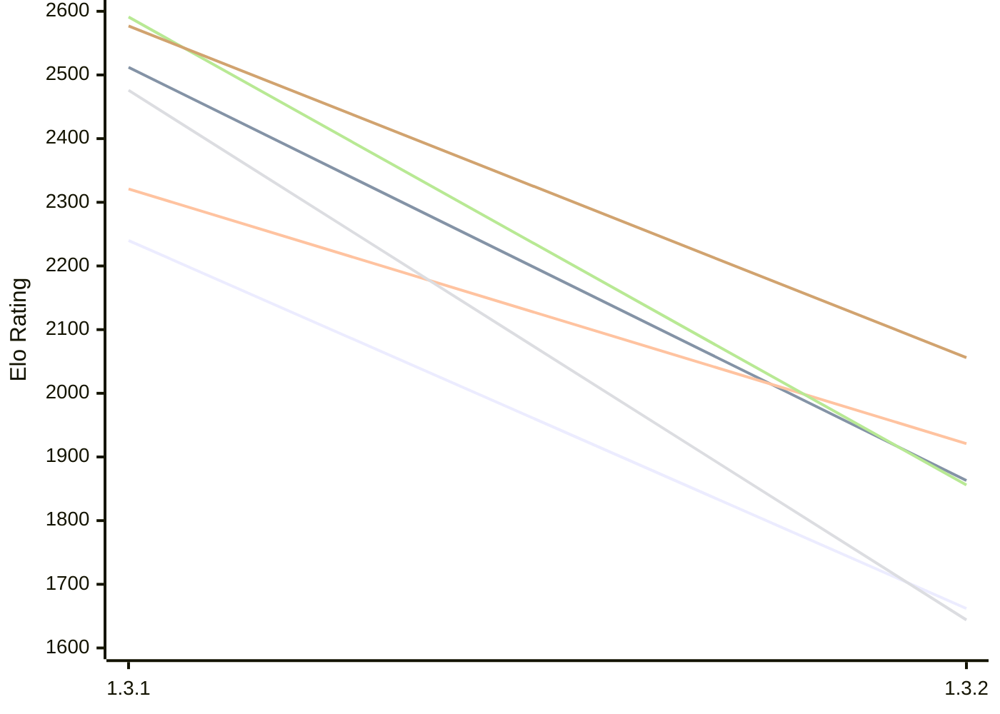
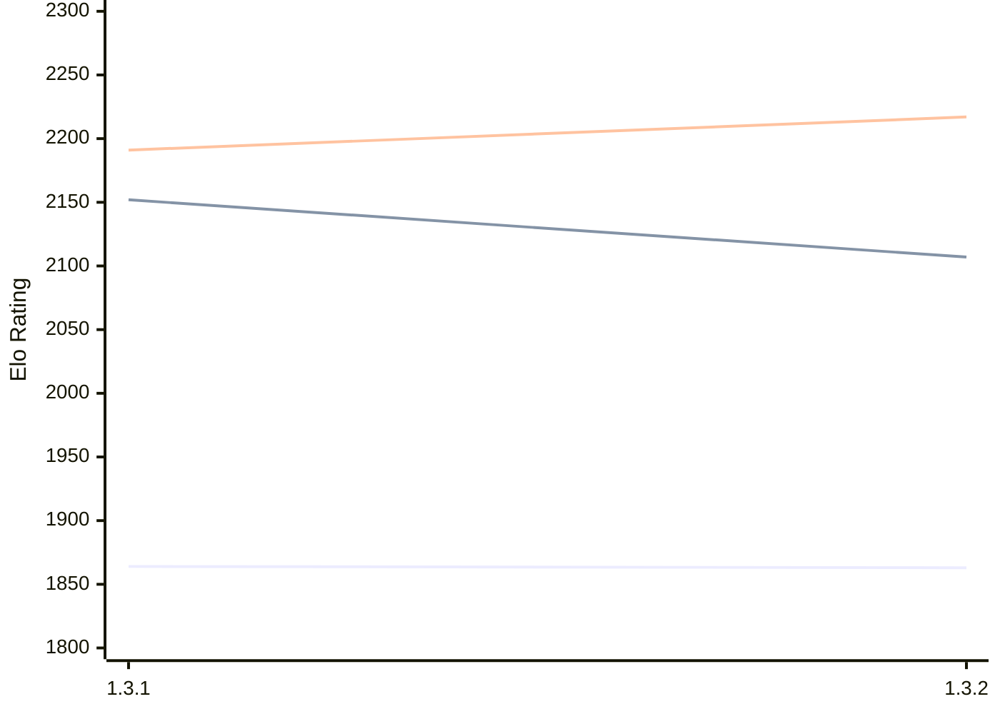

# Engine: Zugblitz

Author: 

Home: https://github.com/P1X3R/zugblitz

## Elo Ratings E1 (Ultra 7 265T (1.50 GHz) - E-Core)

| Version | Published | STC 8.0+0.08s  | LTC 60.0+0.60s | VLTC 2m24s+1.12s | Comment |
| --- | --- | --- | --- | --- | --- |
| 1.3.2 | 2026-06-13 | 1662(-578) | 1863(-649) | 1921(-400) |  |
| 1.3.1 | 2026-01-10 | 2240 | 2512 | 2321 |  |
 | | | cElo (∆ prev) | cElo (∆ prev) | cElo (∆ prev) | 

## Elo Ratings P1 (Ultra 7 265T (1.50 GHz) - P-Core)

| Version | Published | STC 8.0+0.08s  | LTC 60.0+0.60s | VLTC 2m24s+1.12s | Comment |
| --- | --- | --- | --- | --- | --- |
| 1.3.2 | 2026-06-13 | 1644(-832) | 1856(-735) | 2056(-521) |  |
| 1.3.1 | 2026-01-10 | 2476 | 2591 | 2577 |  |
 | | | cElo (∆ prev) | cElo (∆ prev) | cElo (∆ prev) | 

## Elo Ratings T1 (i5-7500T 2.70GHz)

| Version | Published | STC 8.0+0.08s  | LTC 60.0+0.60s | VLTC 2m24s+1.12s | Comment |
| --- | --- | --- | --- | --- | --- |
| 1.3.2 | 2026-06-13 | 1863(-1) | 2107(-45) | 2217(+26) |  |
| 1.3.1 | 2026-01-10 | 1864 | 2152 | 2191 |  |
 | | | cElo (∆ prev) | cElo (∆ prev) | cElo (∆ prev) | 

<a href="https://github.com/computer-chess-index/cci/issues/new?template=submit-version.yml&title=[VERSION]+Zugblitz+<version>&body=###%20Engine%20name%0AZugblitz%0A%0A###%20Version%0A1.3.2" target="_blank">Submit new version</a>

 Test Conditions:

GUI/CLI: <a href=https://github.com/cutechess/cutechess target="_blank">Cute-Chess</a> 
Elo Calculation: <a href=https://www.remi-coulom.fr/Bayesian-Elo/ target="_blank">Bayesian-Elo</a> 
CPU for P1: Intel(R) Core(TM) Ultra 7 265T (1.50 GHz) - P-Core 
CPU for E1: Intel(R) Core(TM) Ultra 7 265T (1.50 GHz) - E-Core 
CPU for T1: Intel(R) Core(TM) i5-7500T 2.70GHz 
Opening book: 8_moves_v3 
\* STC: 8.0+0.08s, LTC: 60.0+0.60s, VLTC: 2m24s+1.12s

 Lists:
Ratings: <a href=https://github.com/computer-chess-index/cci/blob/main/lists/CCIRatings.csv target="_blank">Complete list</a>

Generated: 2026-11-12 05:44:32

## Ratings Verlauf E1 / P1

## Ratings Verlauf T1

## Detailed Evaluation Results

| Version | Time Control | Variant | Elo  | Range +/- | Matches | Score | Average Opponent Elo | Draws |
| --- | --- |--- | --- | --- | --- | --- | --- | --- |
| 1.3.2 | VLTC (2m24s+1.12s) | T1 | 2217 | 29 | 376 | 50% | 2222 | 35% |
|  |  | P1 | 2056 | 37 | 272 | 48% | 2098 | 20% |
|  |  | E1 | 1921 | 29 | 450 | 56% | 1859 | 22% |
|  | LTC (60.0+0.60s) | T1 | 2107 | 29 | 404 | 53% | 2080 | 32% |
|  |  | P1 | 1856 | 31 | 402 | 41% | 1966 | 22% |
|  |  | E1 | 1863 | 33 | 320 | 51% | 1872 | 25% |
|  | STC (8.0+0.08s) | T1 | 1863 | 29 | 410 | 53% | 1827 | 28% |
|  |  | P1 | 1644 | 33 | 350 | 48% | 1661 | 18% |
|  |  | E1 | 1662 | 29 | 440 | 44% | 1719 | 21% |
| --- | --- |--- | --- | --- | --- | --- | --- | --- |
| 1.3.1 | VLTC (2m24s+1.12s) | E1 | 2321 | 170 | 14 | 46% | 2340 | 21% |
|  |  | T1 | 2191 | 27 | 456 | 49% | 2201 | 35% |
|  |  | P1 | 2577 | 262 | 4 | 0% | 2890 | 0% |
|  | LTC (60.0+0.60s) | E1 | 2512 | 262 | 4 | 0% | 2826 | 0% |
|  |  | T1 | 2152 | 28 | 422 | 49% | 2157 | 28% |
|  |  | P1 | 2591 | 294 | 4 | 0% | 2957 | 0% |
|  | STC (8.0+0.08s) | E1 | 2240 | 181 | 16 | 19% | 2681 | 13% |
|  |  | T1 | 1864 | 24 | 614 | 51% | 1843 | 27% |
|  |  | P1 | 2476 | 193 | 12 | 4% | 2890 | 8% |