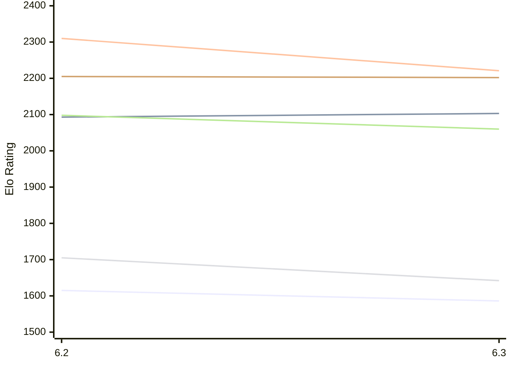
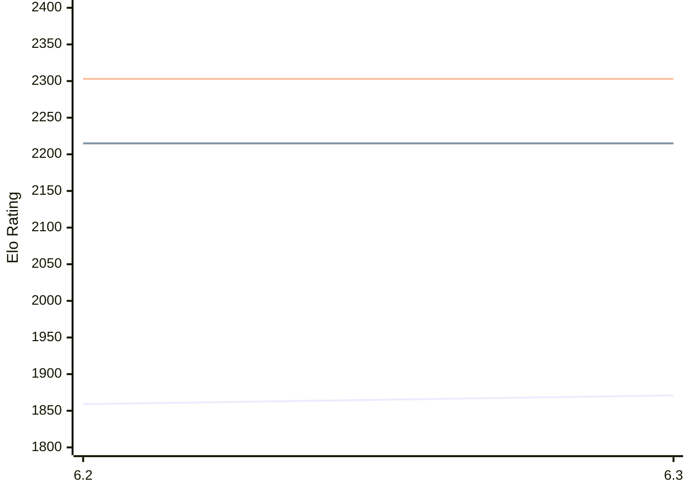

# Engine: chess4j

Author: James Swafford

Home: https://github.com/jswaff/chess4j

## Elo Ratings E1 (Ultra 7 265T (1.50 GHz) - E-Core)

| Version | Published | STC 8.0+0.08s  | LTC 60.0+0.60s | VLTC 2m24s+1.12s | Comment |
| --- | --- | --- | --- | --- | --- |
| 6.3 | 2026-06-06 | 1586(-29) | 2103(+10) | 2221(-89) |  |
| 6.2 | 2025-09-16 | 1615 | 2093 | 2310 |  |
 | | | cElo (∆ prev) | cElo (∆ prev) | cElo (∆ prev) | 

## Elo Ratings P1 (Ultra 7 265T (1.50 GHz) - P-Core)

| Version | Published | STC 8.0+0.08s  | LTC 60.0+0.60s | VLTC 2m24s+1.12s | Comment |
| --- | --- | --- | --- | --- | --- |
| 6.3 | 2026-06-06 | 1642(-63) | 2060(-38) | 2202(-3) |  |
| 6.2 | 2025-09-16 | 1705 | 2098 | 2205 |  |
 | | | cElo (∆ prev) | cElo (∆ prev) | cElo (∆ prev) | 

## Elo Ratings T1 (i5-7500T 2.70GHz)

| Version | Published | STC 8.0+0.08s  | LTC 60.0+0.60s | VLTC 2m24s+1.12s | Comment |
| --- | --- | --- | --- | --- | --- |
| 6.3 | 2026-06-06 | 1871(+12) | 2215(0) | 2303(0) |  |
| 6.2 | 2025-09-16 | 1859 | 2215 | 2303 |  |
 | | | cElo (∆ prev) | cElo (∆ prev) | cElo (∆ prev) | 

<a href="https://github.com/computer-chess-index/cci/issues/new?template=submit-version.yml&title=[VERSION]+chess4j+<version>&body=###%20Engine%20name%0Achess4j%0A%0A###%20Version%0A6.3" target="_blank">Submit new version</a>

 Test Conditions:

GUI/CLI: <a href=https://github.com/cutechess/cutechess target="_blank">Cute-Chess</a> 
Elo Calculation: <a href=https://www.remi-coulom.fr/Bayesian-Elo/ target="_blank">Bayesian-Elo</a> 
CPU for P1: Intel(R) Core(TM) Ultra 7 265T (1.50 GHz) - P-Core 
CPU for E1: Intel(R) Core(TM) Ultra 7 265T (1.50 GHz) - E-Core 
CPU for T1: Intel(R) Core(TM) i5-7500T 2.70GHz 
Opening book: 8_moves_v3 
\* STC: 8.0+0.08s, LTC: 60.0+0.60s, VLTC: 2m24s+1.12s

 Lists:
Ratings: <a href=https://github.com/computer-chess-index/cci/blob/main/lists/CCIRatings.csv target="_blank">Complete list</a>

Generated: 2026-11-28 05:37:21

## Ratings Verlauf E1 / P1

## Ratings Verlauf T1

## Detailed Evaluation Results

| Version | Time Control | Variant | Elo  | Range +/- | Matches | Score | Average Opponent Elo | Draws |
| --- | --- |--- | --- | --- | --- | --- | --- | --- |
| 6.3 | VLTC (2m24s+1.12s) | E1 | 2221 | 31 | 388 | 56% | 2105 | 25% |
|  |  | T1 | 2303 | 30 | 376 | 50% | 2303 | 30% |
|  |  | P1 | 2202 | 39 | 266 | 55% | 2066 | 19% |
|  | LTC (60.0+0.60s) | E1 | 2103 | 30 | 400 | 53% | 2049 | 21% |
|  |  | T1 | 2215 | 31 | 354 | 53% | 2184 | 23% |
|  |  | P1 | 2060 | 37 | 298 | 55% | 1966 | 21% |
|  | STC (8.0+0.08s) | T1 | 1871 | 29 | 438 | 48% | 1886 | 20% |
|  |  | P1 | 1642 | 36 | 294 | 57% | 1534 | 21% |
|  |  | E1 | 1586 | 31 | 396 | 53% | 1536 | 19% |
| --- | --- |--- | --- | --- | --- | --- | --- | --- |
| 6.2 | VLTC (2m24s+1.12s) | T1 | 2303 | 27 | 468 | 49% | 2313 | 30% |
|  |  | P1 | 2205 | 62 | 112 | 37% | 2419 | 21% |
|  |  | E1 | 2310 | 58 | 108 | 48% | 2357 | 20% |
|  | LTC (60.0+0.60s) | T1 | 2215 | 27 | 452 | 50% | 2207 | 28% |
|  |  | P1 | 2098 | 58 | 124 | 42% | 2210 | 17% |
|  |  | E1 | 2093 | 55 | 124 | 50% | 2098 | 18% |
|  | STC (8.0+0.08s) | T1 | 1859 | 25 | 584 | 51% | 1848 | 20% |
|  |  | P1 | 1705 | 53 | 128 | 40% | 1818 | 24% |
|  |  | E1 | 1615 | 55 | 144 | 45% | 1723 | 10% |