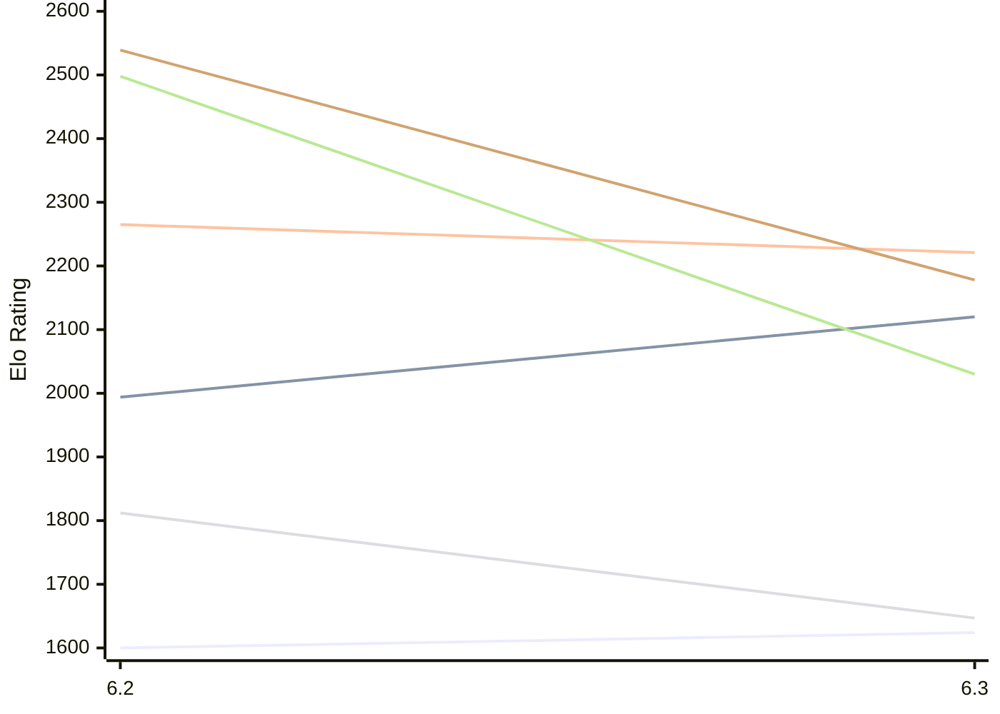
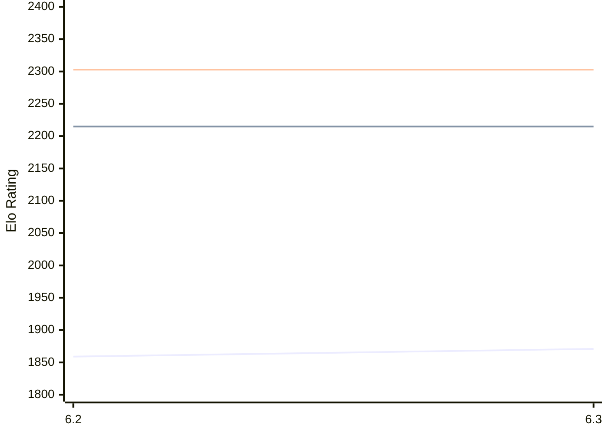

# Engine: chess4j

Author: James Swafford

Home: https://github.com/jswaff/chess4j

## Elo Ratings E1 (Ultra 7 265T (1.50 GHz) - E-Core)

| Version | Published | STC 8.0+0.08s  | LTC 60.0+0.60s | VLTC 2m24s+1.12s | Comment |
| --- | --- | --- | --- | --- | --- |
| 6.3 | 2026-06-06 | 1624(+24) | 2120(+126) | 2221(-44) |  |
| 6.2 | 2025-09-16 | 1600 | 1994 | 2265 |  |
 | | | cElo (∆ prev) | cElo (∆ prev) | cElo (∆ prev) | 

## Elo Ratings P1 (Ultra 7 265T (1.50 GHz) - P-Core)

| Version | Published | STC 8.0+0.08s  | LTC 60.0+0.60s | VLTC 2m24s+1.12s | Comment |
| --- | --- | --- | --- | --- | --- |
| 6.3 | 2026-06-06 | 1647(-165) | 2030(-468) | 2178(-361) |  |
| 6.2 | 2025-09-16 | 1812 | 2498 | 2539 |  |
 | | | cElo (∆ prev) | cElo (∆ prev) | cElo (∆ prev) | 

## Elo Ratings T1 (i5-7500T 2.70GHz)

| Version | Published | STC 8.0+0.08s  | LTC 60.0+0.60s | VLTC 2m24s+1.12s | Comment |
| --- | --- | --- | --- | --- | --- |
| 6.3 | 2026-06-06 | 1871(+12) | 2215(0) | 2303(0) |  |
| 6.2 | 2025-09-16 | 1859 | 2215 | 2303 |  |
 | | | cElo (∆ prev) | cElo (∆ prev) | cElo (∆ prev) | 

<a href="https://github.com/computer-chess-index/cci/issues/new?template=submit-version.yml&title=[VERSION]+chess4j+<version>&body=###%20Engine%20name%0Achess4j%0A%0A###%20Version%0A6.3" target="_blank">Submit new version</a>

 Test Conditions:

GUI/CLI: <a href=https://github.com/cutechess/cutechess target="_blank">Cute-Chess</a> 
Elo Calculation: <a href=https://www.remi-coulom.fr/Bayesian-Elo/ target="_blank">Bayesian-Elo</a> 
CPU for P1: Intel(R) Core(TM) Ultra 7 265T (1.50 GHz) - P-Core 
CPU for E1: Intel(R) Core(TM) Ultra 7 265T (1.50 GHz) - E-Core 
CPU for T1: Intel(R) Core(TM) i5-7500T 2.70GHz 
Opening book: 8_moves_v3 
\* STC: 8.0+0.08s, LTC: 60.0+0.60s, VLTC: 2m24s+1.12s

 Lists:
Ratings: <a href=https://github.com/computer-chess-index/cci/blob/main/lists/CCIRatings.csv target="_blank">Complete list</a>

Generated: 2026-11-13 05:37:11

## Ratings Verlauf E1 / P1

## Ratings Verlauf T1

## Detailed Evaluation Results

| Version | Time Control | Variant | Elo  | Range +/- | Matches | Score | Average Opponent Elo | Draws |
| --- | --- |--- | --- | --- | --- | --- | --- | --- |
| 6.3 | VLTC (2m24s+1.12s) | T1 | 2303 | 30 | 376 | 50% | 2303 | 30% |
|  |  | P1 | 2178 | 42 | 236 | 57% | 2016 | 19% |
|  |  | E1 | 2221 | 33 | 344 | 57% | 2094 | 25% |
|  | LTC (60.0+0.60s) | T1 | 2215 | 31 | 354 | 53% | 2184 | 23% |
|  |  | P1 | 2030 | 41 | 244 | 56% | 1902 | 18% |
|  |  | E1 | 2120 | 33 | 348 | 54% | 2051 | 20% |
|  | STC (8.0+0.08s) | T1 | 1871 | 29 | 438 | 48% | 1886 | 20% |
|  |  | P1 | 1647 | 38 | 262 | 58% | 1528 | 20% |
|  |  | E1 | 1624 | 33 | 342 | 54% | 1561 | 17% |
| --- | --- |--- | --- | --- | --- | --- | --- | --- |
| 6.2 | VLTC (2m24s+1.12s) | P1 | 2539 | 168 | 20 | 25% | 2799 | 10% |
|  |  | E1 | 2265 | 128 | 26 | 35% | 2480 | 15% |
|  |  | T1 | 2303 | 27 | 468 | 49% | 2313 | 30% |
|  | LTC (60.0+0.60s) | E1 | 1994 | 115 | 32 | 42% | 2094 | 16% |
|  |  | T1 | 2215 | 27 | 452 | 50% | 2207 | 28% |
|  |  | P1 | 2498 | 287 | 12 | 67% | 2249 | 0% |
|  | STC (8.0+0.08s) | E1 | 1600 | 94 | 56 | 34% | 1929 | 11% |
|  |  | T1 | 1859 | 25 | 584 | 51% | 1848 | 20% |
|  |  | P1 | 1812 | 114 | 30 | 40% | 1953 | 20% |