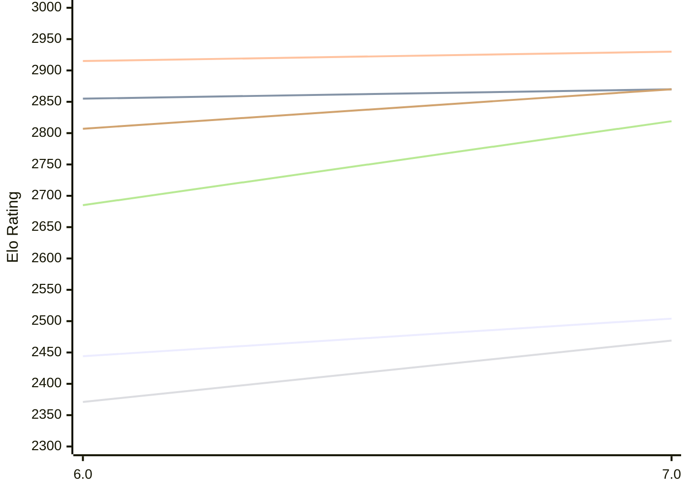
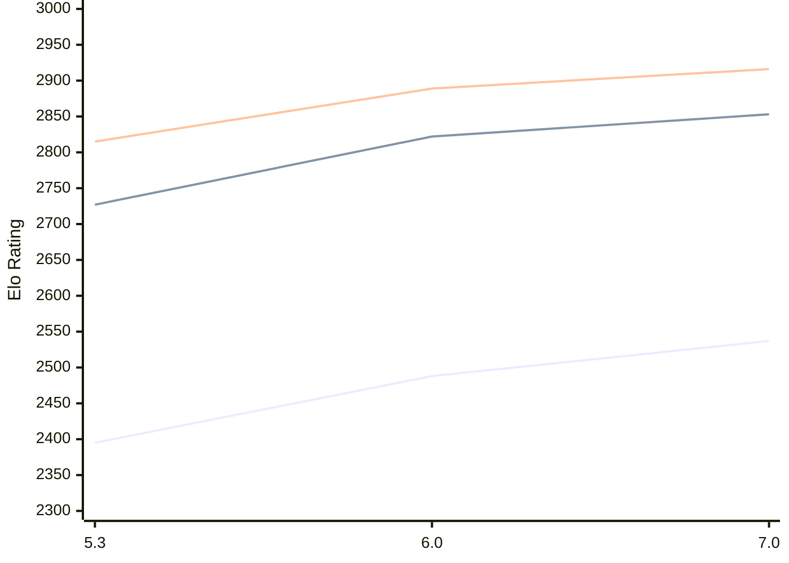

# Engine: tomitankChess

Author: Tamas Kuzmics

Home: https://github.com/tomitank/tomitankChess

## Elo Ratings E1 (Ultra 7 265T (1.50 GHz) - E-Core)

| Version | Published | STC 8.0+0.08s  | LTC 60.0+0.60s | VLTC 2m24s+1.12s | Comment |
| --- | --- | --- | --- | --- | --- |
| 7.0 | 2026-07-06 | 2504(+60) | 2870(+15) | 2930(+15) |  |
| 6.0 | 2026-03-31 | 2444 | 2855 | 2915 |  |
 | | | cElo (∆ prev) | cElo (∆ prev) | cElo (∆ prev) | 

## Elo Ratings P1 (Ultra 7 265T (1.50 GHz) - P-Core)

| Version | Published | STC 8.0+0.08s  | LTC 60.0+0.60s | VLTC 2m24s+1.12s | Comment |
| --- | --- | --- | --- | --- | --- |
| 7.0 | 2026-07-06 | 2469(+98) | 2819(+134) | 2870(+63) |  |
| 6.0 | 2026-03-31 | 2371 | 2685 | 2807 |  |
 | | | cElo (∆ prev) | cElo (∆ prev) | cElo (∆ prev) | 

## Elo Ratings T1 (i5-7500T 2.70GHz)

| Version | Published | STC 8.0+0.08s  | LTC 60.0+0.60s | VLTC 2m24s+1.12s | Comment |
| --- | --- | --- | --- | --- | --- |
| 7.0 | 2026-07-06 | 2537(+49) | 2853(+31) | 2916(+27) |  |
| 6.0 | 2026-03-31 | 2488(+93) | 2822(+95) | 2889(+74) |  |
| 5.3 | 2025-09-26 | 2395 | 2727 | 2815 |  |
 | | | cElo (∆ prev) | cElo (∆ prev) | cElo (∆ prev) | 

<a href="https://github.com/computer-chess-index/cci/issues/new?template=submit-version.yml&title=[VERSION]+tomitankChess+<version>&body=###%20Engine%20name%0AtomitankChess%0A%0A###%20Version%0A7.0" target="_blank">Submit new version</a>

 Test Conditions:

GUI/CLI: <a href=https://github.com/cutechess/cutechess target="_blank">Cute-Chess</a> 
Elo Calculation: <a href=https://www.remi-coulom.fr/Bayesian-Elo/ target="_blank">Bayesian-Elo</a> 
CPU for P1: Intel(R) Core(TM) Ultra 7 265T (1.50 GHz) - P-Core 
CPU for E1: Intel(R) Core(TM) Ultra 7 265T (1.50 GHz) - E-Core 
CPU for T1: Intel(R) Core(TM) i5-7500T 2.70GHz 
Opening book: 8_moves_v3 
\* STC: 8.0+0.08s, LTC: 60.0+0.60s, VLTC: 2m24s+1.12s

 Lists:
Ratings: <a href=https://github.com/computer-chess-index/cci/blob/main/lists/CCIRatings.csv target="_blank">Complete list</a>

Generated: 2026-11-20 05:43:47

## Ratings Verlauf E1 / P1

## Ratings Verlauf T1

## Detailed Evaluation Results

| Version | Time Control | Variant | Elo  | Range +/- | Matches | Score | Average Opponent Elo | Draws |
| --- | --- |--- | --- | --- | --- | --- | --- | --- |
| 7.0 | VLTC (2m24s+1.12s) | P1 | 2870 | 30 | 324 | 49% | 2880 | 44% |
|  |  | E1 | 2930 | 27 | 428 | 50% | 2934 | 44% |
|  |  | T1 | 2916 | 27 | 412 | 51% | 2904 | 45% |
|  | LTC (60.0+0.60s) | P1 | 2819 | 34 | 268 | 50% | 2819 | 39% |
|  |  | E1 | 2870 | 27 | 440 | 51% | 2859 | 39% |
|  |  | T1 | 2853 | 27 | 406 | 51% | 2847 | 44% |
|  | STC (8.0+0.08s) | P1 | 2469 | 35 | 268 | 47% | 2506 | 30% |
|  |  | E1 | 2504 | 28 | 424 | 47% | 2543 | 31% |
|  |  | T1 | 2537 | 29 | 388 | 48% | 2554 | 27% |
| --- | --- |--- | --- | --- | --- | --- | --- | --- |
| 6.0 | VLTC (2m24s+1.12s) | T1 | 2889 | 27 | 406 | 50% | 2890 | 43% |
|  |  | P1 | 2807 | 69 | 66 | 45% | 2849 | 35% |
|  |  | E1 | 2915 | 66 | 88 | 53% | 2873 | 22% |
|  | LTC (60.0+0.60s) | T1 | 2822 | 29 | 362 | 50% | 2819 | 38% |
|  |  | P1 | 2685 | 76 | 66 | 42% | 2758 | 26% |
|  |  | E1 | 2855 | 60 | 96 | 51% | 2832 | 38% |
|  | STC (8.0+0.08s) | T1 | 2488 | 26 | 476 | 48% | 2507 | 35% |
|  |  | P1 | 2371 | 70 | 84 | 58% | 2292 | 17% |
|  |  | E1 | 2444 | 53 | 140 | 41% | 2566 | 24% |
| --- | --- |--- | --- | --- | --- | --- | --- | --- |
| 5.3 | VLTC (2m24s+1.12s) | T1 | 2815 | 31 | 312 | 48% | 2832 | 40% |
|  | LTC (60.0+0.60s) | T1 | 2727 | 32 | 310 | 52% | 2711 | 39% |
|  | STC (8.0+0.08s) | T1 | 2395 | 29 | 420 | 50% | 2392 | 29% |