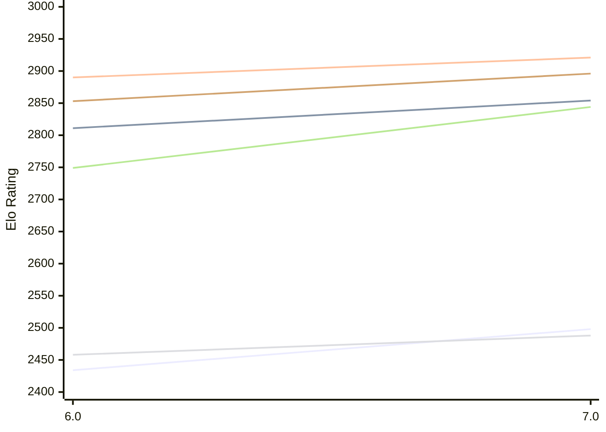
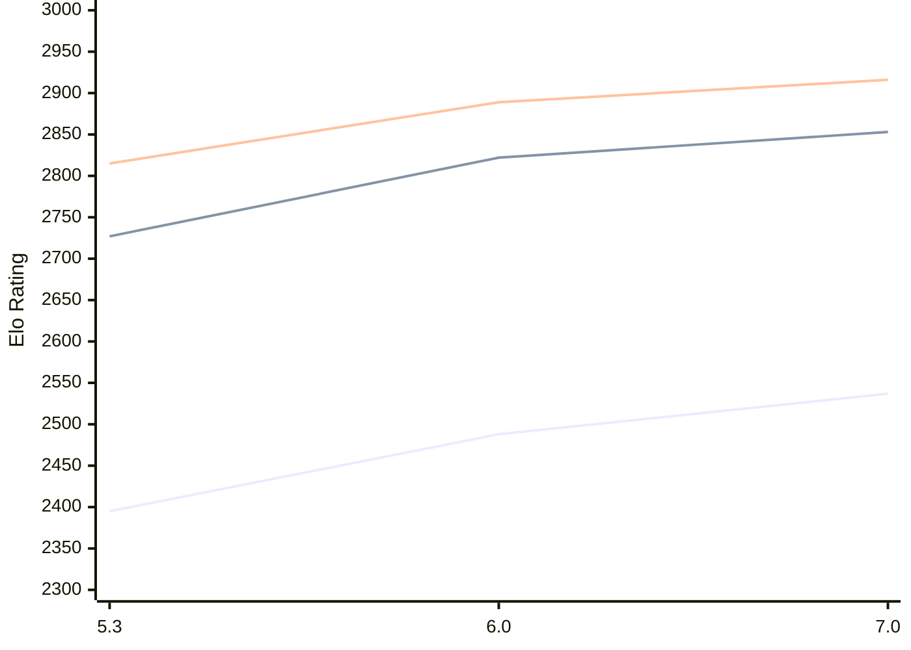

# Engine: tomitankChess

Author: Tamas Kuzmics

Home: https://github.com/tomitank/tomitankChess

## Elo Ratings E1 (Ultra 7 265T (1.50 GHz) - E-Core)

| Version | Published | STC 8.0+0.08s  | LTC 60.0+0.60s | VLTC 2m24s+1.12s | Comment |
| --- | --- | --- | --- | --- | --- |
| 7.0 | 2026-07-06 | 2498(+64) | 2854(+43) | 2921(+31) |  |
| 6.0 | 2026-03-31 | 2434 | 2811 | 2890 |  |
 | | | cElo (∆ prev) | cElo (∆ prev) | cElo (∆ prev) | 

## Elo Ratings P1 (Ultra 7 265T (1.50 GHz) - P-Core)

| Version | Published | STC 8.0+0.08s  | LTC 60.0+0.60s | VLTC 2m24s+1.12s | Comment |
| --- | --- | --- | --- | --- | --- |
| 7.0 | 2026-07-06 | 2488(+30) | 2844(+95) | 2896(+43) |  |
| 6.0 | 2026-03-31 | 2458 | 2749 | 2853 |  |
 | | | cElo (∆ prev) | cElo (∆ prev) | cElo (∆ prev) | 

## Elo Ratings T1 (i5-7500T 2.70GHz)

| Version | Published | STC 8.0+0.08s  | LTC 60.0+0.60s | VLTC 2m24s+1.12s | Comment |
| --- | --- | --- | --- | --- | --- |
| 7.0 | 2026-07-06 | 2537(+49) | 2853(+31) | 2916(+27) |  |
| 6.0 | 2026-03-31 | 2488(+93) | 2822(+95) | 2889(+74) |  |
| 5.3 | 2025-09-26 | 2395 | 2727 | 2815 |  |
 | | | cElo (∆ prev) | cElo (∆ prev) | cElo (∆ prev) | 

<a href="https://github.com/computer-chess-index/cci/issues/new?template=submit-version.yml&title=[VERSION]+tomitankChess+<version>&body=###%20Engine%20name%0AtomitankChess%0A%0A###%20Version%0A7.0" target="_blank">Submit new version</a>

 Test Conditions:

GUI/CLI: <a href=https://github.com/cutechess/cutechess target="_blank">Cute-Chess</a> 
Elo Calculation: <a href=https://www.remi-coulom.fr/Bayesian-Elo/ target="_blank">Bayesian-Elo</a> 
CPU for P1: Intel(R) Core(TM) Ultra 7 265T (1.50 GHz) - P-Core 
CPU for E1: Intel(R) Core(TM) Ultra 7 265T (1.50 GHz) - E-Core 
CPU for T1: Intel(R) Core(TM) i5-7500T 2.70GHz 
Opening book: 8_moves_v3 
\* STC: 8.0+0.08s, LTC: 60.0+0.60s, VLTC: 2m24s+1.12s

 Lists:
Ratings: <a href=https://github.com/computer-chess-index/cci/blob/main/lists/CCIRatings.csv target="_blank">Complete list</a>

Generated: 2026-11-27 05:44:21

## Ratings Verlauf E1 / P1

## Ratings Verlauf T1

## Detailed Evaluation Results

| Version | Time Control | Variant | Elo  | Range +/- | Matches | Score | Average Opponent Elo | Draws |
| --- | --- |--- | --- | --- | --- | --- | --- | --- |
| 7.0 | VLTC (2m24s+1.12s) | P1 | 2896 | 30 | 328 | 49% | 2905 | 45% |
|  |  | E1 | 2921 | 26 | 448 | 49% | 2930 | 45% |
|  |  | T1 | 2916 | 27 | 412 | 51% | 2904 | 45% |
|  | LTC (60.0+0.60s) | P1 | 2844 | 33 | 280 | 50% | 2842 | 39% |
|  |  | E1 | 2854 | 26 | 480 | 50% | 2854 | 39% |
|  |  | T1 | 2853 | 27 | 406 | 51% | 2847 | 44% |
|  | STC (8.0+0.08s) | P1 | 2488 | 34 | 284 | 47% | 2523 | 31% |
|  |  | E1 | 2498 | 27 | 448 | 46% | 2542 | 31% |
|  |  | T1 | 2537 | 29 | 388 | 48% | 2554 | 27% |
| --- | --- |--- | --- | --- | --- | --- | --- | --- |
| 6.0 | VLTC (2m24s+1.12s) | T1 | 2889 | 27 | 406 | 50% | 2890 | 43% |
|  |  | P1 | 2853 | 58 | 90 | 48% | 2865 | 39% |
|  |  | E1 | 2890 | 49 | 144 | 50% | 2884 | 31% |
|  | LTC (60.0+0.60s) | T1 | 2822 | 29 | 362 | 50% | 2819 | 38% |
|  |  | P1 | 2749 | 59 | 102 | 48% | 2761 | 29% |
|  |  | E1 | 2811 | 44 | 168 | 48% | 2824 | 39% |
|  | STC (8.0+0.08s) | T1 | 2488 | 26 | 476 | 48% | 2507 | 35% |
|  |  | P1 | 2458 | 55 | 128 | 61% | 2346 | 23% |
|  |  | E1 | 2434 | 42 | 212 | 44% | 2522 | 24% |
| --- | --- |--- | --- | --- | --- | --- | --- | --- |
| 5.3 | VLTC (2m24s+1.12s) | T1 | 2815 | 31 | 312 | 48% | 2832 | 40% |
|  | LTC (60.0+0.60s) | T1 | 2727 | 32 | 310 | 52% | 2711 | 39% |
|  | STC (8.0+0.08s) | T1 | 2395 | 29 | 420 | 50% | 2392 | 29% |